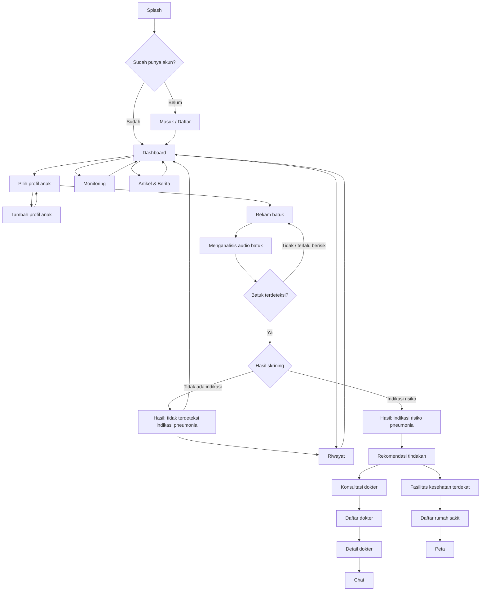
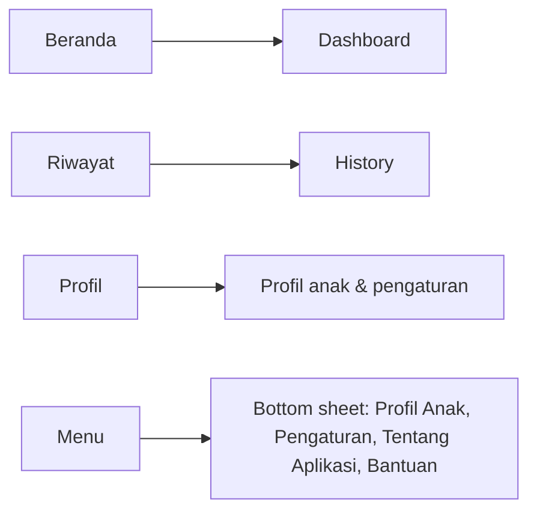

# PNEUMOTrack — Product Requirements Document

Source: "PNEUMOTrack Hackathon Proposal" (team **DiCarryMasAyanokoji**, Universitas Udayana). If this document and the proposal disagree, ask the user before deciding.

## 1. Overview

PNEUMOTrack is a mobile AI app for **early screening of pneumonia risk in children** (primarily under-fives) from **cough sound recorded on a smartphone**. It is a screening aid for parents and caregivers, **not a diagnostic tool**. It never replaces a doctor or radiology (X-ray).

Tagline (splash screen): *"Track the Signs, Guard the Lungs"*.

## 2. Problem

- Pneumonia is a leading cause of child mortality in Indonesia (about 19,000 child deaths in 2018) and the costliest disease for BPJS Kesehatan in 2023 (Rp8.7 trillion).
- In Surakarta (2023), only 452 of an estimated 974 under-five pneumonia cases (46.4%) were detected through health services.
- Symptoms resemble flu or ordinary cough, so parents cannot tell them apart; primary care often lacks X-ray access; early detection relies on manual observation.
- There is no affordable, objective tool that lets parents screen a child's cough at home and connects them to care when risk is detected.

## 3. Goals

1. Fast, non-invasive, low-cost pneumonia screening from a smartphone, with no special equipment.
2. Reliable detection using ensemble anomaly detection (Autoencoder + One-Class SVM).
3. Better access to care, especially in areas with limited facilities (software-only, portable).
4. Decision support: screening result plus recommended next steps (consult a doctor, visit a facility) to reduce diagnostic delay.

Aligned with SDG 3: Good Health and Well-Being.

## 4. Non-goals

- Not a definitive diagnosis and not a replacement for doctors or X-ray.
- No clinical-grade claims until validated in larger clinical studies.
- No requirement for extra hardware or sensors.

## 5. Users and stakeholders

**Primary users:** parents/guardians and caregivers (record cough, view results, get recommendations).
**Secondary users:** health workers (use results as supporting info, especially at primary facilities), at-risk or remote communities, researchers/academics, government and health institutions (epidemiology trends).
**Stakeholder teams:** medical team, technology development, IT, monitoring, QA.

## 6. User flow



Bottom navigation (icon-only, lihat `design.md` §7.18):



After screening, the system branches in parallel to three outputs: **Dashboard** (visual status), **Recommendation**, and **History** (log for follow-up monitoring). Recommendation leads to Doctor Consultation and Hospital Recommendation.

## 7. Functional requirements

| # | Feature | Description |
|---|---|---|
| F1 | Child profile | Add a child: name, age, sex. |
| F2 | Record cough | Record cough audio via the phone mic with timer and waveform. |
| F3 | Analyze | Send the recording to the backend; show an "Analyzing cough audio…" state. |
| F4 | Result (normal) | Show "No sign of pneumonia detected", waveform, "Normal cough pattern", AI summary. |
| F5 | Result (risk) | Show "Pneumonia risk detected, needs attention", abnormal pattern waveform, AI summary, and CTA to Recommended Action. |
| F6 | Recommended action | Cards for "Consult with a doctor" and "Visit the nearest health facility". |
| F7 | Doctors | Doctor list, doctor detail (profile, contact), message list, one-to-one chat. |
| F8 | Hospitals | Recommended hospital list and a map of the nearest hospitals based on user location. |
| F9 | Monitoring | Monitor and analyze the child's cough through the mic. |
| F10 | History | Past analyses and screening results, trend charts, AI summary. |
| F11 | Dashboard | Child status, greeting, vitals-style summary (heart-shaped indicator), articles preview. |
| F12 | Articles & News | Pneumonia symptoms, prevention, handling, child health education. |
| F13 | Auth | Sign-in via Supabase Auth. |

## 8. Screens (from the design appendix, Tabel 7)

1. Splash (lungs + baby-face logo)
2. Dashboard — no-risk and risk variants
3. Add child
4. Recording audio
5. Analyzing cough audio
6. Cough Analysis — normal (blue theme) and risk (red/pink theme)
7. Recommended Action
8. Doctor list, Doctor detail, Message list, Chat
9. Hospital list, Hospital map
10. Monitoring
11. History
12. Articles & News

Visual language: calm teal/blue medical palette; red/pink only for risk states. Large touch targets and simple copy, since parents are the primary users. Default UI language is Indonesian.

## 9. System architecture

| Layer | Tech per proposal | Notes |
|---|---|---|
| Mobile front-end | Kotlin (proposal) | This repo implements the same flows in **Expo/React Native**. Android is the primary target. |
| Back-end | FastAPI (Python) | AI inference and REST API. |
| Database/Auth | Supabase + PostgreSQL | Auth, storage, realtime, auto API. |
| AI model | Autoencoder (`.h5`) + OC-SVM (`.pkl` config and scaler) | Majority voting of both models. |
| Hosting | Biznet Gio VPS | Deploys the model and back-end. |

The mobile app sends the recording to the FastAPI backend and renders the response. It does not run the ML pipeline locally unless the user asks.

## 10. AI pipeline

1. **Preprocessing:** mono conversion, LogMMSE noise reduction, peak/amplitude normalization.
2. **Segmentation:** RMS energy threshold of 0.02; each segment padded or cropped to 22,050 samples (1 second).
3. **Features:** 20 MFCC coefficients, summarized with descriptive statistics into an 80-dimension vector, mean-pooled into one vector per patient.
4. **Models (one-class anomaly detection):**
   - Autoencoder: anomaly if reconstruction MSE exceeds the 95th-percentile threshold.
   - OC-SVM: outlier if decision score < 0.
5. **Decision:** majority voting across both models produces the pneumonia screening result.
6. **Training (backend only):** time shifting, pitch shifting, and Gaussian-noise augmentation (82 → 164 samples per fold); evaluated with Leave-One-Out Cross Validation.

## 11. Reported results and how to use them

From the proposal: 79 of 82 samples (96.3%) classified as pneumonia (inlier), 3 of 82 (3.7%) flagged as anomaly, and 78.0% agreement between Autoencoder and OC-SVM.

The dataset contains only pneumonia-labeled samples, so these figures measure consistency, not clinical sensitivity or specificity. **Do not present "96.3% accurate" as a clinical claim anywhere in the app UI.**

## 12. API contract

> **Status: implemented in `server_side/` (Sprint 1–2, Member A); team sign-off pending.**
> Implementation reference and verification evidence: [`docs/api.md`](./docs/api.md). The backend now behaves as described below; only the team approval and the real-recording calibration remain.

### 12.1 Implemented v2 — `POST /predict`

`multipart/form-data`:

| Field | Type | Required | Notes |
|---|---|---|---|
| `audio` | file | yes | `m4a`, `mp4`, `aac`, `wav`; max 10 MB |
| `child_id` | UUID string | no | never logged |

`200 OK`

```json
{
  "status": "success",
  "result": "risk | normal",
  "raw_label": "Pneumonia | Bukan Pneumonia",
  "agreement": true,
  "votes": { "autoencoder": "risk | normal", "ocsvm": "risk | normal" },
  "autoencoder": { "error": 0.0012, "threshold": 0.03890753 },
  "ocsvm": { "score": 0.41 },
  "chunks": 4,
  "duration_sec": 6.2,
  "waveform": [0.01, 0.2, 0.8],
  "summary": "Ringkasan non-diagnostik berbahasa Indonesia",
  "model_version": "v3"
}
```

`422` — audio not usable (no prediction returned; app must ask for a re-record):

```json
{ "status": "error", "code": "AUDIO_TOO_SHORT", "message": "Rekaman terlalu pendek. Rekam minimal 3 detik." }
```

Codes: `AUDIO_TOO_SHORT`, `AUDIO_SILENT`, `NO_COUGH_DETECTED`, `AUDIO_TOO_NOISY`, `UNSUPPORTED_FORMAT`, `FILE_TOO_LARGE`.

`500` — `{ "status": "error", "code": "INTERNAL_ERROR" }`

`GET /health` — `{ "status": "ok", "model_version": "v3" }`

### 12.2 Label mapping (decision requested)

The model is one-class and trained only on pneumonia samples. `Pneumonia` therefore means **risk**, not diagnosis:

| Raw label | `result` | UI treatment |
|---|---|---|
| `Pneumonia` | `risk` | pink/red, "Indikasi risiko pneumonia, perlu perhatian" |
| `Bukan Pneumonia` | `normal` | blue/teal, "Tidak ditemukan tanda pola batuk pneumonia" |

`agreement = (autoencoder vote == ocsvm vote)`. `confidence` is the vote proportion (0.5 or 1.0) and **must never be presented as clinical accuracy**; the 96.3% proposal figure is not a clinical metric.

### 12.3 Historical v1 (replaced)

`POST /predict` with `audio` only. Response: `status`, `prediction`, `confidence`, `chunks`, `svm { label, score }`, `autoencoder { label, error, threshold }`. No `/health`, no CORS, no size/format gate; invalid audio returned HTTP 200 with `prediction: null` and silent audio crashed with a 500. Kept only as history; do not build against it.

History, children, doctors, hospitals, and articles go through Supabase tables unless stated otherwise.

## 13. Safety, privacy, and compliance

- Recordings and children's data (name, age, sex) are sensitive. Request mic and location permission with a clear rationale, store minimally, enforce Supabase Row Level Security so users only see their own data, and never log audio or personal data in production.
- Result and recommendation screens must show a non-diagnostic disclaimer: screening only, consult a health professional, and seek emergency care immediately for danger signs (fast or difficult breathing, chest indrawing, bluish lips, unable to drink).
- Never use definitive diagnosis wording ("your child has pneumonia"). Use phrasing like "indikasi risiko pneumonia" or "pola batuk tidak biasa terdeteksi".
- Handle poor input gracefully: too short, too noisy, or no cough detected → ask to re-record instead of returning a result.
- Handle offline and API failure states on every network screen.

## 14. Comparison with existing solutions (proposal, Tabel 2)

| Criterion | Manual exam | X-ray | PNEUMOTrack |
|---|---|---|---|
| Accessibility | Needs facility visit | Only where radiology exists | At home via smartphone |
| Cost | Consultation fees | Relatively expensive | Affordable, repeatable |
| Speed | Queue-dependent | Imaging and interpretation time | Seconds |
| Early detection | Needs a visit | Needs a visit | Possible before visiting a facility |
| Accuracy | Experience-dependent | Gold standard | Good for early screening, not definitive |
| Radiation | None | Yes | None |

## 15. SWOT summary

- **Strengths:** fast non-invasive AI screening, no special devices, software-only and portable.
- **Weaknesses:** performance depends on dataset quality and diversity; needs larger clinical validation; noise and mic quality affect consistency.
- **Opportunities:** growth of digital health and AI; partnerships with government, puskesmas, hospitals, and research bodies; integration with digital health platforms.
- **Threats:** competition from global health-tech; limited smartphone access or quality in some regions; ongoing funding needed for model and dataset upkeep.

## 16. MVP scope (hackathon)

Priority: a working end-to-end flow before polish.

1. Record → analyze → result (normal and risk variants)
2. Recommended action → doctor list and hospital list (mock data is fine, isolated in `services/` so it can be swapped for Supabase)
3. History and dashboard
4. Chat, map, and articles as stretch goals
