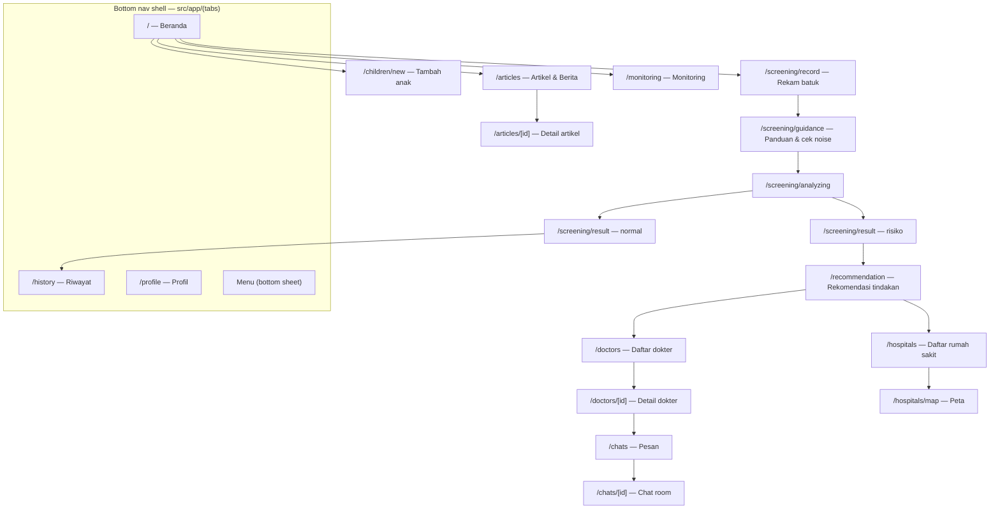

# PNEUMOTrack — Design Implementation Guide

Implementation update, 1 November 2026 (audit 001): colors now come from `src/constants/palette.json`, shared by numeric theme props and NativeWind CSS variables at `ThemeRoot`. The existing color tables below record the original design; use the palette file for current contrast-adjusted values. Child profiles use initials instead of a shared photo. Bottom tabs show Indonesian labels with a history icon. Monitoring remains available through Menu and shows only the last recorded waveform. These decisions implement the requested audit fixes and replace the older photo/icon-only instructions below.

Source of truth for visual implementation. Derived from the screens in [`UI_reference/`](./UI_reference) and the product rules in [`PRD.md`](./PRD.md). If this guide and a mockup disagree, follow the mockup for layout and this guide for tokens, copy, and safety rules.

Stack assumptions: Expo SDK 58, React Native 0.88, NativeWind 4.2.7 (Tailwind CSS 3), Expo Router, `src/app/` routes.

> Fidelity note: `Recording Guidance.png`, `Recording List.png`, and `logo.png` are high resolution and were pixel-sampled. Dashboard, result, recommendations, chat, and hospital screenshots are low resolution, so their spacing/radius values below are approximations to verify on device. Color tokens marked ✅ are sampled; tokens marked ~ are derived.

---

## 1. Design intent

A calm, trustworthy medical assistant for parents — not a hospital dashboard. The interface should feel:

- **Reassuring, not alarming.** Large white space, soft blue surfaces, no aggressive red except when risk is detected.
- **Simple enough for one hand.** One primary action per screen, 48px minimum touch targets, short sentences.
- **Honest about uncertainty.** Screening language everywhere, disclaimer on result/recommendation screens.
- **Child-friendly.** Rounded shapes, friendly illustration, warm accent photo of a child — never clinical stock imagery in the risk state.

Anti-goals: dense data tables, neon gradients, glassmorphism, tiny 12px tap targets, English copy in the default locale.

---

## 2. Color tokens

Sampled values: navy `#1F4B75` (✅ 5.7% of Recording Guidance, 24.7% of the logo outline), light blue `#D6E9F4` (✅ surfaces), logo fill `#A0D1EC` (✅), risk surface `#F4D6D6` (✅), white background.

### 2.1 Raw palette

| Name | Hex | Use |
|---|---|---|
| navy-700 | `#1F4B75` | Primary brand, headings, primary button fill ✅ |
| navy-800 | `#173A5C` | Pressed state, strong borders |
| navy-900 | `#0E2740` | Text on light risk surfaces |
| blue-200 | `#D6E9F4` | Card / hero surface ✅ |
| blue-100 | `#EAF4F9` | Subtle inset, list row tint |
| blue-300 | `#A0D1EC` | Logo fill, decorative illustration ✅ |
| risk-200 | `#F4D6D6` | Risk surface ✅ |
| risk-300 | `#E7B4B4` | Risk border |
| risk-700 | `#A33A3A` | Risk text, risk CTA ~ |
| safe-600 | `#1F7A5C` | “Normal” indicator ~ |
| safe-100 | `#D9EFE7` | Normal surface tint ~ |
| ink-900 | `#0B1B2B` | Primary text |
| ink-600 | `#60646C` | Secondary text (matches existing theme) |
| line | `#E3E9EE` | Hairlines, dividers |
| white | `#FFFFFF` | App background |

### 2.2 Semantic tokens (what components must use)

Never reference the raw palette in JSX. Use these names.

| Token | Light | Dark | Meaning |
|---|---|---|---|
| `surface` | `#FFFFFF` | `#0B1220` | App background |
| `surface-muted` | `#F6F8FA` | `#131C2A` | Section background, skeleton base |
| `surface-card` | `#FFFFFF` | `#131C2A` | Card on white |
| `surface-brand` | `#D6E9F4` | `#1E3A52` | Blue hero/card |
| `surface-brand-soft` | `#EAF4F9` | `#17293D` | Secondary blue |
| `border` | `#E3E9EE` | `#243244` | Dividers |
| `ink` | `#0B1B2B` | `#F5F7FA` | Primary text |
| `ink-muted` | `#60646C` | `#A9B4C2` | Secondary text |
| `icon-muted` | `#AEB7C2` | `#6B7A8C` | Inactive nav icon |
| `brand` | `#1F4B75` | `#7FB3D9` | Brand text, primary CTA |
| `brand-strong` | `#173A5C` | `#A9CBE8` | Pressed/strong |
| `on-brand` | `#FFFFFF` | `#0B1220` | Text on brand fill |
| `risk` | `#A33A3A` | `#F08A8A` | Risk text and CTA |
| `on-risk` | `#FFFFFF` | `#2A0F12` | Text on risk fill |
| `surface-risk` | `#F4D6D6` | `#3A1E22` | Risk banner/card |
| `border-risk` | `#E7B4B4` | `#5A2C31` | Risk card border |
| `safe` | `#1F7A5C` | `#6FD3AE` | Normal-state indicator |
| `surface-safe` | `#D9EFE7` | `#16332A` | Normal-state tint |

### 2.3 `tailwind.config.js` additions

```js
/** @type {import('tailwindcss').Config} */
module.exports = {
  content: ['./src/**/*.{js,jsx,ts,tsx}'],
  presets: [require('nativewind/preset')],
  darkMode: 'media',
  theme: {
    extend: {
      colors: {
        surface: { DEFAULT: '#FFFFFF', dark: '#0B1220' },
        'surface-muted': { DEFAULT: '#F6F8FA', dark: '#131C2A' },
        'surface-card': { DEFAULT: '#FFFFFF', dark: '#131C2A' },
        'surface-brand': { DEFAULT: '#D6E9F4', dark: '#1E3A52' },
        'surface-brand-soft': { DEFAULT: '#EAF4F9', dark: '#17293D' },
        border: { DEFAULT: '#E3E9EE', dark: '#243244' },
        ink: { DEFAULT: '#0B1B2B', muted: '#60646C', dark: '#F5F7FA', 'dark-muted': '#A9B4C2' },
        'icon-muted': { DEFAULT: '#AEB7C2', dark: '#6B7A8C' },
        brand: { DEFAULT: '#1F4B75', strong: '#173A5C', light: '#7FB3D9' },
        'on-brand': '#FFFFFF',
        risk: {
          DEFAULT: '#A33A3A',
          light: '#F08A8A',
          surface: '#F4D6D6',
          'surface-dark': '#3A1E22',
          border: '#E7B4B4',
          'border-dark': '#5A2C31',
        },
        'on-risk': '#FFFFFF',
        safe: { DEFAULT: '#1F7A5C', light: '#6FD3AE' },
        'surface-safe': { DEFAULT: '#D9EFE7', dark: '#16332A' },
      },
      fontSize: {
        display: ['32px', { lineHeight: '40px' }],
        title: ['24px', { lineHeight: '32px' }],
        subtitle: ['18px', { lineHeight: '26px' }],
        body: ['16px', { lineHeight: '24px' }],
        label: ['14px', { lineHeight: '20px' }],
        caption: ['12px', { lineHeight: '16px' }],
      },
      borderRadius: {
        card: '16px',
        sheet: '24px',
        pill: '999px',
      },
      maxWidth: {
        content: '800px',
      },
    },
  },
};
```

Dark variants that cannot live in one token (e.g. `ink`) use paired classes: `text-ink dark:text-ink-dark`, `text-ink-muted dark:text-ink-dark-muted`.

---

## 3. Typography

System font only (SF Pro on iOS, Roboto on Android) — no font files.

| Utility | Size / line | Weight | Used for |
|---|---|---|---|
| `text-display` | 32 / 40 | `font-bold` | Splash tagline, big result label |
| `text-title` | 24 / 32 | `font-bold` | Screen title, section lead |
| `text-subtitle` | 18 / 26 | `font-semibold` | Card title, doctor name |
| `text-body` | 16 / 24 | normal | Paragraphs, list titles |
| `text-label` | 14 / 20 | `font-semibold` | Buttons, tabs, labels |
| `text-caption` | 12 / 16 | normal | Timestamps, helper text, disclaimer |

Rules:

- Only one `text-display` per screen.
- Never go below 12px; body copy is 16px because the audience is parents, often older caregivers.
- Weights: 400 default, 600 for interactive labels, 700 for titles. Avoid 800+.
- Monetary/number values (timer, scores) use `tabular-nums` where supported.

---

## 4. Spacing, shape, elevation

- Spacing uses the Tailwind 4px scale. Screen gutter is `px-5` (20px). Card padding `p-4` (16px). Gaps between cards `gap-3` (12px), inside card `gap-2` (8px).
- Section rhythm: `gap-6` (24px) between sections.
- Radius: `rounded-card` (16) for cards, `rounded-sheet` (24) for bottom sheets, `rounded-pill` for buttons/chips, `rounded-full` for avatars/icons.
- Elevation: prefer a 1px `border border-border` over shadows. If a shadow is required, use `shadow-sm` only and verify on Android (RN 0.88 `boxShadow`).
- Bottom content inset: use `useSafeAreaInsets()`; add `pb-[${insets.bottom + 16}px]` style, not a hardcoded class. `NativeTabs` handles its own inset.

---

## 5. Tailwind / NativeWind best practices (binding rules)

1. **Tokens first.** No `bg-[#D6E9F4]` in components. Add a token to `tailwind.config.js` instead.
2. **Semantic names.** `bg-surface-risk`, not `bg-pink-200`; `text-ink-muted`, not `text-gray-500`.
3. **Static class strings only.** Tailwind scans source; `` className={`bg-${status}-100`} `` produces no CSS. Use lookup maps:
   ```ts
   const statusStyles = {
     normal: 'bg-surface-brand',
     risk: 'bg-risk-surface',
   } as const;
   ```
4. **Layout with flex + gap.** Prefer `flex-col gap-3` over stacking margins. Use `flex-1` for fill, never `h-screen` (breaks with keyboard and safe areas).
5. **Prevent overflow.** Wrap truncating text with `min-w-0 flex-1` and `numberOfLines={2}`; pin icons with `shrink-0`.
6. **Compose, don't repeat.** Repeated class clusters become components in `src/components/ui/` (`Card`, `PrimaryButton`, `ScreenHeader`, `StatusBanner`). A screen should read as structure, not as 200 utilities.
7. **One source of truth per decision.** Colors/spacing live in `tailwind.config.js`; product copy lives in `src/constants/copy.ts`; measurement values live in `src/constants/theme.ts`.
8. **`className` + `style`.** When both are passed, `style` wins in React Native. Use `style` only for dynamic values (insets, animated values, measured widths).
9. **Utility coverage.** `gap-*`, `flex-*`, `p-*`, `m-*`, `rounded-*`, `border-*`, `text-*`, `items-*`, `justify-*` are safe. Avoid `space-x-*` (use `gap-*`), `divide-*`, and CSS-only effects (`backdrop-blur`, `grid` on native).
10. **`@expo/ui` and `NativeTabs` do not accept `className`.** Style those with their props (`backgroundColor`, `labelStyle`) and keep the values coming from the same tokens.
11. **Dark mode via `dark:`** with `darkMode: 'media'`. Every screen must be checked in both schemes; risk surfaces must keep readable contrast in dark.
12. **Arbitrary values are a smell.** Allowed only for one-off, measured values (e.g. `w-[186px]` for a logo), and must carry a comment.
13. **Accessibility:** minimum `h-12` for CTAs, 44×44 hit area, `accessibilityRole`/`accessibilityLabel` on icon-only buttons, contrast ≥ 4.5:1 for body text. Measured: `ink` on `surface` = 17.4:1, `on-brand` on `brand` = 9.1:1, `ink-muted` on `surface` = 5.9:1, `risk` on `surface-risk` = 4.8:1. Avoid `ink-muted` on `surface-risk` (4.4:1) — use `ink` or `risk` there.

---

## 6. Shared components

Build these once in `src/components/ui/` and reuse. Class strings below are the contract.

### `Screen`

```tsx
<View className="flex-1 bg-surface px-5 pt-2 dark:bg-surface-dark">
  <View className="w-full max-w-content self-center">{children}</View>
</View>
```

### `ScreenHeader` (centered title, back, kebab)

```tsx
<View className="h-14 flex-row items-center justify-between">
  <Pressable className="h-11 w-11 items-center justify-center" accessibilityLabel="Kembali">
    <Icon name="chevron.left" className="text-ink dark:text-ink-dark" />
  </Pressable>
  <Text className="text-subtitle font-semibold text-ink dark:text-ink-dark">{title}</Text>
  <Pressable className="h-11 w-11 items-center justify-center" accessibilityLabel="Menu">…</Pressable>
</View>
```

Optional subtitle under the title (`text-caption text-ink-muted`) for counts, e.g. “37 Rekaman”.

### `Card`

```tsx
<View className="rounded-card border border-border bg-surface-card p-4 dark:border-border-dark dark:bg-surface-card-dark">
```

Variant `brand`: `bg-surface-brand border-transparent`. Variant `risk`: `bg-risk-surface border-risk-border`.

### `PrimaryButton`

```tsx
<Pressable className="h-12 flex-row items-center justify-center gap-2 rounded-pill bg-brand px-5 active:opacity-80">
  <Text className="text-label font-semibold text-on-brand">{label}</Text>
</Pressable>
```

Risk CTA swaps `bg-brand` → `bg-risk`. Secondary CTA: `border border-brand bg-transparent`, text `text-brand`.

### `StatusBanner`

Normal:

```tsx
<View className="flex-row items-center gap-3 rounded-card bg-surface-brand p-4">
  <View className="h-8 w-8 items-center justify-center rounded-full bg-white">
    <Text className="text-safe">✓</Text>
  </View>
  <Text className="flex-1 text-label font-semibold text-brand">Tidak terdeteksi indikasi pneumonia</Text>
</View>
```

Risk: `bg-risk-surface`, icon `bg-white text-risk`, text `text-risk`, copy “Indikasi risiko pneumonia terdeteksi”.

### `Disclaimer`

Required on result and recommendation screens.

```tsx
<Text className="text-caption text-ink-muted">
  Hasil ini adalah skrining awal, bukan diagnosis. Selalu konsultasikan ke tenaga kesehatan.
</Text>
```

### `ListRow` (doctor, hospital, history)

```tsx
<Pressable className="flex-row items-center gap-3 border-b border-border py-3">
  <Image className="h-14 w-14 rounded-xl" source={…} />
  <View className="min-w-0 flex-1 gap-1">
    <Text numberOfLines={1} className="text-body font-semibold text-ink">…</Text>
    <Text numberOfLines={1} className="text-caption text-ink-muted">…</Text>
  </View>
  <Icon className="shrink-0 text-ink-muted" name="chevron.right" />
</Pressable>
```

### `SegmentedTabs` (Mesages: Semua / Dokter / Pasien)

Container `flex-row gap-1 rounded-pill bg-surface-brand-soft p-1`; active `bg-brand` + `text-on-brand`; inactive `text-brand`.

### `HeartGauge` (dashboard/monitoring)

Concentric heart-shaped indicator with three rings (safe / watch / risk). Implementation requires `react-native-svg` (`bunx expo install react-native-svg`), rings drawn as stroked paths, center label:

- safe: stroke `safe`, center text `text-brand “Tidak ada indikasi pneumonia”`
- risk: stroke `risk`, center text `text-risk “Indikasi pneumonia”`

Never rely on color alone — always pair with the label.

### `Waveform`

Static amplitude strip inside a `rounded-card bg-surface-brand` block, 64–96px tall, stroke `brand`. Render from the recorded samples downsampled to ≤ 200 points; idle state shows a flat baseline. Risk variant uses `stroke-risk` and `bg-risk-surface`.

### `EmptyState` / `ErrorState`

Icon `h-16 w-16` muted, `text-subtitle` title, `text-body text-ink-muted` body, one `PrimaryButton` action (“Rekam ulang”, “Coba lagi”).

### `BottomNav` (app shell)

Icon-only tab bar shown on the four root screens. Anatomy and states are specified in [§7.18](#718-bottom-navigation-navbar).

---

## 7. Screen specifications

Baseline frame: 390×844. Content is centered with `max-w-content` on tablets/web.

### 7.0 Navigation map (routes)

Route-level flow, matching `src/app/` structure. Product flow lives in `PRD.md` §6.



Rules:

- Tab bar visible only on `HOME`, `HIST`, `PROF`, and the articles/menu entry points. Hidden on `CHILD`, `REC`, `GUIDE`, `ANA`, `RES_*`, `RECO`, `CHAT`, and `MAP`.
- Back from any focused flow returns to where the user came from (record → dashboard, result → dashboard/history).
- Result and recommendation are separate routes so the risk CTA can be deep-linked; both render the disclaimer.


### 7.1 Splash

- Full-bleed `bg-surface`, centered logo (lungs + baby face) at 160–186px wide.
- Tagline `text-title font-bold text-brand text-center`: “Track the Signs, Guard the Lungs.”
- No buttons; auto-advance after boot.

### 7.2 Dashboard — safe state

Structure:

1. Greeting block: `text-caption text-ink-muted` “Hai, Bunda” + `text-title font-bold` “Pantau kondisi si kecil”.
2. Child hero card: `rounded-card bg-surface-brand p-4`, name + age pill, child photo right-aligned, `overflow-hidden`.
3. Vitals card: icon rows (suhu, napas, detak) with `text-caption` labels; right side `HeartGauge` 120px.
4. Primary action “Rekam Batuk” (`PrimaryButton`).
5. “Artikel & Berita” section: `SectionTitle` + horizontal `ScrollView` of 2–3 article cards (`w-40`).

Risk state: same layout, `bg-risk-surface` on hero + vitals card, gauge ring `risk`, banner copy “Indikasi risiko pneumonia terdeteksi”, CTA becomes “Lihat Rekomendasi”.

### 7.3 Recording guidance

High-fidelity reference: `UI_reference/Recording Guidance.png`.

- Header title “Rekaman Audio”, back left, kebab right.
- Instruction `text-title font-bold text-brand text-center` “Pegang ponsel seperti ini.”
- Illustration (child coughing + phone) centered, ~220px tall.
- Noise check block pinned above CTA: label `text-label font-semibold text-brand` “Memeriksa tingkat kebisingan”; progress track `h-1.5 rounded-full bg-brand/20`, fill `bg-brand`, endpoints `text-caption` “Aman” / “Terlalu berisik”.
- `PrimaryButton` full-width “Mulai”.

### 7.4 Recording audio

- Header “Rekaman Audio”.
- Timer `text-display font-bold tabular-nums text-brand` `00:00.9`.
- Waveform region `h-40 bg-surface-brand` with live amplitude bars.
- Controls row at bottom: skip (`h-12 w-12`), pause (`h-14 w-14 rounded-full bg-surface-brand`), stop (`h-12 w-12 rounded-full bg-brand`).
- Recording state must also show a “Batalkan” text button and a hint “Dekatkan ponsel ke mulut anak”.

### 7.5 Analyzing

- Centered logo 140px, subtle pulse (Reanimated, respect reduce-motion).
- `text-body text-ink-muted` “Menganalisis audio batuk…”.
- No back navigation; cancel only after 20s.

### 7.6 Cough Analysis — normal

- Header “Analisis Batuk”.
- `StatusBanner` normal + child photo card.
- Waveform card: “Pola batuk normal”.
- “Ringkasan AI” card: `rounded-card bg-surface-brand-soft p-4`, bullet list `text-body` with `text-ink`.
- Disclaimer at the bottom.

### 7.7 Cough Analysis — risk

High fidelity reference: `UI_reference/pneumonia result_user.png`.

- Header same.
- Banner `bg-risk-surface` with risk icon and copy “Indikasi risiko pneumonia terdeteksi — perlu perhatian”.
- Waveform card risk variant with label “Pola batuk tidak biasa”.
- Two CTA cards stacked:
  - “Konsultasi dengan dokter” — doctor photo + `rounded-pill bg-risk` button “Mulai Konsultasi”.
  - “Kunjungi fasilitas kesehatan terdekat” — hospital photo + button “Lihat Rumah Sakit”.
- Disclaimer block + danger-signs block (`text-caption`, bold heading “Segera ke IGD jika:” followed by list).

### 7.8 Recommended Action

High fidelity reference: `UI_reference/recommendations page_user.png`.

- Header “Rekomendasi Tindakan”.
- Summary banner `bg-risk-surface` (short risk sentence, `text-caption`).
- Card 1: doctor photo left, title `text-subtitle`, descriptor `text-caption`, CTA `PrimaryButton` risk variant.
- Card 2: hospital photo right, same anatomy, CTA risk variant.
- Same disclaimer as 7.7.

### 7.9 Doctor list

- Header “Dokter” + subtitle count.
- Search field `h-11 rounded-pill bg-surface-muted px-4 text-body` with leading icon.
- List of `ListRow`: photo `rounded-xl`, name, specialty, rating row (`text-caption`, star icon `text-amber-500`), availability dot `h-2 w-2 rounded-full bg-safe`.
- Row height ≥ 72px, separated by `border-b border-border`.

### 7.10 Doctor detail

- Header “Detail Dokter”.
- Profile card: photo 96px `rounded-2xl`, name `text-subtitle`, specialty, rating + `Tersedia` chip.
- “Tentang” section with `text-body text-ink-muted` and `Read more` link `text-brand`.
- Sticky bottom CTA: `rounded-pill bg-brand` “Chat dengan Dokter”, inside safe-area padding.

### 7.11 Messages (list)

- Header “Pesan” with search icon.
- `SegmentedTabs`: Semua / Dokter / Pasien.
- Rows: avatar 48px, name, last message `text-caption text-ink-muted numberOfLines={1}`, time right, unread dot `bg-brand`.
- Floating compose button `absolute bottom-6 right-5 h-14 w-14 rounded-full bg-brand shadow-sm`.

### 7.12 Chat room

- Header: back, avatar, name, “Online” `text-caption text-safe`, call + kebab icons.
- Date divider centered `text-caption text-ink-muted`.
- Received bubble: `max-w-[75%] self-start rounded-2xl rounded-bl-sm bg-surface-brand px-4 py-2`.
- Sent bubble: `max-w-[75%] self-end rounded-2xl rounded-br-sm bg-brand px-4 py-2`, text `text-on-brand`.
- Composer: `flex-row items-center gap-2 rounded-pill border border-border bg-surface-muted px-4 py-2`, send button `h-10 w-10 rounded-full bg-brand`.

### 7.13 Hospital list

- Header “Rumah Sakit” + subtitle “Berdasarkan lokasi Anda”.
- Search field as 7.9.
- Rows with 72×72 photo `rounded-xl`, name, distance `text-caption`, rating, `Lihat Peta` link `text-brand`.
- Permission-denied state: `EmptyState` with “Aktifkan lokasi” CTA.

### 7.14 Hospital map

- Header “Rumah Sakit”.
- Search field overlays top of map (`absolute top-3 left-5 right-5`).
- Map fills the screen behind a bottom sheet.
- Bottom card `rounded-sheet bg-surface-card p-5` with hospital name, address `text-caption`, `PrimaryButton` “Lihat Detail”.
- Use `expo-maps` (verify its SDK 58 API in the versioned docs before implementing); it requires a development build.

### 7.15 History

- Header “Riwayat”.
- Summary card `bg-surface-brand` with latest result + child photo.
- “Tren” card: two mini line charts + one bar chart, `text-caption` axis labels, grid lines `border-border`.
- “Ringkasan AI” card: bullet list, same styling as 7.6.
- Empty state when no records: illustration + “Belum ada riwayat” + CTA “Rekam Batuk”.

### 7.16 Articles & News

- Header “Artikel & Berita” + search.
- Filter chips `rounded-pill bg-surface-brand-soft px-4 py-2`, active `bg-brand text-on-brand`.
- “Artikel Populer” horizontal carousel of `w-40` cards: image `h-24 rounded-xl`, title `text-label font-semibold numberOfLines={2}`, meta `text-caption text-ink-muted`.
- “Artikel Terkait” vertical list with 56px thumbnail and 2-line title.
- Uses the shared bottom navbar (see §7.18), with “Menu” as the active item.

### 7.17 Add child

- Header “Tambah Anak”.
- Avatar picker circle `h-20 w-20 rounded-full bg-surface-brand` with camera badge.
- Inputs: label `text-label font-semibold`, field `h-12 rounded-xl border border-border bg-surface px-4 text-body`.
- Sex selector `SegmentedTabs` (Laki-laki / Perempuan).
- Sticky `PrimaryButton` “Simpan”.

### 7.18 Bottom navigation (navbar)

Reference: the 4-icon bar below the mockup screens (`UI_reference/chat list_user.png`, `cough analysis_user.png`).

**Anatomy:** white bar, 1px top hairline, four evenly spaced icon-only items, 64px tall (plus system safe-area inset). Icons 24px, no labels, no badge.

| # | Item | Icon | Route |
|---|---|---|---|
| 1 | Beranda | house outline | `/` |
| 2 | Riwayat | pulse / waveform | `/history` |
| 3 | Profil | person outline | `/profile` |
| 4 | Menu | three horizontal lines | opens `MenuSheet` (does not navigate) |

**States**

| State | Icon color | Notes |
|---|---|---|
| Active | `brand` (`#1F4B75`) | Also thicker stroke (2px vs 1.5px) — do not rely on color alone |
| Inactive | `icon-muted` (`#AEB7C2`) | 60% visual weight |
| Pressed | `brand-strong` | `active:opacity-70` on Pressable |

**Implementation**

Use a custom tab bar with `Tabs` from `expo-router/ui` (the same pattern already in `src/components/app-tabs.web.tsx`). `NativeTabs` is not used for this bar: it always renders labels and cannot express the icon-only navy styling in the mockup.

```tsx
// src/app/(tabs)/_layout.tsx
<View className="border-t border-border bg-surface dark:border-border-dark dark:bg-surface-dark">
  <View className="h-16 flex-row items-center">
    <TabTrigger name="home" href="/" asChild>
      <Pressable
        className="h-12 flex-1 items-center justify-center"
        accessibilityRole="tab"
        accessibilityLabel="Beranda"
        accessibilityState={{ selected: isFocused }}>
        <HomeIcon
          className={
            isFocused
              ? 'text-brand dark:text-brand-light'
              : 'text-icon-muted dark:text-icon-muted-dark'
          }
        />
      </Pressable>
    </TabTrigger>
    {/* history, profile, menu — same anatomy */}
  </View>
  <View style={{ height: insets.bottom }} />
</View>
```

Rules:

- The bar is **not** `absolute`; it sits in normal flex flow so screens never scroll under it. Screens that use `ScrollView` add `contentContainerStyle={{ paddingBottom: 24 }}` and the bar's height handles the rest.
- Each item is `flex-1` with a ≥ 48px touch area; the visible icon is 24px.
- Icon-only controls require `accessibilityLabel` in Indonesian and `accessibilityState={{ selected }}`.
- The bar is hidden on focused flows: Recording, Recording guidance, Analyzing, Result, Recommended Action, Chat room, Add child, and Hospital map. Those screens are full-bleed and rely on the header back action.
- “Menu” opens a bottom sheet (`rounded-sheet`, `bg-surface-card`, drag handle `h-1 w-10 rounded-full bg-border`) with: Profil Anak, Pengaturan, Tentang Aplikasi, Bantuan. It is not a pushed route, so the active tab stays highlighted.
- Dark mode: surface `#131C2A`, hairline `#243244`, active icon `brand-light` `#7FB3D9`, inactive `#6B7A8C`.
- Do not add a floating tab bar, blur, or shadow; the mockup is flat with one hairline.

---

## 8. State matrix

| State | Surface | Text/icon | Notes |
|---|---|---|---|
| Normal | `surface-brand` | `brand` / `safe` | Checkmark icon, no red |
| Risk | `surface-risk` | `risk` | Always paired with wording and CTA |
| Caution (recording noise) | `surface-brand-soft` | `brand` | Amber only for “terlalu berisik” fill |
| Loading | `surface-muted` | `ink-muted` | Skeleton blocks `rounded-card`, no spinner-only screens |
| Empty | `surface` | `ink-muted` | Illustration + one CTA |
| Error/offline | `surface` | `ink` | `ErrorState` + retry, never lose recorded audio |
| Disabled | `surface-muted` | `ink-muted` at 60% | Keep label readable |

Every network screen implements: loading, empty, error, offline, retry.

---

## 9. Copy rules (Indonesian default)

- Use “Bunda/Papah” only if the profile knows the relation; otherwise “Anda”.
- Risky result headline: **“Indikasi risiko pneumonia terdeteksi”** — never “Anak Anda menderita pneumonia”.
- Normal result headline: **“Tidak terdeteksi indikasi pneumonia”**.
- Use “skrining” and “pola batuk tidak biasa”, not “diagnosis” or “akurasi 96,3%”.
- Numbers use Indonesian formatting (`0,0` decimal comma) in UI copy; API values stay raw.
- Buttons are verbs: “Rekam Batuk”, “Mulai Konsultasi”, “Lihat Rekomendasi”, “Coba Lagi”.
- Keep all strings in `src/constants/copy.ts`, one object per screen.

```ts
export const copy = {
  result: {
    normalTitle: 'Tidak terdeteksi indikasi pneumonia',
    riskTitle: 'Indikasi risiko pneumonia terdeteksi',
    normalPattern: 'Pola batuk normal',
    abnormalPattern: 'Pola batuk tidak biasa',
    disclaimer:
      'Hasil ini adalah skrining awal, bukan diagnosis. Selalu konsultasikan ke tenaga kesehatan.',
    dangerTitle: 'Segera ke IGD jika:',
  },
} as const;
```

---

## 10. Dark mode

- Background `surface-dark` `#0B1220`; cards `#131C2A`; borders `#243244`.
- Brand surfaces become `#1E3A52`, text stays light. Never use pure black (#000) or pure white text on brand in dark.
- Risk surface `#3A1E22` with `risk-light` text `#F08A8A` — verify contrast ≥ 4.5:1.
- Photos and illustrations stay unchanged; do not desaturate.
- Status bar: `expo-status-bar` `style="auto"` (already set through `userInterfaceStyle: automatic`).

---

## 11. Motion

- Default durations 150–250ms, `ease-out`; only Reanimated on the UI thread.
- Allowed: waveform amplitude, analyzing pulse, button press `active:opacity-80`, screen transitions handled by Expo Router.
- Respect reduce-motion (`AccessibilityInfo.isReduceMotionEnabled`): disable pulses and looping animations.
- No parallax, no bouncy springs on medical results.

---

## 12. Accessibility checklist

- [ ] CTA height ≥ 48px, icon-only hit area ≥ 44×44.
- [ ] Every icon-only control has `accessibilityLabel` in Indonesian.
- [ ] Result state is announced as text, not color alone.
- [ ] Body text contrast ≥ 4.5:1; large text ≥ 3:1.
- [ ] Supports system font scaling (`allowFontScaling` default true); layouts use `flex-wrap` where labels can grow.
- [ ] Recording screens work with screen reader: timer and noise level exposed via `accessibilityLiveRegion="polite"`.
- [ ] No text baked into images for critical information.

---

## 13. Mapping to existing code

| Today | After this guide |
|---|---|
| `src/constants/theme.ts` → `Colors` | Keep for props that require raw values (`NativeTabs backgroundColor`, `ThemeProvider`, chart libraries). UI code uses `className` tokens. |
| `ThemedText` types (`title`, `subtitle`, …) | Map to `text-display/title/subtitle/body/label/caption`; keep the component for `themeColor` until screens migrate. |
| `ThemedView` | Replace with `View` + `bg-surface` / `bg-surface-card` tokens. |
| `Spacing` numbers | Use Tailwind spacing utilities; keep constants only for numeric props (chart padding, insets). |
| Inline `StyleSheet` | Migrate screen by screen; do not mix both in one component. |

Shared components to create: `src/components/ui/{screen,screen-header,card,primary-button,secondary-button,status-banner,disclaimer,list-row,segmented-tabs,heart-gauge,waveform,empty-state,error-state}.tsx`.

---

## 14. Implementation order

1. Tokens + fonts in `tailwind.config.js`; `copy.ts`; UI primitives (`Screen`, `ScreenHeader`, `Card`, buttons, `StatusBanner`, `Disclaimer`).
2. End-to-end MVP path: Record → Analyzing → Result (normal + risk) → Recommended Action.
3. Supporting: History → Dashboard → Doctor list/detail → Chat → Hospital list/map → Articles.
4. Screenshot compare each screen against `UI_reference/` at 390×844; fix spacing before adding motion.
