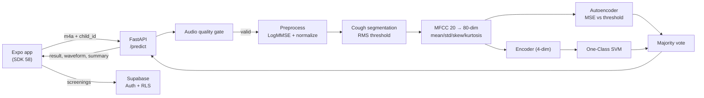

# PNEUMOTrack — Architecture & AI Pipeline (slide outline)

Use this as the source for the Sprint 5 architecture slide. One bullet block per slide.

## Slide 1 — One-line product

Screening aid for pneumonia risk in children from a cough recorded on a phone. **Not a diagnosis.**

## Slide 2 — System diagram

## Slide 3 — Preprocessing & quality gate

1. Decode to mono 22.05 kHz WAV (ffmpeg), max 10 MB.
2. Reject before inference: `< 3 s`, silent, noisy (SNR / active frames), no cough segment.
3. Noise reduction (LogMMSE-style via `noisereduce`) + peak normalization.

Why: PRD §13 — never return a result for unusable audio.

## Slide 4 — Features

- 20 MFCCs per 1-second chunk.
- Per chunk: mean, std, skew, kurtosis → 80-dim vector.
- Mean-pooled across cough chunks → one vector per recording.

## Slide 5 — Two one-class models + vote

| Model | Input | Decision |
|---|---|---|
| Autoencoder | 80-dim scaled | anomaly if reconstruction MSE **>** `0.03890753` |
| Encoder + OC-SVM | 4-dim latent | outlier if `predict == -1` |

- Majority vote; tie → `risk` (conservative).
- `agreement = both models agree`.
- `Pneumonia` label = **risk**; `Bukan Pneumonia` = normal.
- `confidence` is only the vote share (0.5 / 1.0) — not a clinical probability.

## Slide 6 — What the UI shows

- Blue state: "Tidak ditemukan tanda pola batuk pneumonia".
- Pink state: "Indikasi risiko pneumonia, perlu perhatian".
- Waveform, AI summary (non-diagnostic), disclaimer + danger signs.
- No accuracy percentage anywhere.

## Slide 7 — Dataset & honest limitations

- Training data: **only pneumonia-labelled** cough samples → one-class consistency check, not sensitivity/specificity.
- 96.3% (79/82) = agreement with the training class; **not** clinical accuracy.
- No independent validation yet; noise/mic quality affects features.
- Quality-gate thresholds calibrated with synthetic signals; real cough recordings required before claiming performance.

## Slide 8 — Privacy & safety

- Audio deleted after inference; never logged.
- Supabase RLS: a parent can only read/write their own children and screenings.
- No child identifiers in API logs; only request id, status, timing.
- Wording is risk-based, with emergency guidance (119 / IGD).

## Slide 9 — Next steps

1. Collect labelled normal + pneumonia recordings, re-calibrate gate, report sensitivity/specificity.
2. Clinical validation with a partner facility.
3. On-device inference for offline use.
4. Expand to other respiratory sounds / triage.

## Likely judge questions

| Question | Answer |
|---|---|
| Is 96.3% the accuracy? | No. It is consistency on a pneumonia-only dataset; clinical accuracy is unknown without normal controls. |
| Can it diagnose? | No. It is a screening aid; results use risk wording and always advise professional care. |
| Where does the audio go? | To the FastAPI backend, deleted after inference; not stored, not logged. |
| What if the audio is bad? | 422 with a specific code; the app asks for a re-record and shows no result. |
| Can it run offline? | Not today. Requires network to the API; on-device is a next step. |
