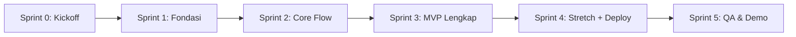

# PNEUMOTrack — Sprint Plan & Pembagian Tugas Tim

> Sumber: [`PRD.md`](./PRD.md), [`AGENTS.md`](./AGENTS.md), kode `server_side/`, template `src/`, desain `UI_reference/`.
> Kalau dokumen ini bertentangan dengan PRD, **PRD yang berlaku**. Kalau PRD tidak membahas sesuatu, tanya ke tim, jangan menebak.

---

## Daftar Isi
1. [Ringkasan Kondisi Repo & Temuan Kritis](#1-ringkasan-kondisi-repo--temuan-kritis)
2. [Tim & Kepemilikan Folder](#2-tim--kepemilikan-folder)
3. [Konvensi Kerja](#3-konvensi-kerja)
4. [Kontrak Bersama (API, Supabase, Route)](#4-kontrak-bersama)
5. [Roadmap Sprint](#5-roadmap-sprint)
6. [Sprint 0 — Kickoff & Kontrak](#sprint-0--kickoff--kontrak)
7. [Sprint 1 — Fondasi](#sprint-1--fondasi)
8. [Sprint 2 — Core Screening Flow (MVP Inti)](#sprint-2--core-screening-flow-mvp-inti)
9. [Sprint 3 — Fitur Pendukung MVP (Data, History, Dashboard, Rekomendasi)](#sprint-3--fitur-pendukung-mvp)
10. [Sprint 4 — Stretch (Chat, Peta, Artikel, Monitoring) & Deploy](#sprint-4--stretch--deploy)
11. [Sprint 5 — Hardening, QA & Demo](#sprint-5--hardening-qa--demo)
12. [Definition of Done](#definition-of-done)
13. [Pertanyaan Terbuka](#pertanyaan-terbuka)

---

## 1. Ringkasan Kondisi Repo & Temuan Kritis

| Area | Kondisi sekarang | Gap terhadap PRD |
|---|---|---|
| Mobile (`src/`) | Template `create-expo-app` (Expo SDK **58**, Expo Router, NativeTabs `index`/`explore`, NativeWind 4) | Belum ada satu pun layar PNEUMOTrack. Modul audio, location, map, dan Supabase belum terpasang |
| Theme | `src/constants/theme.ts` masih hitam/putih bawaan template | Palet teal/biru + merah/pink untuk risiko, serta file teks UI bahasa Indonesia belum ada |
| Backend | FastAPI `POST /predict` → Autoencoder + OC-SVM + voting sudah jalan | Respons beda dengan PRD §12. Audio jelek tidak ditolak. Error tetap HTTP 200. Belum ada CORS, `/health`, batas ukuran file, atau decode m4a |
| Supabase | Belum ada | Skema, aturan akses data (RLS), login, dan data contoh belum ada |
| Config | `app.json` masih bernama `PNM-TRACK` dengan splash template. `.gitignore` hanya mengabaikan `.env*.local` | Izin mic/lokasi, plugin, nama app, splash, `.env.example` |

### ⚠️ Temuan Kritis (diputuskan di Sprint 0)
1. **Makna label terbalik.** Model dilatih **hanya** dengan batuk pneumonia (one-class). Di kode, rekaman yang mirip pola pneumonia (*inlier*) diberi label `"Pneumonia"`, sedangkan PRD menulis "anomaly → risk". **Usulan:** `Pneumonia` → `risk`, `Bukan Pneumonia` → `normal`.
2. **Kontrak API beda.** PRD memakai `POST /screen`, kode memakai `POST /predict` dengan field yang berbeda.
3. **Voting seri (1–1) jatuh ke `Pneumonia`** dengan `confidence 0.5`. UI menampilkannya sebagai "perlu perhatian".
4. **`confidence` hanya proporsi vote**, bukan probabilitas klinis. Jangan tampilkan sebagai akurasi, begitu juga angka 96,3%.
5. **Audio tanpa batuk tidak ditolak.** Kalau tidak ada segmen batuk, backend memakai seluruh sinyal. Ini melanggar PRD §13.
6. **Android merekam m4a/AAC, bukan WAV.** Backend perlu ffmpeg.
7. **Desain menampilkan napas, suhu, dan detak jantung**, padahal data ini tidak bisa diukur dari batuk. Jangan memalsukan angka.
8. **Siapa yang menyimpan hasil skrining?** Usulan: app menyimpan ke Supabase, dilindungi RLS.

---

## 2. Tim & Kepemilikan Folder

| Member | Peran | Folder yang dimiliki |
|---|---|---|
| **Member A** — *Backend, AI & Data* | FastAPI, model, Supabase (skema, RLS, login, data contoh), deploy VPS | `server_side/**`, `supabase/**`, `PRD.md` §12 |
| **Member B** — *Mobile Core Flow* | Fondasi app + alur **rekam → analisis → hasil → rekomendasi** | `src/app/_layout.tsx`, `src/app/index.tsx`, `src/app/screening/**`, `src/app/recommendation.tsx`, `src/constants/**`, `src/components/ui/**`, `src/components/screening/**`, `src/services/api/**`, `src/hooks/use-recorder.ts`, `src/hooks/use-screening.ts`, `src/types/**`, `app.json`, `eas.json` |
| **Member C** — *Mobile Features* | Login, dashboard, profil anak, riwayat, monitoring, dokter, chat, rumah sakit, peta, artikel + service data | `src/app/(auth)/**`, `src/app/(tabs)/**` (isi), `src/app/children/**`, `src/app/history/**`, `src/app/doctors/**`, `src/app/chats/**`, `src/app/hospitals/**`, `src/app/articles/**`, `src/services/{supabase,children,screenings,doctors,hospitals,articles,chat}/**`, hook fitur terkait |

> **File bersama** (`theme.ts`, `copy.ts`, `src/types/**`, `package.json`, `app.json`) dimiliki **Member B**. Member lain boleh menambah lewat PR kecil terpisah, dengan memberi tahu grup dulu.

---

## 3. Konvensi Kerja

- **Branch:** `feat/<a|b|c>-<fitur>` (contoh `feat/b-recording`). PR ke `main`, minimal 1 reviewer member lain.
- **Commit:** Conventional Commits (`feat:`, `fix:`, `chore:`, `docs:`).
- **Wajib sebelum PR:** `bunx expo lint` dan `bunx tsc --noEmit` lolos. Backend: `pytest` atau smoke test `curl`.
- **Install paket:** `bunx expo install <pkg>` (repo memakai **bun**). Jangan `npm i`/`bun add` untuk paket Expo/RN.
- **API Expo:** cek docs SDK 58 (https://docs.expo.dev/versions/v58.0.0/, https://docs.expo.dev/llms.txt). Jangan mengandalkan ingatan.
- **Native module** (audio, location, maps) butuh **development build**, bukan Expo Go. Jangan edit `android/`/`ios/` manual.
- **Env:** hanya `EXPO_PUBLIC_*` di app, disimpan di `.env.local`. Commit `.env.example` tanpa nilai. Service-role key Supabase hanya di server.
- **Privasi:** dilarang me-log audio, URI rekaman, nama anak, atau respons yang berisi data anak.
- **Teks UI:** semua di `src/constants/copy.ts`, bahasa Indonesia, tanpa kata diagnosis pasti.
- **Prioritas:** `P0` = wajib demo, `P1` = penting, `P2` = stretch (PRD §16).
- **Ritme sprint:** daily stand-up 10 menit (kemarin, hari ini, hambatan). Di akhir sprint: demo internal + review checklist exit + update task.md.

---

## 4. Kontrak Bersama

### 4.1 API `POST /predict` v2 (usulan, final ditulis A di PRD §12)
Request `multipart/form-data`: `audio` (m4a/mp4/aac/wav, ≤ 10 MB), `child_id` (opsional, tidak di-log).

**200 OK**
```json
{
  "status": "success",
  "result": "risk | normal",
  "raw_label": "Pneumonia | Bukan Pneumonia",
  "agreement": true,
  "votes": { "autoencoder": "risk | normal", "ocsvm": "risk | normal" },
  "autoencoder": { "error": 0.0012, "threshold": 0.0031 },
  "ocsvm": { "score": 12.3 },
  "chunks": 4,
  "duration_sec": 6.2,
  "waveform": [0.01, 0.2, 0.8],
  "summary": "Ringkasan non-diagnostik berbahasa Indonesia",
  "model_version": "v3"
}
```
**422** (audio tidak layak, app minta rekam ulang): `{ "status": "error", "code": "AUDIO_TOO_SHORT | AUDIO_SILENT | NO_COUGH_DETECTED | AUDIO_TOO_NOISY | UNSUPPORTED_FORMAT | FILE_TOO_LARGE", "message": "..." }`
**500**: `{ "status": "error", "code": "INTERNAL_ERROR" }` · **`GET /health`** → `{ "status": "ok", "model_version": "v3" }`

### 4.2 Skema Supabase
| Tabel | Kolom utama | RLS |
|---|---|---|
| `profiles` | `id (=auth.uid)`, `full_name` | hanya milik sendiri |
| `children` | `id`, `parent_id`, `name`, `birth_date`, `sex` | CRUD hanya `parent_id = auth.uid()` |
| `screenings` | `id`, `child_id`, `result`, `agreement`, `ae_error`, `ae_threshold`, `ocsvm_score`, `chunks`, `duration_sec`, `waveform jsonb`, `summary`, `model_version`, `created_at` | lewat `children.parent_id = auth.uid()` |
| `doctors` | `id`, `name`, `specialty`, `hospital_id`, `photo_url`, `phone`, `whatsapp`, `bio`, `rating`, `schedule jsonb` | read-only |
| `hospitals` | `id`, `name`, `address`, `lat`, `lng`, `phone`, `type`, `has_pediatric` | read-only |
| `articles` | `id`, `title`, `category`, `cover_url`, `body_md`, `source`, `published_at` | read-only |
| `conversations` / `messages` *(P2)* | peserta, isi pesan, waktu | hanya peserta, realtime |

> Untuk MVP, **audio tidak disimpan** (minimasi data, PRD §13).

### 4.3 Struktur Route (skeleton dibuat B di Sprint 1)
```
src/app/
  _layout.tsx, index.tsx                  # B: root Stack + splash/redirect
  (auth)/sign-in.tsx, sign-up.tsx         # C
  (tabs)/_layout.tsx                      # B buat shell: Beranda, Monitoring, Anak, Lainnya
  (tabs)/index.tsx, monitoring.tsx, children.tsx, more.tsx   # C
  children/new.tsx                        # C
  screening/guide.tsx, record.tsx, analyzing.tsx, result.tsx # B
  recommendation.tsx                      # B
  history/index.tsx, history/[id].tsx     # C
  doctors/index.tsx, doctors/[id].tsx     # C
  chats/index.tsx, chats/[id].tsx         # C (P2)
  hospitals/index.tsx, hospitals/map.tsx  # C (map P2)
  articles/index.tsx, articles/[id].tsx   # C (P2)
```

---

## 5. Roadmap Sprint

> Durasi di bawah adalah usulan untuk hackathon (±7 hari kerja). Sesuaikan dengan deadline tim; urutan sprint tetap dipertahankan.

| Sprint | Durasi | Sprint Goal | Deliverable demo akhir sprint |
|---|---|---|---|
| **Sprint 0** | ½ hari | Semua keputusan kritis & kontrak disepakati | PRD §12, tipe TS, keputusan §1 tercatat |
| **Sprint 1** | 1 hari | Fondasi siap: app ber-theme, backend v2 lokal, Supabase hidup | Dev build Android dengan tab ber-theme. `curl /predict` v2 jalan. Tabel Supabase + data contoh |
| **Sprint 2** | 1,5 hari | **Rekam → analisis → hasil** jalan end-to-end di HP asli | Rekam batuk di HP → hasil normal/risiko dari backend asli. Audio jelek → minta rekam ulang |
| **Sprint 3** | 1,5 hari | MVP lengkap: login, anak, simpan hasil, riwayat, dashboard, rekomendasi → dokter & RS | Demo alur MVP PRD §16 poin 1–3 |
| **Sprint 4** | 1 hari | Stretch + backend online di VPS | Chat, peta, artikel, monitoring (atau disembunyikan rapi). API via HTTPS |
| **Sprint 5** | 1 hari | Stabil, aman, siap demo | APK preview, QA checklist lulus, skenario demo |



---

## Sprint 0 — Kickoff & Kontrak
**Durasi:** ½ hari · **Goal:** semua orang tahu apa yang dibangun, kontrak terkunci, tidak ada yang saling menunggu.

### 👥 Bersama (meeting kickoff, ±2 jam)
- [ ] Baca `PRD.md`, `AGENTS.md`, dan task.md ini bersama.
- [ ] Putuskan 9 pertanyaan terbuka ([§Pertanyaan Terbuka](#pertanyaan-terbuka)) dan catat jawabannya di bagian itu.
- [ ] Sepakati kontrak API (§4.1), skema Supabase (§4.2), struktur route (§4.3).
- [ ] Isi nama asli Member A/B/C di §2.
- [ ] Buat grup komunikasi + board (GitHub Projects/Trello) dengan kolom To Do / In Progress / Review / Done. Masukkan semua todo Sprint 1.
- [ ] Atur proteksi branch `main` (wajib PR + 1 review).

### 🅰️ Member A
- [ ] Konfirmasi ke pemilik model: makna label, nilai `ae_threshold` dan `sample_rate` di `config_v3.pkl`.
- [ ] Lengkapi PRD §12: endpoint, contoh request/response, semua kode error, mapping label.
- [ ] Draf perubahan PRD §12 (endpoint, field, makna label) dan minta persetujuan tim.
- [ ] Jalankan backend saat ini secara lokal (`pip install -r requirements.txt`, `uvicorn app:app`) dan catat kendala instalasi.

### 🅱️ Member B
- [ ] Tulis `src/types/screening.ts` (`ScreeningResult`, `AudioErrorCode`, `PredictResponse`, `ScreeningError`) sesuai kontrak.
- [ ] Cek di docs SDK 58: modul audio yang benar (`expo-audio`?), API NativeTabs, `Stack.Protected`. Catat temuannya di PR.
- [ ] Siapkan Android Studio/emulator atau HP asli untuk development build.

### 🅲 Member C
- [ ] Tulis `src/types/domain.ts` (`Child`, `Screening`, `Doctor`, `Hospital`, `Article`, `Message`) sesuai skema §4.2.
- [ ] Cek docs: Supabase + Expo (session di AsyncStorage), `expo-location`, pilihan `expo-maps` vs `react-native-maps` di SDK 58, library grafik yang kompatibel.
- [ ] Kumpulkan aset gambar dari `UI_reference/` (logo, foto anak, dokter, ilustrasi loading) ke `assets/images/`.

### ✅ Exit Criteria Sprint 0
- [ ] PRD §12 dan `src/types/*` ter-merge.
- [ ] Semua pertanyaan terbuka sudah terjawab atau punya keputusan sementara.
- [ ] Board berisi semua todo Sprint 1 dengan assignee.

---

## Sprint 1 — Fondasi
**Durasi:** 1 hari · **Goal:** pondasi teknis tiap member siap supaya Sprint 2 bisa langsung membangun fitur.

### 🅰️ Member A — Backend v2 & Supabase
**Backend endpoint v2** (`server_side/app.py`, `predictor.py`, `model.py`)
- [ ] Ubah respons `/predict` sesuai §4.1, dengan mapping `Pneumonia → risk` dan `Bukan Pneumonia → normal`, dan `agreement = svm_label == ae_label`.
- [ ] Kembalikan HTTP **422/500** untuk error, bukan 200 dengan `prediction: null`.
- [ ] Terima field `child_id` (opsional) tanpa me-log nilainya.
- [ ] Simpan file sementara dengan ekstensi asli dan pertahankan penghapusan di `finally`.
- [ ] Batasi upload ≤ 10 MB dan cek MIME/ekstensi (`FILE_TOO_LARGE`, `UNSUPPORTED_FORMAT`).
- [ ] Tambah `GET /health` dan `CORSMiddleware` (origin dari env).
- [ ] Jalankan inferensi di threadpool. Warm-up model saat startup. Ganti `print()` dengan `logger`.

**Format audio**
- [ ] Install `ffmpeg` lalu konversi upload ke WAV mono 22.050 Hz sebelum `librosa.load` (via `ffmpeg`/`pydub`).
- [ ] Pin versi `requirements.txt` (sesuaikan `scikit-learn`/`tensorflow`/`numpy` dengan versi pembuatan `.pkl`/`.h5`).

**Supabase**
- [ ] Buat project (region Singapura). Bagikan URL + anon key lewat kanal privat.
- [ ] Migrasi `supabase/migrations/0001_init.sql`: semua tabel §4.2, FK, index `screenings(child_id, created_at desc)`.
- [ ] Aktifkan RLS di semua tabel dan tulis policy-nya.
- [ ] Trigger buat `profiles` otomatis saat sign-up.
- [ ] Login email + password. Matikan konfirmasi email untuk demo.

**✔ Acceptance:** `curl -F audio=@sample.m4a http://localhost:8000/predict` → 200 sesuai kontrak. File kosong → 422. Tabel Supabase terlihat di dashboard.

### 🅱️ Member B — Fondasi App & Design System
**Setup proyek**
- [ ] Bersihkan template: hapus `explore.tsx`, `animated-icon*`, `web-badge`, `hint-row`, aset Expo/React yang tidak terpakai.
- [ ] `app.json`: nama `PNEUMOTrack`, splash teal + logo, adaptive icon, portrait.
- [ ] Buat **skeleton semua route §4.3** (placeholder) supaya C bisa langsung mengisi.
- [ ] `(tabs)/_layout.tsx`: NativeTabs 4 tab (Beranda, Monitoring, Anak, Lainnya) dengan ikon.
- [ ] Root `_layout.tsx`: Stack, `SafeAreaProvider`, `GestureHandlerRootView`, slot untuk `SessionProvider` (dari C), `StatusBar`.
- [ ] `.env.example` + `src/constants/config.ts` (baca & validasi `EXPO_PUBLIC_*`, flag `EXPO_PUBLIC_USE_MOCK_API`).
- [ ] Pastikan `tsconfig.json` `strict: true` dan alias `@/*` aktif.

**Design system**
- [ ] `src/constants/theme.ts`: palet teal/biru (primary, primaryDark, surface biru muda), **risk** merah/pink (`riskSurface`, `riskPrimary`, `riskText`), success/warning, teks, border, spacing, radius, typography (besar & mudah dibaca). Sinkronkan ke `tailwind.config.js`.
- [ ] `src/constants/copy.ts`: struktur per layar + teks **disclaimer** + **tanda bahaya** (napas cepat/sesak, tarikan dinding dada, bibir kebiruan, tidak bisa minum → segera ke IGD).
- [ ] Komponen `src/components/ui/`: `Button` (primary/secondary/danger, ≥ 48dp), `Card` (default/risk), `ScreenHeader`, `Disclaimer`, `DangerSignsBox`, `ErrorState`, `LoadingState`, `EmptyState`, `Avatar`, `Badge`, `StatusBanner` (foto anak + status normal/risk).
- [ ] Halaman `src/app/dev/components.tsx` (hanya `__DEV__`) untuk preview komponen.

**Audio**
- [ ] `bunx expo install expo-audio` (setelah verifikasi docs). Config plugin `microphonePermission` dengan teks Indonesia.
- [ ] Buat **development build Android** dan bagikan APK dev ke A & C.

**✔ Acceptance:** app jalan di dev build, 4 tab ber-theme, halaman preview komponen tampil.

### 🅲 Member C — Service Layer & Data Mock
- [ ] `bunx expo install @supabase/supabase-js @react-native-async-storage/async-storage react-native-url-polyfill`.
- [ ] `src/services/supabase/client.ts`: session tersimpan di AsyncStorage, auto-refresh saat app kembali ke foreground.
- [ ] Untuk setiap domain, buat **interface + implementasi mock** (switch `EXPO_PUBLIC_USE_MOCK_DATA`):
  - [ ] `children/`: `list`, `get`, `create`, `update`, `remove`
  - [ ] `screenings/`: `save`, `listByChild`, `get`, `latest`
  - [ ] `doctors/`: `list(filter)`, `get`
  - [ ] `hospitals/`: `list`, `nearest(lat, lng, limit)` (haversine)
  - [ ] `articles/`: `list(category)`, `get`
- [ ] `mock-data.ts` per domain (≥ 6 dokter, ≥ 10 RS dengan lat/lng asli di kota demo, ≥ 6 artikel, 2 anak, ±10 riwayat skrining). Bagikan ke A sebagai bahan data contoh.
- [ ] Sepakati dengan B apakah memakai `@tanstack/react-query` untuk caching/loading/error. Kalau ya, pasang `QueryClientProvider`.
- [ ] `src/hooks/use-active-child.ts` (context + AsyncStorage) supaya B bisa memakai `child_id`.

**✔ Acceptance:** semua service bisa dipanggil dan mengembalikan data mock bertipe benar. `tsc` lolos.

### ✅ Exit Criteria Sprint 1
- [ ] Dev build Android terpasang di HP ketiga member.
- [ ] Backend v2 jalan lokal dan menerima file m4a.
- [ ] Supabase: tabel + RLS aktif.
- [ ] Theme, copy, komponen dasar, skeleton route, dan service mock ter-merge ke `main`.

---

## Sprint 2 — Core Screening Flow (MVP Inti)
**Durasi:** 1,5 hari · **Goal:** orang tua bisa merekam batuk di HP asli lalu melihat hasil dari backend asli, dengan audio jelek & error jaringan tertangani. *(PRD §16 poin 1)*

### 🅰️ Member A — Quality Gate, Waveform, Summary, Privasi
**Validasi audio (PRD §13)** — fungsi `validate_audio()` sebelum prediksi
- [ ] `AUDIO_TOO_SHORT`: durasi < **3 dtk** (samakan dengan batas di app).
- [ ] `AUDIO_SILENT`: RMS maksimum di bawah ambang **sebelum** normalisasi.
- [ ] `NO_COUGH_DETECTED`: segmentasi tetap 0 chunk. **Matikan fallback "pakai seluruh sinyal"** di `segment_cough_chunks` untuk inferensi.
- [ ] `AUDIO_TOO_NOISY`: SNR rendah atau frame aktif > 80%.
- [ ] Kalibrasi ambang dengan ±10 rekaman uji (hening, bicara, TV/kipas, batuk dewasa, sampel dataset). Catat hasilnya bersama kontrak API pada PRD §12.

**Output untuk UI**
- [ ] `waveform`: envelope RMS ±100 titik, dinormalisasi 0..1.
- [ ] `summary` template non-diagnostik (varian risk / normal / tidak sepakat), tanpa vital palsu dan tanpa angka akurasi.
- [ ] `duration_sec`, `chunks`, `model_version`.

**Privasi & test**
- [ ] Hapus log nama file asli/path. Log hanya request-id, durasi proses, status, kode error. Skor model hanya di level DEBUG.
- [ ] `temp/` masuk `.gitignore` dan dibersihkan saat startup.
- [ ] `server_side/tests/test_api.py`: sukses, kosong, format salah, terlalu besar, hening.
- [ ] Jalankan backend dengan `--host 0.0.0.0` dan bagikan IP LAN ke B.

**✔ Acceptance:** rekaman hening/bicara/kipas → 422 dengan kode tepat. Sampel batuk → 200.

### 🅱️ Member B — Rekam → Analisis → Hasil
**Hook & service**
- [ ] `src/hooks/use-recorder.ts`: izin + rationale + ditolak permanen (`Linking.openSettings()`), start/pause/resume/stop, durasi, metering, URI, reset. Minimal **3 dtk**, auto-stop **30 dtk**. Hapus file lokal setelah upload/dibatalkan.
- [ ] `src/services/api/client.ts`: `fetch` + base URL env + timeout 60 dtk (`AbortController`) + mapping error → `ScreeningError` (network/timeout/audio/server).
- [ ] `src/services/api/screening.ts`: `predict(uri, childId)` via `FormData` dengan validasi respons (type guard).
- [ ] `src/services/api/screening.mock.ts`: respons normal, risk, tidak sepakat, dan tiap kode error.
- [ ] `src/hooks/use-screening.ts`: state `idle → uploading → analyzing → success | error`, retry, cancel. Simpan hasil terakhir di context.

**Layar**
- [ ] `screening/guide.tsx` *(ref `Recording Guidance.png`)*: anak aktif (dari `use-active-child`), ilustrasi cara memegang HP, tips (jarak 15–30 cm, ruangan tenang, 2–3 batuk), cek bising 2–3 dtk (bar Oke ↔ Terlalu Bising), tombol Mulai.
- [ ] `screening/record.tsx` *(ref `cough recording_user.png`)*: timer `00:00.0`, waveform live (Reanimated), play/pause/stop, pratinjau dengan opsi "Rekam ulang" / "Analisis". Kalau app pindah ke background → stop & simpan.
- [ ] `screening/analyzing.tsx` *(ref `analysis loading page_user.png`)*: animasi + langkah proses, tombol batal, konfirmasi saat back.
  - [ ] Error audio → layar "Rekaman belum bisa dianalisis" dengan alasan per kode + **Rekam ulang** (tanpa hasil).
  - [ ] Error network/timeout/server → `ErrorState` dengan "Coba lagi" (file sama) & "Rekam ulang".
- [ ] `src/components/screening/ResultView.tsx` (komponen murni, juga dipakai C di riwayat).
- [ ] `screening/result.tsx` *(ref `cough results_user.png`, `pneumonia result_user.png`)*:
  - [ ] Varian **normal** (biru): "Tidak ditemukan tanda pola batuk pneumonia", kartu waveform + "Pola batuk normal", Ringkasan AI, tombol Beranda & Riwayat.
  - [ ] Varian **risiko** (pink): "Indikasi risiko pneumonia, perlu perhatian", "Pola batuk tidak biasa terdeteksi", Ringkasan AI, CTA **Lihat Rekomendasi Tindakan**.
  - [ ] `agreement=false` → badge "Hasil model berbeda" + ajakan rekam ulang.
  - [ ] `Disclaimer` + `DangerSignsBox` wajib. Skor teknis di collapsible. **Tanpa persen akurasi.**

**Integrasi (CP2)**
- [ ] Uji dengan backend lokal A (IP LAN; emulator memakai `10.0.2.2`) menggunakan rekaman asli dari HP.

**✔ Acceptance:** di HP asli, rekam → analisis → hasil normal/risiko tampil. Rekaman hening → layar rekam ulang. Mode pesawat → pesan offline + coba lagi.

### 🅲 Member C — Auth & Profil Anak
**Auth (F13)**
- [ ] `src/hooks/use-session.ts` + `SessionProvider` (pasang di root layout, koordinasi dengan B).
- [ ] `(auth)/sign-in.tsx` & `(auth)/sign-up.tsx`: email, password, nama orang tua, validasi, error berbahasa Indonesia, loading.
- [ ] Redirect: belum login → `(auth)`, sudah login → `(tabs)` (pakai `Stack.Protected`/redirect sesuai docs SDK 58).
- [ ] Tombol "Masuk sebagai Demo" hanya kalau `__DEV__`/flag demo aktif.

**Profil anak (F1)**
- [ ] `children/new.tsx`: nama, tanggal lahir (umur otomatis dalam bulan/tahun), jenis kelamin, validasi (nama wajib, 0–12 thn).
- [ ] `(tabs)/children.tsx`: daftar anak, pilih **anak aktif**, edit/hapus dengan konfirmasi, empty state "Tambahkan profil anak untuk mulai skrining".
- [ ] Hubungkan `use-active-child` ke service `children`.
- [ ] Kalau belum ada anak saat masuk `screening/guide` → arahkan ke `children/new` (koordinasi dengan B).

**Implementasi Supabase**
- [ ] Implementasi Supabase untuk `children` & `screenings` (selain mock) dan uji dengan proyek A.

**✔ Acceptance:** daftar akun → login → tambah anak → anak aktif terpilih dan terbaca di layar panduan rekam B.

### ✅ Exit Criteria Sprint 2
- [ ] **CP2 lulus:** rekaman asli Android → backend asli → hasil tampil.
- [ ] Semua kode error audio & jaringan punya layar penanganan.
- [ ] Login + profil anak jalan dengan Supabase.

---

## Sprint 3 — Fitur Pendukung MVP
**Durasi:** 1,5 hari · **Goal:** MVP PRD §16 poin 2–3 lengkap: hasil tersimpan, riwayat & dashboard hidup, rekomendasi mengarah ke dokter & RS.

### 🅰️ Member A — Data Contoh, RLS Test, Dukungan Integrasi
- [ ] `supabase/seed.sql`: ≥ 6 dokter (fiktif, Sp.A/Sp.P), ≥ 10 RS/puskesmas dengan lat/lng asli di kota demo, ≥ 6 artikel bersumber WHO/Kemenkes/IDAI (gejala, pencegahan, penanganan, tanda bahaya).
- [ ] **Uji RLS** dengan 2 akun: akun B tidak bisa membaca/menulis anak & skrining akun A. Insert `screenings` untuk anak orang lain ditolak.
- [ ] Bantu C debugging query/policy Supabase.
- [ ] Siapkan VPS Biznet Gio: akses SSH, Python/Docker, ffmpeg, domain/subdomain.
- [ ] `server_side/Dockerfile` (python-slim + ffmpeg) atau unit systemd + venv.
- [ ] Skrip smoke test `server_side/scripts/smoke.ps1`/`.sh` (`/health`, `/predict`).

**✔ Acceptance:** data contoh tampil di app C. Uji RLS tercatat bersama kontrak data pada PRD §12.

### 🅱️ Member B — Rekomendasi, Simpan Hasil, Polish Core Flow
- [ ] `recommendation.tsx` *(ref `recommendations page_user.png`)*:
  - [ ] Banner status risiko + "Lihat Detail" (kembali ke hasil).
  - [ ] Kartu **Konsultasi dengan dokter** → `doctors/`.
  - [ ] Kartu **Kunjungi fasilitas kesehatan terdekat** → `hospitals/`.
  - [ ] `DangerSignsBox` menonjol + tombol telepon **119** (`tel:119`).
  - [ ] `Disclaimer` wajib.
- [ ] Hubungkan `use-screening` ke `screeningsService.save()` (dari C). Kalau gagal simpan, hasil tetap tampil dengan toast "Hasil belum tersimpan" + coba lagi.
- [ ] Cek konektivitas sebelum upload (`@react-native-community/netinfo` via `expo install`).
- [ ] Haptic ringan saat start/stop rekam (`expo-haptics`, opsional).
- [ ] Ganti mock API ke backend asli sebagai default dev.
- [ ] Review PR C untuk konsistensi theme & komponen.

**✔ Acceptance:** hasil risiko → rekomendasi → masuk ke list dokter & RS milik C. Hasil tersimpan di tabel `screenings`.

### 🅲 Member C — Dashboard, Riwayat, Dokter, Rumah Sakit
**Dashboard `(tabs)/index.tsx` (F11)** *(ref `dashboard_user.png`, `information_user.png`, `pneumonia dashboard_user.png`)*
- [ ] Sapaan "Hai, {nama}" + "Berikut status anak Anda".
- [ ] `StatusBanner` dari skrining terakhir: normal / risiko / belum pernah (CTA).
- [ ] `HeartIndicator` (SVG, `react-native-svg`): teal untuk normal, pink untuk risiko.
- [ ] Ganti vital palsu dengan: tanggal skrining terakhir, jumlah batuk terdeteksi, status kesepakatan model, jumlah skrining 7 hari (ikuti keputusan Sprint 0).
- [ ] Tombol besar **Rekam Batuk** → `screening/guide`. "Lihat Detail" → riwayat terakhir.
- [ ] Kartu Rekomendasi muncul kalau status terakhir risiko.
- [ ] Preview 2–3 artikel (mock dulu kalau halaman artikel belum ada).
- [ ] Skeleton loading, error + retry, pull-to-refresh, banner offline.

**Riwayat (F10)** *(ref `cough history_user.png`, `Recording List.png`)*
- [ ] `history/index.tsx`: banner status terbaru, filter 7/30 hari/semua.
- [ ] Grafik tren: skrining per hari (bar) + normal vs risiko. Pakai library yang kompatibel SDK 58, atau bar chart sederhana dari View.
- [ ] Ringkasan riwayat (template client, non-diagnostik).
- [ ] Daftar item (tanggal, jam, badge status, durasi), tanpa tombol play karena audio tidak disimpan.
- [ ] `history/[id].tsx`: pakai `ResultView` dari B + disclaimer.
- [ ] Empty & error state.

**Dokter (F7)** *(ref `doctor page_user.png`, `doctor profile_user.png`)*
- [ ] `doctors/index.tsx`: foto, nama, spesialisasi, RS, rating, search/filter.
- [ ] `doctors/[id].tsx`: profil, jadwal, alamat, tombol **Telepon** (`tel:`), **WhatsApp** (`https://wa.me/…`). Tombol Chat disembunyikan sampai Sprint 4.

**Rumah Sakit (F8, list)** *(ref `hospital list_user.png`)*
- [ ] `bunx expo install expo-location` + plugin dengan rationale Indonesia (koordinasi edit `app.json` dengan B).
- [ ] `src/hooks/use-location.ts`: izin foreground, fallback kota default kalau ditolak, timeout.
- [ ] `hospitals/index.tsx`: nama, tipe, jarak km, alamat, tombol **Arahkan** (Google Maps URL) & **Telepon**.

**Implementasi Supabase**
- [ ] Implementasi Supabase untuk `doctors`, `hospitals`, `articles`, lalu ganti default dari mock.

**✔ Acceptance:** setelah skrining, dashboard & riwayat ter-update. Dokter & RS tampil dari Supabase, diurutkan berdasarkan jarak.

### ✅ Exit Criteria Sprint 3 (MVP SELESAI)
- [ ] **CP3 lulus:** login → tambah anak → rekam → hasil → tersimpan → muncul di riwayat & dashboard.
- [ ] Risiko → rekomendasi → dokter (telepon/WA) & RS (arahkan) jalan.
- [ ] Disclaimer muncul di Result, Recommendation, History detail.
- [ ] Lint + typecheck lolos di `main`.

---

## Sprint 4 — Stretch & Deploy
**Durasi:** 1 hari · **Goal:** fitur stretch PRD §16 poin 4 + backend online. Fitur yang tidak selesai **disembunyikan dengan rapi**, bukan dibiarkan rusak.

### 🅰️ Member A — Deploy VPS & Realtime
- [ ] Deploy backend ke VPS: `uvicorn app:app --workers 1` (pertimbangkan `tensorflow-cpu`, pastikan RAM ≥ 2 GB).
- [ ] Nginx reverse proxy + **HTTPS** (Let's Encrypt), `client_max_body_size 10m`, timeout ≥ 60 dtk.
- [ ] Auto-restart (systemd/Docker `restart: always`) + log rotation.
- [ ] Bagikan `EXPO_PUBLIC_API_URL` final ke B/C, lalu uji `/health` dari HP via data seluler.
- [ ] Aktifkan Realtime untuk tabel `messages`. Tambah data contoh percakapan + akun dokter demo (kalau chat dibuat realtime).
- [ ] `server_side/README.md`: setup lokal, env, deploy, batasan model (dataset hanya pneumonia; 96,3% = konsistensi, **bukan** akurasi klinis).

**✔ Acceptance:** `https://<domain>/health` → ok dari HP. App memakai URL produksi.

### 🅱️ Member B — Build Pipeline & Monitoring Support
- [ ] `eas.json`: profile `development`, `preview` (APK internal), `production`.
- [ ] Set env EAS (`EXPO_PUBLIC_API_URL`, Supabase URL/anon key) per profile.
- [ ] Build **APK preview pertama** dan bagikan ke tim untuk testing.
- [ ] Ekspos `use-recorder` / alur `screening/guide` agar bisa dipanggil dari Monitoring (C).
- [ ] Polish animasi (waveform live, transisi hasil) dengan skill `expo-animation`, tanpa mengorbankan performa HP low-end.
- [ ] `bunx expo-doctor` bersih.

**✔ Acceptance:** APK preview terpasang dan berjalan ke backend VPS.

### 🅲 Member C — Chat, Peta, Artikel, Monitoring, Lainnya
**Chat (F7, P2)** *(ref `chat list_user.png`, `chat room_user.png`)*
- [ ] Service `chat/`: `listConversations`, `getMessages`, `send`, `subscribe`.
- [ ] `chats/index.tsx`: avatar, nama dokter, pesan terakhir, waktu.
- [ ] `chats/[id].tsx`: bubble, input, `KeyboardAvoidingView`, auto-scroll, optimistic send, gagal → kirim ulang.
- [ ] Banner "Chat ini bukan layanan darurat. Hubungi 119 untuk kondisi darurat."
- [ ] Fallback: mock balasan otomatis berlabel "Demo" kalau realtime tidak sempat.
- [ ] Aktifkan tombol Chat di detail dokter.

**Peta RS (F8, P2)** *(ref `hospital map_user.png`)*
- [ ] Pasang modul peta sesuai hasil cek docs SDK 58 (`expo-maps`/`react-native-maps`). Google Maps API key lewat env/EAS secret (**jangan commit**), dibatasi ke package name.
- [ ] `hospitals/map.tsx`: marker RS, lingkaran radius dari lokasi user, bottom card "Lihat Detail".
- [ ] Fallback: tombol "Buka di Google Maps" kalau peta gagal.

**Artikel (F12, P2)** *(ref `article page_user.png`)*
- [ ] `articles/index.tsx`: tab kategori (Gejala, Pencegahan, Penanganan, Edukasi), cover, judul, tanggal.
- [ ] `articles/[id].tsx`: isi artikel + sumber (`expo-web-browser`).
- [ ] Hubungkan preview artikel di dashboard.

**Monitoring (F9, P1)** *(ref `cough analysis_user.png`)*
- [ ] `(tabs)/monitoring.tsx`: status anak + waveform skrining terakhir + tombol "Mulai Monitoring" → alur rekam B. Badge "Live Monitoring" hanya saat merekam. **Tanpa** rekaman background terus-menerus.

**Lainnya**
- [ ] `(tabs)/more.tsx`: profil orang tua, anak, artikel, riwayat, **Tentang & Disclaimer** (tanpa 96,3% sebagai akurasi), kebijakan privasi singkat, Logout (bersihkan cache).

**✔ Acceptance:** semua tab dan menu bisa dibuka tanpa layar kosong/crash. Fitur yang tidak selesai disembunyikan.

### ✅ Exit Criteria Sprint 4
- [ ] Backend online via HTTPS.
- [ ] APK preview berjalan ke backend VPS + Supabase.
- [ ] Setiap fitur stretch berstatus jelas: selesai, mock berlabel "Demo", atau disembunyikan.

---

## Sprint 5 — Hardening, QA & Demo
**Durasi:** 1 hari · **Goal:** aplikasi stabil, aman, sesuai aturan PRD §13, dan siap dipresentasikan.

### 👥 Bersama — QA Checklist (bagi per area, lalu saling silang-uji)
**Alur utama**
- [ ] Login → tambah anak → rekam 5 dtk → analisis → hasil normal → riwayat bertambah → dashboard ter-update.
- [ ] Hasil risiko → rekomendasi → dokter → telepon/WA; → RS → arahkan / peta.
- [ ] `agreement=false` tampil sebagai "perlu perhatian" + ajakan rekam ulang.

**Input buruk & jaringan (PRD §13)**
- [ ] Rekaman < 3 dtk diblokir di app.
- [ ] Rekaman hening, bicara tanpa batuk, dan bising → layar rekam ulang, **tanpa hasil**.
- [ ] Mode pesawat di setiap layar jaringan (analyzing, dashboard, riwayat, dokter, RS, artikel, chat) → pesan offline + retry, tanpa crash.
- [ ] Backend mati/timeout → pesan jelas + retry.
- [ ] Izin mic ditolak & ditolak permanen. Izin lokasi ditolak.

**Keamanan, privasi & wording**
- [ ] Tidak ada `console.log` yang memuat data anak/audio (`git grep -n "console.log" src/`).
- [ ] Tidak ada klaim akurasi (`git grep -n "96" src/`).
- [ ] Tidak ada frasa diagnosis pasti ("menderita pneumonia", "positif pneumonia", "has pneumonia").
- [ ] Disclaimer + tanda bahaya ada di Result, Recommendation, History detail.
- [ ] Tidak ada secret di repo (`git grep -in "service_role\|apikey\|secret"`). `.env.local` tidak ter-commit.
- [ ] RLS teruji dengan 2 akun.

**Kualitas teknis**
- [ ] `bunx expo lint` ✔ · `bunx tsc --noEmit` ✔ · `bunx expo-doctor` ✔ · `pytest` ✔
- [ ] Uji di ≥ 1 HP Android asli (mid/low-end) + emulator. Font besar tidak merusak layout.
- [ ] Touch target ≥ 48dp, kontras cukup, label aksesibilitas pada tombol ikon.

### 🅰️ Member A
- [ ] Perbaiki bug backend/Supabase dari QA.
- [ ] Pantau log VPS selama QA (tanpa data pribadi). Cek memori & waktu respons (< 10 dtk target).
- [ ] Finalisasi kontrak pada PRD §12.
- [ ] Siapkan slide arsitektur & pipeline AI (preprocessing → segmentasi → MFCC 80-dim → AE + OC-SVM → voting), lengkap dengan batasan model.

### 🅱️ Member B
- [ ] Perbaiki bug alur inti dari QA.
- [ ] Build **APK preview final** dan pasang di HP demo (+ cadangan di HP kedua).
- [ ] Siapkan **rekaman audio demo** (contoh normal & risiko) dan backup video screen-record alur end-to-end, untuk berjaga-jaga kalau internet saat demo bermasalah.
- [ ] Update `README.md` root: deskripsi app, cara setup, env, menjalankan dev build.

### 🅲 Member C
- [ ] Perbaiki bug layar fitur dari QA.
- [ ] Siapkan **akun demo** berisi data cantik: 2 anak, riwayat ±2 minggu (campuran normal/risiko), percakapan chat contoh.
- [ ] Final review teks UI (bahasa Indonesia konsisten, tanpa typo, wording non-diagnostik).
- [ ] Ambil screenshot setiap layar untuk slide/presentasi.

### 🎤 Persiapan Demo (bersama)
- [ ] Skenario demo 3–5 menit: masalah → rekam batuk → hasil → rekomendasi → dokter/RS → riwayat & dashboard.
- [ ] Gladi bersih minimal 2× dengan APK final.
- [ ] Siapkan jawaban untuk pertanyaan juri: akurasi & validasi klinis, privasi data anak, batasan dataset, rencana pengembangan.

### ✅ Exit Criteria Sprint 5
- [ ] Semua item QA checklist dicentang atau punya catatan known-issue.
- [ ] APK final + video backup + slide siap.
- [ ] `main` bersih, dengan tag rilis `v1.0.0-hackathon`.

---

## Definition of Done
Sebuah todo dianggap **Done** kalau:
1. Sesuai acceptance criteria dan PRD (wording non-diagnostik, disclaimer kalau relevan).
2. Loading, empty, error, dan offline state ditangani (untuk layar berbasis jaringan).
3. Tidak ada hardcode warna/teks (pakai `theme.ts`/`copy.ts`).
4. `bunx expo lint` + `bunx tsc --noEmit` lolos. Tidak ada `any` tanpa alasan.
5. Diuji di dev build Android, dengan screenshot/video di PR.
6. Di-review 1 member lain lalu di-merge ke `main`, dan dipindah ke kolom Done di board.

---

## Matriks Dependensi Antar-Member

| Todo | Bergantung pada | Sambil menunggu, pakai |
|---|---|---|
| B: API client (S2) | A: endpoint v2 (S1) | `screening.mock.ts` |
| B: panduan rekam pilih anak (S2) | C: `use-active-child` (S1) | anak dummy |
| B: simpan hasil (S3) | C: `screeningsService.save` (S1–S2) | no-op/mock |
| C: semua layar | B: theme & komponen (S1) | komponen RN dasar, refactor setelah merge |
| C: Supabase impl (S2–S3) | A: skema (S1) + data contoh (S3) | mock data |
| C: riwayat detail (S3) | B: `ResultView` (S2) | tampilan sederhana |
| B: rekomendasi → dokter/RS (S3) | C: dokter & RS (S3) | route placeholder |
| C: peta (S4) | A: data RS dengan lat/lng, Maps API key | list + link Google Maps |
| B: APK preview (S4) | A: URL VPS HTTPS (S4) | URL LAN |

---

## Pertanyaan Terbuka
> Dijawab di **Sprint 0**. Tulis keputusan di kolom kanan.

| # | Pertanyaan | Usulan default | Keputusan |
|---|---|---|---|
| 1 | Mapping label: `Pneumonia` = risiko? | Ya (ikuti kode, konfirmasi pemilik model) | |
| 2 | Kontrak endpoint final? | `/predict` v2 seperti §4.1 | |
| 3 | Vital (napas/suhu/detak) di dashboard/summary? | Dihapus, diganti data skrining | |
| 4 | Siapa yang menyimpan hasil ke `screenings`? | App via Supabase + RLS | |
| 5 | Login wajib untuk demo? | Ya, + akun demo | |
| 6 | Audio boleh disimpan (fitur "All Recordings" + play)? | Tidak | |
| 7 | Kota demo untuk data contoh RS & default peta? | Denpasar | |
| 8 | Chat dokter realtime atau mock? | Realtime kalau sempat, fallback mock "Demo" | |
| 9 | Nama tampilan app? | "PNEUMOTrack" | |
