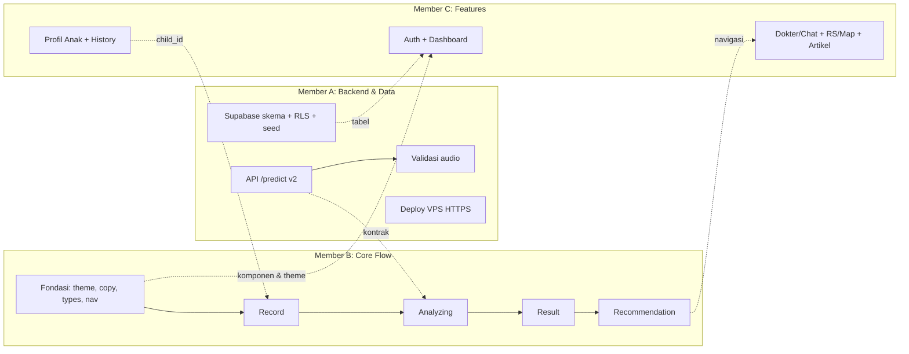

# PNEUMOTrack — Pembagian Tugas Tim (task.md)

> Sumber: [`PRD.md`](./PRD.md), [`AGENTS.md`](./AGENTS.md), kode di `server_side/`, template di `src/`, dan desain di `UI_reference/`.
> Kalau dokumen ini bertentangan dengan PRD, **PRD yang berlaku**. Kalau PRD tidak membahas sesuatu, tanyakan ke tim/PO, jangan menebak.

---

## 0. Ringkasan Kondisi Repo Saat Ini

| Area | Kondisi sekarang | Gap terhadap PRD |
|---|---|---|
| Mobile (`src/`) | Masih template `create-expo-app` (Expo SDK **58**, Expo Router, NativeTabs `index`/`explore`, NativeWind 4 sudah terpasang) | Semua layar PNEUMOTrack belum ada. Belum ada modul audio, location, map, Supabase |
| Theme (`src/constants/theme.ts`) | Warna hitam/putih bawaan template | Belum ada palet teal/biru dan merah/pink untuk risiko. Belum ada file copy UI berbahasa Indonesia |
| Backend (`server_side/`) | FastAPI `POST /predict` → AE + OC-SVM + voting sudah jalan | Endpoint/response **beda** dengan kontrak PRD §12. Audio jelek belum ditolak. Error tetap HTTP 200. Belum ada CORS, `/health`, batas ukuran file, atau konversi format (m4a dari HP) |
| Supabase | Belum ada | Skema, RLS, Auth, dan seed data belum ada |
| Config | `app.json` masih bernama `PNM-TRACK` dengan splash biru template. `.gitignore` hanya mengabaikan `.env*.local` | Izin mic dan lokasi, plugin, nama app, splash, `.env.example` |

### ⚠️ Temuan Kritis (harus diputuskan di Hari 0)

1. **Makna label terbalik antara PRD dan kode.** Model dilatih **hanya pada batuk pneumonia** (one-class). Di `predictor.py`, *inlier* (`ae_error <= threshold`, `svm_pred == 1`) diberi label `"Pneumonia"`, sedangkan *outlier* diberi `"Bukan Pneumonia"`. PRD §6/§12 malah menulis "anomaly → risk". **Usulan:** ikuti kode. Mapping-nya: `Pneumonia` → `risk`, `Bukan Pneumonia` → `normal`. Konfirmasi dulu ke pemilik model, lalu perbarui PRD §12.
2. **Kontrak API berbeda.** PRD: `POST /screen` + `child_id`, field `label/autoencoder_mse/...`. Kode: `POST /predict`, field `status/prediction/confidence/chunks/svm/autoencoder`. Kontrak final perlu disepakati (lihat §3) **sebelum** Member B mulai menulis API client.
3. **Hasil voting seri (1–1) jatuh ke `Pneumonia`** dengan `confidence = 0.5`. Ini sudah konservatif, tapi UI harus menampilkannya sebagai "perlu perhatian", bukan "yakin 50%".
4. **`confidence` hanya proporsi vote (0.5 / 1.0)**, bukan probabilitas klinis. Jangan tampilkan sebagai persentase akurasi. Begitu juga angka 96,3% (PRD §11).
5. **Audio tanpa batuk tidak pernah ditolak.** Kalau segmentasi gagal, `segment_cough_chunks` memakai seluruh sinyal, jadi rekaman hening/bising tetap menghasilkan prediksi. Ini melanggar PRD §13 dan wajib diperbaiki.
6. **Format rekaman.** Perekam Android (expo-audio/MediaRecorder) menghasilkan **m4a/AAC**, bukan WAV. Backend harus bisa decode (ffmpeg) atau mengonversi dulu.
7. **Desain menampilkan vital** (napas/menit, suhu, detak jantung) dan AI Summary yang menyebut suhu/heart rate. **Data ini tidak bisa diukur dari batuk.** Usulan: hilangkan, atau jadikan input manual opsional yang diberi label "diisi orang tua". Jangan pernah memalsukan angka.
8. **Penyimpanan hasil screening.** Pilihan: (a) app menyimpan ke tabel `screenings` lewat Supabase dengan RLS (lebih sederhana, **usulan**), atau (b) backend menyimpan memakai service key. Putuskan di Hari 0.

---

## 1. Pembagian Peran

| Member | Peran | Fokus utama | Folder yang dimiliki (owner) |
|---|---|---|---|
| **Member A** — *Backend, AI & Data* | FastAPI, model, Supabase (skema, RLS, Auth, seed), deploy VPS | Kontrak API final, validasi audio, Supabase siap dipakai | `server_side/**`, `supabase/**` (baru), `docs/api.md` (baru) |
| **Member B** — *Mobile Core Screening Flow* | Fondasi app, lalu alur inti **record → analyze → result → recommendation** | MVP end-to-end paling prioritas | `src/app/_layout.tsx`, `src/app/screening/**`, `src/app/recommendation.tsx`, `src/constants/**`, `src/components/ui/**`, `src/hooks/use-recorder.ts`, `src/hooks/use-screening.ts`, `src/services/api/**`, `src/types/**`, `app.json` |
| **Member C** — *Mobile Features & Data Screens* | Auth UI, Dashboard, Profil Anak, Riwayat/Monitoring, Dokter & Chat, Rumah Sakit & Peta, Artikel | Semua layar pendukung + service layer Supabase/mock | `src/app/(auth)/**`, `src/app/(tabs)/**`, `src/app/children/**`, `src/app/history/**`, `src/app/doctors/**`, `src/app/chats/**`, `src/app/hospitals/**`, `src/app/articles/**`, `src/services/{supabase,children,screenings,doctors,hospitals,articles,chat}/**`, `src/hooks/use-*.ts` milik fitur tersebut |

**File bersama** (`src/constants/theme.ts`, `src/constants/copy.ts`, `src/types/**`, `package.json`, `app.json`): **owner Member B**. Member lain boleh menambah, asalkan lewat PR kecil terpisah dan memberi tahu di grup supaya tidak konflik.



---

## 2. Konvensi Kerja Tim

- **Branch:** `feat/<member>-<fitur>`, contoh `feat/b-recording`, `feat/a-audio-validation`. PR ke `main`, minimal 1 reviewer dari member lain.
- **Commit:** Conventional Commits (`feat:`, `fix:`, `chore:`, `docs:`).
- **Sebelum PR (wajib):** `bunx expo lint` dan `bunx tsc --noEmit` lolos tanpa error. Untuk backend, jalankan smoke test `pytest` atau `curl`.
- **Install paket:** selalu `bunx expo install <pkg>` (repo memakai **bun**, ada `bun.lock`). Jangan `npm i`/`bun add` untuk paket Expo/RN.
- **Jangan percaya ingatan untuk API Expo.** Cek dokumentasi versi SDK 58: https://docs.expo.dev/versions/v58.0.0/ dan https://docs.expo.dev/llms.txt
- **Native module baru** (audio, location, maps) **tidak bisa dipakai di Expo Go** kalau tidak dibundel. Gunakan development build (`bunx expo run:android` atau `bunx eas-cli build --profile development`). Jangan edit `android/`/`ios/` manual; atur lewat `app.json` atau config plugin.
- **Env:** hanya `EXPO_PUBLIC_*` di app (`EXPO_PUBLIC_API_URL`, `EXPO_PUBLIC_SUPABASE_URL`, `EXPO_PUBLIC_SUPABASE_ANON_KEY`). Simpan di `.env.local` (sudah di-ignore) dan commit `.env.example` tanpa nilai. Service-role key Supabase **hanya** di server/VPS.
- **Privasi:** dilarang `console.log` audio, URI rekaman, nama anak, atau respons berisi data anak. Backend dilarang me-log nama file asli atau isi audio.
- **Copy UI:** semua teks di `src/constants/copy.ts`, bahasa Indonesia, tanpa kata diagnosis pasti.
- **Prioritas:** `P0` = MVP wajib demo, `P1` = penting, `P2` = stretch (chat, map, artikel; PRD §16).

---

## 3. Kontrak Bersama (disepakati Hari 0, ditulis Member A di `docs/api.md`)

### 3.1 Usulan kontrak `POST /predict` (v2)

Request `multipart/form-data`:
- `audio`: file (`audio/m4a`, `audio/mp4`, `audio/aac`, `audio/wav`), maks. **10 MB**
- `child_id`: string (opsional, hanya diteruskan; tidak di-log)

Response **200** (sukses):
```json
{
  "status": "success",
  "result": "risk | normal",
  "raw_label": "Pneumonia | Bukan Pneumonia",
  "agreement": true,
  "votes": { "autoencoder": "risk | normal", "ocsvm": "risk | normal" },
  "autoencoder": { "error": 0.0012, "threshold": 0.0031 },
  "ocsvm": { "score": 12.3 },
  "chunks": 4,
  "duration_sec": 6.2,
  "waveform": [0.01, 0.2, "... ±100 nilai envelope 0..1 untuk digambar di UI"],
  "summary": "Teks ringkasan berbahasa Indonesia, non-diagnostik",
  "model_version": "v3"
}
```

Response **422** (audio tidak layak, app minta rekam ulang):
```json
{ "status": "error", "code": "AUDIO_TOO_SHORT | AUDIO_SILENT | NO_COUGH_DETECTED | AUDIO_TOO_NOISY | UNSUPPORTED_FORMAT | FILE_TOO_LARGE", "message": "..." }
```
Response **500**: `{ "status": "error", "code": "INTERNAL_ERROR" }`

`GET /health` → `{ "status": "ok", "model_version": "v3" }`

### 3.2 Tipe TypeScript (Member B, `src/types/screening.ts`)

```ts
export type ScreeningResult = 'risk' | 'normal';
export type AudioErrorCode =
  | 'AUDIO_TOO_SHORT' | 'AUDIO_SILENT' | 'NO_COUGH_DETECTED'
  | 'AUDIO_TOO_NOISY' | 'UNSUPPORTED_FORMAT' | 'FILE_TOO_LARGE';
export interface PredictResponse { /* sesuai 3.1 */ }
export type ScreeningError =
  | { kind: 'audio'; code: AudioErrorCode }
  | { kind: 'network' } | { kind: 'timeout' } | { kind: 'server' };
```

### 3.3 Skema Supabase (Member A, `supabase/migrations/*.sql`)

| Tabel | Kolom utama | RLS |
|---|---|---|
| `profiles` | `id (=auth.uid)`, `full_name`, `created_at` | baca/ubah hanya milik sendiri |
| `children` | `id`, `parent_id → profiles`, `name`, `birth_date`, `sex ('L'/'P')`, `avatar_url?` | CRUD hanya `parent_id = auth.uid()` |
| `screenings` | `id`, `child_id → children`, `result`, `agreement`, `ae_error`, `ae_threshold`, `ocsvm_score`, `chunks`, `duration_sec`, `waveform jsonb`, `summary`, `model_version`, `created_at` | lewat join `children.parent_id = auth.uid()` |
| `doctors` | `id`, `name`, `specialty`, `hospital_id?`, `photo_url`, `phone`, `whatsapp`, `bio`, `rating`, `schedule jsonb` | read-only untuk user login |
| `hospitals` | `id`, `name`, `address`, `lat`, `lng`, `phone`, `type (RS/Puskesmas/Klinik)`, `has_pediatric` | read-only |
| `articles` | `id`, `title`, `category (gejala/pencegahan/penanganan/edukasi)`, `cover_url`, `body_md`, `source`, `published_at` | read-only |
| `conversations` *(P2)* | `id`, `parent_id`, `doctor_id`, `last_message_at` | hanya peserta |
| `messages` *(P2)* | `id`, `conversation_id`, `sender ('parent'/'doctor')`, `body`, `created_at` | hanya peserta, realtime aktif |

> **Audio tidak disimpan** di Supabase Storage untuk MVP (minimasi data, PRD §13). Kalau nanti dibutuhkan, harus dengan persetujuan eksplisit.

### 3.4 Struktur Route Expo Router (disepakati, dibuat Member B sebagai skeleton)

```
src/app/
  _layout.tsx                 # Root Stack + providers (B)
  index.tsx                   # Splash/redirect → auth atau tabs (B)
  (auth)/sign-in.tsx          # (C)
  (auth)/sign-up.tsx          # (C)
  (tabs)/_layout.tsx          # NativeTabs: Beranda, Monitoring, Anak, Lainnya (B buat shell, C isi)
  (tabs)/index.tsx            # Dashboard (C)
  (tabs)/monitoring.tsx       # Monitoring (C)
  (tabs)/children.tsx         # Daftar/profil anak (C)
  (tabs)/more.tsx             # Artikel, riwayat rekaman, pengaturan, tentang & disclaimer (C)
  children/new.tsx            # Tambah anak (C)
  screening/guide.tsx         # Panduan + cek bising (B)
  screening/record.tsx        # Rekam (B)
  screening/analyzing.tsx     # Loading analisis (B)
  screening/result.tsx        # Hasil normal/risiko (B)
  recommendation.tsx          # Recommended Action (B)
  history/index.tsx           # Riwayat + grafik (C)
  history/[id].tsx            # Detail satu screening, reuse komponen result (C)
  doctors/index.tsx, doctors/[id].tsx    # (C)
  chats/index.tsx, chats/[id].tsx        # (C, P2)
  hospitals/index.tsx, hospitals/map.tsx # (C; map P2)
  articles/index.tsx, articles/[id].tsx  # (C, P2)
```

---

## 4. Fase & Timeline

| Fase | Tujuan | Exit criteria |
|---|---|---|
| **Fase 0 — Kickoff & Kontrak** (½ hari) | Putuskan temuan kritis §0, sepakati §3 | `docs/api.md`, `src/types/*`, skeleton route ter-merge |
| **Fase 1 — Fondasi** (1 hari) | Theme, copy, komponen dasar, Supabase project, backend v2 lokal | App bisa jalan di dev build dengan tab kosong ber-theme. Backend v2 bisa di-`curl` |
| **Fase 2 — MVP End-to-End** (1,5–2 hari) | Record → analyze → result → recommendation → list dokter/RS, history & dashboard | Demo end-to-end di HP Android asli ke backend (LAN/VPS) |
| **Fase 3 — Stretch** (1 hari) | Chat, peta, artikel, monitoring | Fitur P2 jalan atau disembunyikan dengan rapi |
| **Fase 4 — Hardening & Demo** (½–1 hari) | QA checklist §8, build APK preview, video/slide demo | APK `preview` terinstal, skenario demo lulus |

**Checkpoint integrasi (wajib sinkron bertiga):**
- **CP1 (akhir Fase 0):** kontrak API dan tipe disetujui.
- **CP2 (tengah Fase 2):** app Member B memanggil backend Member A dengan audio asli dari HP.
- **CP3 (akhir Fase 2):** hasil screening tersimpan dan tampil di History & Dashboard milik Member C.
- **CP4 (Fase 4):** full regression dengan checklist §8.

---

## 5. MEMBER A — Backend, AI & Data

### A-0 · Kickoff (P0, Fase 0)
- [ ] Konfirmasi ke pemilik model: makna label `Pneumonia`/`Bukan Pneumonia`, nilai `ae_threshold` di `config_v3.pkl`, `sample_rate`.
- [ ] Tulis `docs/api.md` berisi kontrak final §3.1, termasuk contoh request/response dan semua kode error.
- [ ] Usulkan update PRD §12 (endpoint, field, makna label) lalu minta persetujuan tim.

### A-1 · Refactor endpoint `/predict` v2 (P0, Fase 1)
File: `server_side/app.py`, `server_side/predictor.py`, `server_side/model.py`
- [ ] Ubah response mengikuti §3.1. Mapping `Pneumonia → "risk"`, `Bukan Pneumonia → "normal"`. Isi `agreement = (svm_label == ae_label)`.
- [ ] Kembalikan **HTTP 422/500** untuk error (sekarang `status:error` tetap dikirim dengan HTTP 200 dan `prediction: null`).
- [ ] Terima field `child_id` (opsional) tanpa me-log nilainya.
- [ ] Simpan file sementara dengan ekstensi asli (bukan selalu `.wav`) dan tetap hapus di `finally` (sudah ada, pertahankan).
- [ ] Batasi ukuran upload (≤ 10 MB) dan cek MIME/ekstensi, lalu balas `FILE_TOO_LARGE`/`UNSUPPORTED_FORMAT`.
- [ ] Tambah `GET /health`.
- [ ] Tambah `CORSMiddleware` (untuk testing web/Expo dev). Origin dikonfigurasi lewat env.
- [ ] Jalankan inferensi berat di threadpool (`run_in_threadpool`) supaya event loop tidak terblokir. Lakukan model warm-up sekali saat startup.
- [ ] Ganti `print()` di `model.py` dengan `logger`.
- **Acceptance:** `curl -F audio=@sample.m4a http://localhost:8000/predict` → 200 dengan JSON sesuai kontrak. File kosong → 422.

### A-2 · Dukungan format audio dari HP (P0, Fase 1)
- [ ] Pastikan decode **m4a/AAC** berhasil. Pilih salah satu: install `ffmpeg` di server dan konversi ke WAV mono 22.050 Hz (via `ffmpeg`/`pydub`) sebelum `librosa.load`, atau pastikan backend `audioread` bisa membaca m4a.
- [ ] Tambah `ffmpeg` ke instruksi deploy dan `pydub` (kalau dipakai) ke `requirements.txt`. Pin versi semua paket (`tensorflow`, `numpy`, `scikit-learn` harus cocok dengan versi saat `.pkl` dibuat, kalau tidak muncul warning/inkompatibilitas pickle).
- **Acceptance:** rekaman asli dari Android (dari Member B, CP2) berhasil diprediksi.

### A-3 · Quality gate audio buruk (P0, Fase 1–2) — *PRD §13*
Tambahkan fungsi `validate_audio()` sebelum prediksi:
- [ ] `AUDIO_TOO_SHORT`: durasi < **2 dtk** (angka final disepakati dengan B, samakan dengan minimal durasi rekam di app).
- [ ] `AUDIO_SILENT`: RMS maksimum < ambang (mis. 1e-3) **sebelum** normalisasi.
- [ ] `NO_COUGH_DETECTED`: segmentasi adaptif + fallback tetap 0 chunk. **Hapus perilaku "pakai seluruh sinyal"** di `segment_cough_chunks` untuk jalur inferensi (atau beri flag `allow_full_signal_fallback=False`).
- [ ] `AUDIO_TOO_NOISY`: estimasi SNR sederhana (energi segmen batuk vs. noise floor persentil-10) di bawah ambang, atau rasio frame aktif terlalu tinggi (> 80%, artinya bising terus-menerus).
- [ ] Kalibrasi ambang dengan ±10 rekaman uji: hening, ngobrol, TV/kipas, batuk dewasa, dan sampel dataset. Catat hasilnya di `docs/api.md`.
- **Acceptance:** rekaman hening, bicara tanpa batuk, dan kipas angin → 422 dengan kode yang tepat. Sampel dataset tetap → 200.

### A-4 · Waveform & summary (P0/P1, Fase 2)
- [ ] `waveform`: envelope RMS dari audio terproses, di-downsample ke ±100 titik dan dinormalisasi 0..1 (untuk kartu waveform di layar result).
- [ ] `summary` (template berbahasa Indonesia, **non-diagnostik**, tanpa vital palsu). Contoh:
  - risk: "Pola batuk menunjukkan **indikasi risiko pneumonia**. Kedua model sepakat. Disarankan berkonsultasi dengan tenaga kesehatan."
  - normal: "Tidak ditemukan pola batuk yang mengarah ke pneumonia. Tetap pantau gejala anak."
  - seri (`agreement=false`): "Hasil kedua model berbeda, sehingga dianggap **perlu perhatian**. Ulangi perekaman atau konsultasikan ke tenaga kesehatan."
- [ ] Field ringkas yang membantu UI: jumlah segmen batuk (`chunks`) dan `duration_sec`.
- **Acceptance:** tidak ada frasa "anak Anda menderita/terkena pneumonia" atau angka akurasi di `summary`.

### A-5 · Privasi & logging backend (P0, Fase 2)
- [ ] Hapus log `audio.filename` dan path file. Log cukup berisi request-id, durasi proses, status, kode error.
- [ ] `log_prediction` tidak boleh mencatat data yang bisa mengidentifikasi anak. Skor model boleh dicatat di level DEBUG saja.
- [ ] Pastikan folder `temp/` di-`.gitignore` dan dibersihkan saat startup.

### A-6 · Test backend (P1, Fase 2)
- [ ] `server_side/tests/test_api.py` (pytest + `TestClient`): sukses, file kosong, format salah, terlalu besar, hening. Siapkan fixture audio kecil (bukan data pasien asli).
- [ ] Skrip `server_side/scripts/smoke.sh`/`.ps1` berisi `curl` ke `/health` dan `/predict`.

### A-7 · Supabase (P0, Fase 1)
- [ ] Buat project Supabase (region Singapura). Bagikan URL & anon key lewat kanal privat tim, **jangan di repo**.
- [ ] Tulis migrasi SQL `supabase/migrations/0001_init.sql` sesuai §3.3 (tabel, FK, index `screenings(child_id, created_at desc)`).
- [ ] Aktifkan **RLS di semua tabel** dan tulis policy. Uji dengan 2 akun berbeda bahwa data anak tidak saling terlihat.
- [ ] Trigger buat baris `profiles` saat user baru sign-up.
- [ ] Auth: email + password (MVP). Matikan konfirmasi email untuk demo, atau siapkan akun demo.
- [ ] Seed `supabase/seed.sql`: ≥ 6 dokter anak/paru (data fiktif, foto dari `UI_reference/image_doctor.png` atau placeholder), ≥ 10 RS/puskesmas di sekitar lokasi demo (mis. Denpasar) dengan `lat/lng` asli, ≥ 6 artikel (gejala, pencegahan, penanganan, tanda bahaya), dengan sumber jelas (WHO/Kemenkes/IDAI).
- [ ] *(P2)* Aktifkan Realtime untuk tabel `messages`.
- **Acceptance:** Member C bisa query `doctors/hospitals/articles` dengan anon key + user login. Insert `screenings` untuk anak milik orang lain ditolak.

### A-8 · Deploy VPS Biznet Gio (P1, Fase 3)
- [ ] `server_side/Dockerfile` (python-slim + ffmpeg) **atau** systemd + venv. Jalankan `uvicorn app:app --host 0.0.0.0 --port 8000 --workers 1` (model TF berat, cukup 1 worker).
- [ ] Nginx reverse proxy + **HTTPS** (Let's Encrypt). Android release memblokir HTTP cleartext secara default. Set `client_max_body_size 10m` dan timeout ≥ 60 dtk.
- [ ] Bagikan `EXPO_PUBLIC_API_URL` final ke B/C.
- [ ] Cek memori VPS cukup untuk TensorFlow (≥ 2 GB RAM). Pertimbangkan `tensorflow-cpu`.
- **Acceptance:** `GET https://<domain>/health` → ok dari HP lewat jaringan seluler.

### A-9 · Dokumentasi (P1, Fase 4)
- [ ] `server_side/README.md`: setup lokal, env, cara menjalankan, deploy, dan batasan model (dataset hanya pneumonia, angka 96,3% = konsistensi, **bukan** akurasi klinis).
- [ ] Update PRD §12 dengan kontrak final.

---

## 6. MEMBER B — Mobile Core Screening Flow

### B-0 · Fondasi proyek (P0, Fase 0–1) — *harus selesai duluan, yang lain bergantung*
- [ ] Bersihkan template: hapus `explore.tsx`, `animated-icon*`, `web-badge`, `hint-row`, aset Expo/React yang tidak terpakai (**jangan** pakai `reset-project` kalau sudah ada kode tim).
- [ ] `app.json`: `name: "PNEUMOTrack"`, splash teal + logo dari `UI_reference/logo.png`, adaptive icon, `orientation: portrait`.
- [ ] Buat skeleton semua route §3.4 (placeholder satu baris per layar) supaya C bisa langsung mengisi tanpa konflik.
- [ ] `(tabs)/_layout.tsx` dengan NativeTabs 4 tab (Beranda, Monitoring, Anak, Lainnya). Cek API `expo-router/native-tabs` di docs SDK 58.
- [ ] Root `_layout.tsx`: Stack, `SafeAreaProvider`, `GestureHandlerRootView`, provider sesi (hook dari C), `StatusBar`.
- [ ] `.env.example` (`EXPO_PUBLIC_API_URL`, `EXPO_PUBLIC_SUPABASE_URL`, `EXPO_PUBLIC_SUPABASE_ANON_KEY`), plus `src/constants/config.ts` yang membaca dan memvalidasi env.
- [ ] `tsconfig.json`: pastikan `strict: true` dan alias `@/*`.

### B-1 · Design system (P0, Fase 1)
- [ ] `src/constants/theme.ts`: palet **teal/biru** (primary, primaryDark `#1F4E79`-ish sesuai desain, surface biru muda `#D6E8F5`-ish), **risk** (merah/pink: `riskSurface`, `riskPrimary`, `riskText`), status success/warning, text, border. Tambah spacing, radius, typography (ukuran besar dan mudah dibaca), shadow. Sinkronkan ke `tailwind.config.js` (`theme.extend.colors`) supaya NativeWind memakai token yang sama.
- [ ] `src/constants/copy.ts`: semua teks UI berbahasa Indonesia, dikelompokkan per layar, plus teks **disclaimer** dan **tanda bahaya** (PRD §13): napas cepat/sesak, tarikan dinding dada, bibir kebiruan, tidak bisa minum, lalu "segera ke IGD".
- [ ] Komponen di `src/components/ui/`: `Button` (primary/secondary/danger, size lg ≥ 48dp), `Card` (variant `default`/`risk`), `ScreenHeader` (back + judul + menu ⋮), `Disclaimer`, `DangerSignsBox`, `ErrorState` (ikon, pesan, tombol coba lagi), `LoadingState`, `EmptyState`, `Avatar`, `Badge`, `StatusBanner` (kartu foto anak + status, varian normal/risk, dipakai di Result, Dashboard, History, Monitoring).
- [ ] Buat halaman `src/app/dev/components.tsx` (hanya `__DEV__`) untuk preview komponen, supaya C bisa melihat yang tersedia.
- **Acceptance:** C bisa membangun layar hanya dengan komponen & token ini tanpa hardcode warna.

### B-2 · Modul audio & izin mikrofon (P0, Fase 1)
- [ ] **Verifikasi di docs SDK 58** modul yang benar (kemungkinan besar `expo-audio`; `expo-av` sudah deprecated/dihapus, jangan asumsi). `bunx expo install expo-audio`.
- [ ] Config plugin di `app.json` dengan `microphonePermission` berbahasa Indonesia: "PNEUMOTrack membutuhkan mikrofon untuk merekam suara batuk anak sebagai bahan skrining."
- [ ] Buat dev build Android (`bunx expo run:android` atau EAS `development`). Bagikan APK dev ke A & C.
- [ ] `src/hooks/use-recorder.ts`: request izin (dengan rationale + handling "ditolak permanen" → tombol buka Pengaturan via `Linking.openSettings()`), start/pause/resume/stop, durasi (ms), metering (level dB untuk waveform live), URI hasil, reset. Preset kualitas: mono, 22.050/44.100 Hz, AAC.
- [ ] Batas durasi: minimal **3 dtk** (tombol stop nonaktif/peringatan sebelum itu), maksimal **30 dtk** (auto-stop).
- [ ] Bersihkan file rekaman lokal setelah upload berhasil atau saat dibatalkan (privasi).
- **Acceptance:** rekam 5 dtk di HP asli → dapat URI file m4a yang bisa diputar ulang.

### B-3 · Layar Panduan Rekam `screening/guide.tsx` (P0, Fase 2) — *ref: `Recording Guidance.png`*
- [ ] Pemilihan anak (kalau > 1 anak) atau tampilkan anak aktif. Kalau belum ada anak → arahkan ke `children/new` (milik C).
- [ ] Ilustrasi cara memegang HP (aset dari `UI_reference`), tips singkat: jarak 15–30 cm, ruangan tenang, rekam 2–3 batuk.
- [ ] **Cek kebisingan sekitar** 2–3 dtk memakai metering (bar "Oke ↔ Terlalu Bising"). Kalau terlalu bising, tampilkan peringatan tapi tetap boleh lanjut.
- [ ] Tombol "Mulai" → `screening/record`.

### B-4 · Layar Rekam `screening/record.tsx` (P0, Fase 2) — *ref: `cough recording_user.png`*
- [ ] Timer besar `00:00.0`, waveform live dari metering (bar animasi; Reanimated sudah terpasang, lihat skill `expo-animation`), tombol play (putar ulang), pause/resume, stop.
- [ ] Setelah stop: pratinjau dengan opsi "Rekam ulang" atau "Analisis".
- [ ] Handle: izin ditolak, app ke background saat merekam (stop & simpan), panggilan masuk.
- [ ] Haptic ringan saat start/stop (`expo-haptics`, opsional).

### B-5 · API client & hook screening (P0, Fase 2)
- [ ] `src/services/api/client.ts`: wrapper `fetch` dengan base URL dari env, timeout (`AbortController`, 60 dtk), dan mapping error → `ScreeningError` (§3.2): network (offline), timeout, 422 → audio code, 5xx → server.
- [ ] `src/services/api/screening.ts`: `predict(uri, childId)` → upload `FormData` (`{ uri, name: 'cough.m4a', type: 'audio/m4a' }`). Parse dan validasi respons (type guard; zod boleh kalau tim setuju).
- [ ] `src/services/api/screening.mock.ts` + flag `EXPO_PUBLIC_USE_MOCK_API=true` agar UI bisa dikembangkan sebelum backend siap (respons normal, risk, tiap kode error).
- [ ] `src/hooks/use-screening.ts`: state machine `idle → uploading → analyzing → success | error`, retry, cancel. Setelah sukses, panggil `screeningsService.save()` (dari C) untuk menyimpan ke Supabase. Kalau simpan gagal, hasil tetap ditampilkan dengan toast "Hasil belum tersimpan".
- [ ] Hasil terakhir disimpan di state ringan (context/store) supaya `result.tsx` & `recommendation.tsx` bisa membacanya tanpa melempar objek besar lewat params.
- [ ] Cek konektivitas sebelum upload (`@react-native-community/netinfo` via `expo install` atau tangkap error fetch).

### B-6 · Layar Analyzing `screening/analyzing.tsx` (P0, Fase 2) — *ref: `analysis loading page_user.png`, `image_loading.png`*
- [ ] Animasi loading + teks "Menganalisis suara batuk…" + langkah (Membersihkan suara → Mendeteksi batuk → Menganalisis pola).
- [ ] Tombol batal. Cegah back gesture tidak sengaja (konfirmasi).
- [ ] Error **audio** → layar "Rekaman belum bisa dianalisis" dengan alasan per kode (terlalu pendek / hening / tidak ada batuk / terlalu bising) + tombol **Rekam ulang**. **Jangan tampilkan hasil.**
- [ ] Error **network/timeout/server** → `ErrorState` dengan "Coba lagi" (kirim ulang file yang sama) & "Rekam ulang".

### B-7 · Layar Hasil `screening/result.tsx` (P0, Fase 2) — *ref: `cough results_user.png`, `pneumonia result_user.png`*
- [ ] **Varian normal (biru):** `StatusBanner` "Tidak ditemukan tanda pola batuk pneumonia", kartu waveform (dari `waveform`) + label "Pola batuk normal", kartu **Ringkasan AI** (dari `summary`), tombol "Kembali ke Beranda" & "Lihat Riwayat".
- [ ] **Varian risiko (merah/pink):** "**Indikasi risiko pneumonia, perlu perhatian**", waveform "Pola batuk tidak biasa terdeteksi", ringkasan AI, CTA utama **"Lihat Rekomendasi Tindakan"** → `recommendation`, plus kartu cepat Konsultasi Dokter & Faskes Terdekat.
- [ ] `agreement=false` → badge "Hasil model berbeda, ulangi perekaman untuk konfirmasi" + tombol rekam ulang.
- [ ] **Wajib:** `Disclaimer` + `DangerSignsBox` di bawah.
- [ ] Detail teknis (skor AE/SVM) **disembunyikan** di collapsible "Detail teknis". Jangan pernah menampilkan persen akurasi.
- [ ] Buat `ResultView` sebagai komponen murni di `src/components/screening/` supaya C bisa memakainya ulang di `history/[id].tsx`.

### B-8 · Layar Rekomendasi `recommendation.tsx` (P0, Fase 2) — *ref: `recommendations page_user.png`*
- [ ] Banner status risiko + tombol kecil "Lihat Detail" (kembali ke hasil).
- [ ] Kartu **"Konsultasi dengan dokter"** (foto `image_doctor.png`) → `doctors/` (C).
- [ ] Kartu **"Kunjungi fasilitas kesehatan terdekat"** → `hospitals/` (C).
- [ ] `DangerSignsBox` menonjol: "Jika ada tanda bahaya, segera ke IGD", tombol telepon **119** (`Linking.openURL('tel:119')`).
- [ ] `Disclaimer` wajib.

### B-9 · Integrasi & build (P0/P1, Fase 2–4)
- [ ] **CP2:** uji dengan backend lokal A (pakai IP LAN, bukan `localhost`; emulator Android memakai `10.0.2.2`).
- [ ] `eas.json` profile `development`, `preview` (APK internal), `production`. Lihat skill `eas-app-stores`/`expo-dev-client`.
- [ ] Build APK `preview` untuk demo (Fase 4).
- [ ] `bunx expo-doctor` bersih.

---

## 7. MEMBER C — Mobile Features & Data Screens

### C-0 · Service layer & Supabase client (P0, Fase 1)
- [ ] `bunx expo install @supabase/supabase-js @react-native-async-storage/async-storage react-native-url-polyfill` (cek panduan Supabase + Expo terbaru, juga contoh `with-supabase` di skill `expo-examples`).
- [ ] `src/services/supabase/client.ts`: client dengan session persisted di AsyncStorage dan auto-refresh saat app foreground.
- [ ] Untuk setiap domain, buat **interface + 2 implementasi (mock & supabase)** dengan satu titik switch (`EXPO_PUBLIC_USE_MOCK_DATA`):
  - `src/services/children/` → `list()`, `get(id)`, `create(input)`, `update()`, `remove()`
  - `src/services/screenings/` → `save(result, childId)`, `listByChild(childId, range)`, `get(id)`, `latest(childId)`
  - `src/services/doctors/` → `list(filter?)`, `get(id)`
  - `src/services/hospitals/` → `list()`, `nearest(lat, lng, limit)` (hitung haversine di client untuk MVP)
  - `src/services/articles/` → `list(category?)`, `get(id)`
  - `src/services/chat/` *(P2)* → `listConversations()`, `getMessages(id)`, `send()`, `subscribe(id)`
- [ ] Data mock di `src/services/**/mock-data.ts` (konsisten dengan seed A).
- [ ] Tipe domain di `src/types/` (`Child`, `Screening`, `Doctor`, `Hospital`, `Article`, `Message`). Koordinasikan dengan B (file bersama).
- [ ] *(Opsional, disarankan)* `@tanstack/react-query` untuk caching/loading/error state, sepakati dengan B. Lihat skill `expo-data-fetching`.
- **Acceptance:** semua layar C bisa jalan dengan mock **dan** dengan Supabase hanya dengan mengganti flag.

### C-1 · Auth (P1, Fase 2) — *F13*
- [ ] `src/hooks/use-session.ts` + `SessionProvider` (dipasang B di root layout).
- [ ] `(auth)/sign-in.tsx`, `(auth)/sign-up.tsx`: email, password, nama orang tua, validasi form, pesan error berbahasa Indonesia, loading state.
- [ ] Redirect: belum login → `(auth)`, sudah login → `(tabs)`. Pakai `Stack.Protected` / redirect sesuai docs Expo Router SDK 58.
- [ ] Logout di tab "Lainnya". Saat logout, bersihkan cache data anak.
- [ ] Mode demo: tombol "Masuk sebagai Demo" (akun demo) **hanya** kalau `__DEV__` atau flag demo aktif.

### C-2 · Profil Anak (P0, Fase 2) — *F1*
- [ ] `children/new.tsx`: nama, tanggal lahir (umur dihitung otomatis dan ditampilkan dalam bulan/tahun), jenis kelamin. Validasi (nama wajib, umur 0–12 thn, highlight balita).
- [ ] `(tabs)/children.tsx`: daftar anak, pilih **anak aktif** (disimpan di context + AsyncStorage), edit/hapus dengan konfirmasi.
- [ ] `src/hooks/use-active-child.ts` (dipakai B di `screening/guide` untuk `child_id`).
- [ ] Empty state: "Tambahkan profil anak untuk mulai skrining".
- [ ] Minimal data: hanya nama, tgl lahir, jenis kelamin (PRD §13). Jangan log.

### C-3 · Dashboard `(tabs)/index.tsx` (P0, Fase 2) — *F11, ref: `dashboard_user.png`, `information_user.png`, `pneumonia dashboard_user.png`*
- [ ] Sapaan "Hai, {nama}" + "Berikut status anak Anda".
- [ ] `StatusBanner` anak aktif dari **screening terakhir**: normal (biru) / risiko (pink) / belum pernah skrining (netral + CTA).
- [ ] Kartu status dengan indikator **berbentuk hati** (komponen `HeartIndicator`, warna teal/hijau untuk normal, pink/merah untuk risiko; bisa SVG via `react-native-svg` lewat `expo install`), tanggal skrining terakhir, tren singkat (jumlah skrining 7 hari).
- [ ] **Vital (napas/suhu/detak):** ikuti keputusan Hari 0 (§0 poin 7). Default: **tidak ditampilkan**, ganti dengan "Skrining terakhir", "Jumlah batuk terdeteksi (chunks)", "Status kesepakatan model".
- [ ] Tombol besar **"Rekam Batuk"** → `screening/guide`. Tombol "Lihat Detail" → `history/[id]` terakhir.
- [ ] Kartu "Rekomendasi Tindakan" muncul kalau status terakhir risiko.
- [ ] Preview **Artikel & Berita** (2–3 item) → `articles/`.
- [ ] Loading skeleton, error + retry, pull-to-refresh, offline banner.

### C-4 · Riwayat `history/index.tsx` & `history/[id].tsx` (P0, Fase 2) — *F10, ref: `cough history_user.png`, `Recording List.png`*
- [ ] Banner status terbaru + filter rentang (7 hari / 30 hari / semua).
- [ ] Grafik tren: jumlah skrining per hari (bar) & hasil normal vs risiko (line/step). Pilih library grafik yang kompatibel SDK 58 (mis. `victory-native` + Skia, atau `react-native-gifted-charts` + svg). Cek kompatibilitas sebelum install, atau buat bar chart sederhana dengan View kalau waktunya mepet.
- [ ] Ringkasan AI riwayat (template di client: "Dalam 7 hari terakhir: X skrining, Y menunjukkan indikasi risiko…"). Non-diagnostik.
- [ ] Daftar item (tanggal, jam, status badge, durasi) → `history/[id]` yang memakai `ResultView` dari B (+ disclaimer).
- [ ] Empty state & error state.
- [ ] *(Catatan)* Desain "All Recordings" punya tombol play. Karena audio **tidak disimpan** (§3.3), tampilkan sebagai daftar skrining tanpa tombol play, kecuali tim memutuskan lain.

### C-5 · Monitoring `(tabs)/monitoring.tsx` (P1, Fase 3) — *F9, ref: `cough analysis_user.png`*
- [ ] Interpretasi MVP: ringkasan status anak + waveform skrining terakhir + tombol "Mulai Monitoring" yang menjalankan alur rekam B (reuse `use-recorder`/route `screening/guide`).
- [ ] Badge "Live Monitoring" hanya saat merekam. **Jangan** buat rekaman background terus-menerus (privasi & baterai) tanpa keputusan tim.

### C-6 · Dokter `doctors/index.tsx`, `doctors/[id].tsx` (P0, Fase 2) — *F7, ref: `doctor page_user.png`, `doctor profile_user.png`*
- [ ] List: foto, nama, spesialisasi (Sp.A / Sp.P), RS, rating, tombol "Hubungi". Search/filter spesialisasi.
- [ ] Detail: profil, jadwal, alamat praktik, tombol **Telepon** (`tel:`), **WhatsApp** (`https://wa.me/…`), **Chat** (→ `chats/[id]`, P2; sembunyikan kalau chat belum siap).
- [ ] Loading/empty/error/offline.

### C-7 · Chat `chats/index.tsx`, `chats/[id].tsx` (P2, Fase 3) — *ref: `chat list_user.png`, `chat room_user.png`*
- [ ] List percakapan (avatar, nama dokter, pesan terakhir, waktu).
- [ ] Room: bubble chat, input + kirim, `KeyboardAvoidingView`, auto-scroll, optimistic send, status gagal + kirim ulang.
- [ ] Realtime via Supabase channel. Kalau tidak sempat, buat **mock** dengan balasan otomatis dan beri label "Demo".
- [ ] Banner: "Chat ini bukan layanan darurat. Untuk kondisi darurat hubungi 119."

### C-8 · Rumah Sakit `hospitals/index.tsx` (P0) & `hospitals/map.tsx` (P2) — *F8, ref: `hospital list_user.png`, `hospital map_user.png`*
- [ ] `bunx expo install expo-location`. Plugin di `app.json` dengan rationale: "Lokasi dipakai untuk menampilkan fasilitas kesehatan terdekat." Koordinasikan edit `app.json` dengan B.
- [ ] `src/hooks/use-location.ts`: izin foreground saja, handle ditolak (fallback: urut berdasarkan kota default atau input manual), timeout.
- [ ] List: nama, tipe, jarak (km), alamat, tombol **Arahkan** (buka Google Maps via URL `geo:`/`https://www.google.com/maps/dir/?api=1&destination=lat,lng`) & **Telepon**.
- [ ] Map (P2): **cek docs SDK 58** untuk pilihan `expo-maps` vs `react-native-maps`. Keduanya butuh Google Maps API key Android lewat config `app.json`. Key dibatasi ke package name/SHA-1, diinject lewat env/EAS secret, **jangan commit**. Marker RS, lingkaran radius dari lokasi user, bottom card "Lihat Detail".
- [ ] Fallback kalau map tidak siap: tombol "Buka di Google Maps" saja.

### C-9 · Artikel & Berita `articles/index.tsx`, `articles/[id].tsx` (P2, Fase 3) — *F12, ref: `article page_user.png`*
- [ ] List dengan tab kategori (Gejala, Pencegahan, Penanganan, Edukasi), cover, judul, tanggal.
- [ ] Detail: render markdown sederhana (atau teks berparagraf), sumber artikel + tautan (`expo-web-browser`, sudah terpasang).
- [ ] Konten harus mencantumkan sumber terpercaya dan tidak mengklaim diagnosis.

### C-10 · Tab Lainnya `(tabs)/more.tsx` (P1, Fase 3)
- [ ] Menu: Profil orang tua, Anak, Artikel, Riwayat, **Tentang & Disclaimer** (penjelasan bahwa ini alat skrining, cara kerja singkat, batasan model **tanpa** angka 96,3% sebagai akurasi), Kebijakan privasi singkat, Logout.

---

## 8. QA Checklist Bersama (Fase 4, semua member)

**Alur utama (P0)**
- [ ] Login → tambah anak → rekam 5 dtk batuk → analisis → hasil normal → riwayat bertambah → dashboard ter-update.
- [ ] Alur risiko → rekomendasi → list dokter → detail → telepon/WA; → list RS → arahkan.
- [ ] `agreement=false` tampil sebagai "perlu perhatian" + ajakan rekam ulang.

**Input buruk & jaringan (PRD §13)**
- [ ] Rekaman < 3 dtk diblokir di app. Rekaman hening, bicara tanpa batuk, dan bising → layar rekam ulang, **tanpa hasil**.
- [ ] Mode pesawat di setiap layar jaringan (analyzing, dashboard, history, dokter, RS, artikel, chat) → pesan offline + retry, tanpa crash/layar putih.
- [ ] Backend mati / timeout → pesan jelas + retry.
- [ ] Izin mic ditolak & ditolak permanen. Izin lokasi ditolak.

**Keamanan, privasi & wording**
- [ ] `grep -ri "console.log" src/` → tidak ada log data anak/audio.
- [ ] `grep -ri "96" src/` → tidak ada klaim akurasi.
- [ ] Tidak ada frasa diagnosis pasti ("menderita pneumonia", "positif pneumonia", "has pneumonia").
- [ ] Disclaimer + tanda bahaya muncul di **Result, Recommendation, History detail**.
- [ ] Tidak ada secret di repo (`git grep -i "service_role\|apikey\|sk-"`). `.env.local` tidak ter-commit.
- [ ] Uji RLS: akun B tidak bisa melihat anak/skrining akun A.

**Kualitas teknis**
- [ ] `bunx expo lint` ✔ · `bunx tsc --noEmit` ✔ · `bunx expo-doctor` ✔ · `pytest` backend ✔
- [ ] Uji di minimal 1 HP Android asli (mid/low-end) + emulator. Font besar (aksesibilitas) tidak merusak layout.
- [ ] Touch target ≥ 48dp, kontras teks cukup, label aksesibilitas pada tombol ikon.

---

## 9. Definition of Done (per task)

1. Sesuai acceptance criteria dan PRD (wording non-diagnostik, disclaimer jika relevan).
2. Loading, empty, error, dan offline state ditangani (untuk layar berbasis jaringan).
3. Tidak ada hardcode warna/teks (pakai `theme.ts`/`copy.ts`).
4. Lint dan typecheck lolos. Tidak ada `any` tanpa alasan.
5. Diuji di dev build Android. Screenshot dilampirkan di PR.
6. Di-review 1 member lain lalu di-merge ke `main`.

---

## 10. Matriks Dependensi

| Task | Bergantung pada | Bisa mulai dengan |
|---|---|---|
| B-5 API client | A-1 kontrak | `screening.mock.ts` |
| B-3 pilih anak | C-2 `use-active-child` | anak dummy hardcode sementara |
| B-5 simpan hasil | C-0 `screeningsService.save` | no-op/mock |
| C-* semua layar | B-0/B-1 theme & komponen | komponen RN dasar, refactor setelah B-1 merge |
| C-0 supabase impl | A-7 skema & seed | mock data |
| C-4 history detail | B-7 `ResultView` | tampilan sederhana |
| B-8 rekomendasi → dokter/RS | C-6, C-8 | route placeholder |
| C-8 map | A-7 seed RS (lat/lng), API key Maps | list + link Google Maps |
| CP2 integrasi | A-1, A-2, B-2, B-5 | — |

---

## 11. Pertanyaan Terbuka (jawab di Kickoff)

1. Mapping label: `Pneumonia` = risiko? (§0 poin 1) → **perlu konfirmasi pemilik model.**
2. Kontrak final endpoint (`/predict` v2 seperti §3.1, atau `/screen` sesuai PRD)?
3. Vital di dashboard/summary: dihapus, input manual, atau mock berlabel?
4. Siapa yang menyimpan hasil ke `screenings`: app (RLS) atau backend (service key)?
5. Auth wajib untuk demo, atau boleh mode tamu/demo?
6. Apakah audio boleh disimpan (fitur "All Recordings" dengan play)? Default: **tidak**.
7. Lokasi demo (kota) untuk seed RS & default peta?
8. Chat dengan dokter: realtime sungguhan (dokter = akun lain) atau mock demo?
9. Nama tampilan app: "PNEUMOTrack" (PRD) vs "PNM-TRACK" (`app.json` sekarang)?
