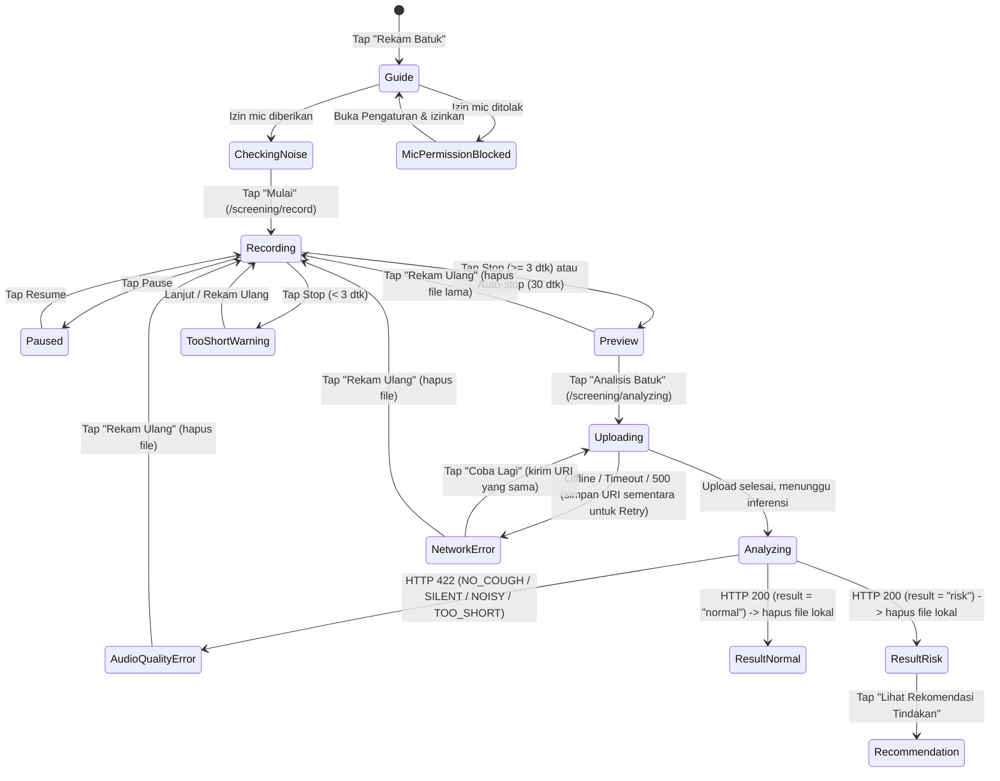

# PNEUMOTrack — Panduan Tugas Detail & Kontrak Kerja **Team Member B** (*Mobile Core Flow*)

> **Target Pembaca:** **AI Coding Agent** (pelaksana teknis) & **Human Reviewer** (pemilik keputusan, penguji perangkat fisik, dan reviewer PR).
> **Sumber Kebenaran (*Source of Truth*):** [`PRD.md`](./PRD.md) > [`design.md`](./design.md) > [`AGENTS.md`](./AGENTS.md) > [`task.md`](./task.md).
> Jika terdapat ambiguitas yang tidak tercakup di dokumen ini atau di `PRD.md`, **AI Agent WAJIB berhenti dan bertanya kepada Human Reviewer — dilarang menebak.**

---

## Daftar Isi
1. [Profil Peran & Keputusan Arsitektur yang Dikunci](#1-profil-peran--keputusan-arsitektur-yang-dikunci)
2. [Constraint AI Agent: Apa yang BOLEH & TIDAK BOLEH Dilakukan](#2-constraint-ai-agent-apa-yang-boleh--tidak-boleh-dilakukan)
3. [Gambaran Hasil Akhir (*Expected End-State*)](#3-gambaran-hasil-akhir-expected-end-state)
4. [Kontrak Teknis & Integrasi Lintas-Member](#4-kontrak-teknis--integrasi-lintas-member)
5. [Rincian Pekerjaan per Sprint (Sprint 0 – Sprint 5)](#5-rincian-pekerjaan-per-sprint-sprint-0--sprint-5)
   - [Sprint 0 — Kontrak Tipe & Verifikasi SDK 58](#sprint-0--kontrak-tipe--verifikasi-sdk-58)
   - [Sprint 1 — Fondasi App, Navigation Shell & Design System](#sprint-1--fondasi-app-navigation-shell--design-system)
   - [Sprint 2 — Core Screening Flow (Panduan → Rekam → Analisis → Hasil)](#sprint-2--core-screening-flow-panduan--rekam--analisis--hasil)
   - [Sprint 3 — Rekomendasi Tindakan, Simpan Hasil & Polish MVP](#sprint-3--rekomendasi-tindakan-simpan-hasil--polish-mvp)
   - [Sprint 4 — EAS Build Config, Dukungan Monitoring & Motion Polish](#sprint-4--eas-build-config-dukungan-monitoring--motion-polish)
   - [Sprint 5 — Hardening, Audit Kepatuhan & Persiapan Rilis Demo](#sprint-5--hardening-audit-kepatuhan--persiapan-rilis-demo)
6. [Checklist Audit Pra-PR (*Definition of Done*)](#6-checklist-audit-pra-pr-definition-of-done)

---

## 1. Profil Peran & Keputusan Arsitektur yang Dikunci

**Team Member B (*Mobile Core Flow*)** bertanggung jawab atas:
1. **Fondasi Aplikasi & Konfigurasi Expo:** pembersihan template awal, konfigurasi `app.json`, `eas.json`, `.env.example`, `src/constants/config.ts`, root layout, bottom navigation shell, dan pembuatan skeleton route awal agar Member C tidak terblokir.
2. **Design System & Shared UI Primitives:** token warna/tipografi/radius di `tailwind.config.js` & `src/constants/theme.ts`, seluruh teks bahasa Indonesia terpusat di `src/constants/copy.ts`, serta komponen UI dasar di `src/components/ui/`.
3. **Alur Skrining Inti End-to-End (MVP P0):** **Panduan & Cek Kebisingan (`/screening/guide`) → Perekaman Audio Batuk (`/screening/record`) → Analisis ke FastAPI (`/screening/analyzing`) → Hasil Skrining Normal/Risiko (`/screening/result`) → Rekomendasi Tindakan (`/recommendation`)**.

### Keputusan Sinkronisasi Dokumen (Sudah Dikunci oleh PM)
1. **Bottom Navigation Bar:** Mengikuti `PRD.md` §6 dan `design.md` §7.18 — menggunakan **custom tab bar *icon-only* berbasis `Tabs` dari `expo-router/ui`** (bukan `NativeTabs` berlabel), dengan 4 item: **Beranda (`/`)**, **Riwayat (`/history`)**, **Profil (`/children`)**, dan **Menu** (membuka bottom sheet `MenuSheet`, bukan pindah halaman). Seluruh route milik Member C tetap disediakan skeleton-nya agar tidak ada konflik.
2. **Path & Urutan Alur Skrining:** Menggunakan path **`/screening/guide`** → **`/screening/record`** → **`/screening/analyzing`** → **`/screening/result`** → **`/recommendation`** (mempertahankan nama `/screening/guide` agar kompatibel dengan pemanggilan dari Dashboard, Profil Anak, dan Monitoring milik Member C).
3. **Pemisahan CTA Hasil Risiko vs Rekomendasi:** Sesuai `PRD.md` F5 & F6, layar `/screening/result` varian risiko menampilkan ringkasan, waveform risiko, disclaimer, tanda bahaya, dan **1 CTA utama `"Lihat Rekomendasi Tindakan"`** menuju `/recommendation`. Dua kartu aksi (**Konsultasi dengan Dokter** → `/doctors` dan **Kunjungi Fasilitas Kesehatan Terdekat** → `/hospitals`) serta tombol darurat `119` ditempatkan di `/recommendation`.
4. **Kontrak API & Makna Label Model:**
   - Endpoint: `POST /predict` v2 (`multipart/form-data`: `audio`, opsional `child_id`).
   - Mapping label backend: `"Pneumonia"` → `result: "risk"`, `"Bukan Pneumonia"` → `result: "normal"`. Jika model tidak sepakat (`agreement: false`), UI menampilkan badge perhatian & saran rekam ulang di ruangan lebih tenang.
   - Rekaman audio **tidak disimpan permanen** (dihapus dari cache/storage lokal HP segera setelah analisis selesai atau dibatalkan).
   - **Dilarang** menampilkan angka tanda vital palsu (suhu, laju napas, detak jantung) yang tidak diukur dari audio batuk.
   - Nama tampilan aplikasi: **`PNEUMOTrack`**.

---

## 2. Constraint AI Agent: Apa yang BOLEH & TIDAK BOLEH Dilakukan

Karena pekerjaan ini dieksekusi oleh **AI Agent** dengan pengawasan **Human Reviewer**, seluruh batasan di bawah ini bersifat **mengikat tanpa pengecualian**.

### 2.1 Batas Kepemilikan File & Folder (*Scope Boundary*)

| Kategori | Path File / Folder | Aturan untuk AI Agent Member B |
|---|---|---|
| **Milik Penuh Member B** *(Full Read/Write)* | `src/app/_layout.tsx`, `src/app/index.tsx`, `src/app/(tabs)/_layout.tsx`, `src/app/screening/**`, `src/app/recommendation.tsx`, `src/app/dev/**`, `src/components/ui/**`, `src/components/screening/**`, `src/services/api/**`, `src/hooks/use-recorder.ts`, `src/hooks/use-screening.ts`, `src/constants/**`, `src/types/screening.ts`, `tailwind.config.js`, `app.json`, `eas.json` | **BOLEH** membuat, mengubah, dan me-refactor sesuai spesifikasi dokumen ini. |
| **File Konfigurasi Bersama** *(Controlled Edit)* | `package.json`, `bun.lock`, `.env.example`, `tsconfig.json`, `README.md` | **BOLEH** diedit sesuai kebutuhan tugas Member B. Di `.env.example`, **WAJIB mempertahankan** variabel lokal Supabase yang sudah ada (`EXPO_PUBLIC_SUPABASE_URL`, `EXPO_PUBLIC_SUPABASE_ANON_KEY`) dan hanya menambahkan variabel baru. |
| **Skeleton Route Member C** *(Write-Once di Sprint 1)* | `src/app/(auth)/**`, `src/app/(tabs)/{index,history,children,monitoring,more}.tsx`, `src/app/children/**`, `src/app/history/**`, `src/app/doctors/**`, `src/app/chats/**`, `src/app/hospitals/**`, `src/app/articles/**` | **HANYA BOLEH** dibuatkan file placeholder minimal di **Sprint 1** jika file belum ada. Setelah Sprint 1 selesai / mulai diisi Member C, **DILARANG KERAS** menimpa atau mengubah file-file ini. |
| **Area Terlarang** *(Strictly Forbidden)* | `server_side/**`, `supabase/**`, `docker/**`, `docs/api.md`, `src/services/{supabase,children,screenings,doctors,hospitals,articles,chat}/**`, `src/types/domain.ts`, `android/**`, `ios/**` | **DILARANG KERAS** membuat, mengedit, atau menghapus file di area ini. Jika butuh penyesuaian kontrak dari Member A atau Member C, buat catatan untuk Human Reviewer. |

### 2.2 Batas Eksekusi AI Agent vs Human Reviewer (*Human-in-the-Loop*)

| Aktivitas | AI Agent | Human Reviewer |
|---|---|---|
| Menulis kode TypeScript/TSX, styling NativeWind, state management, mock API | ✅ **BOLEH & WAJIB** | Me-review diff kode & arsitektur |
| Membaca dokumentasi Expo SDK 58 (`v58.0.0`, `llms.txt`) & skill di `.agents/skills/` | ✅ **BOLEH & WAJIB** | — |
| Menginstal paket SDK-compatible dengan `bunx expo install <paket>` | ✅ **BOLEH** | Memeriksa perubahan `package.json` & `bun.lock` |
| Menjalankan `bunx tsc --noEmit`, `bunx expo lint`, `bunx expo-doctor` | ✅ **BOLEH & WAJIB** | Memastikan semua check hijau di PR |
| Menulis konfigurasi `app.json` dan `eas.json` | ✅ **BOLEH** | Memvalidasi package name, projectId, & kredensial |
| Menjalankan `eas login`, `eas init`, `eas build`, `eas secret:*`, atau `expo run:android` | ❌ **DILARANG** | ✅ **Eksekusi oleh Manusia** di mesin/akun resmi |
| Menguji perekaman mikrofon asli, cek kebisingan ruang, & uji APK di HP Android fisik | ❌ **Tidak Bisa / Jangan Diklaim Sudah Diuji** | ✅ **Eksekusi oleh Manusia** pada setiap *Human Checkpoint* |
| Meng-commit file `.env` / `.env.local` atau melakukan push langsung / merge ke `main` | ❌ **DILARANG KERAS** | ✅ **Eksekusi oleh Manusia** lewat PR (`feat/b-<fitur>`) |

### 2.3 Constraint Teknis (Expo SDK 58, Bun, NativeWind v4, TypeScript)

#### ✅ YANG BOLEH & WAJIB DILAKUKAN (*DO*)
1. **Verifikasi Dokumentasi Expo SDK 58 sebelum menulis kode API native:**
   - Cek versi di `package.json` (`expo: ~58.0.21`, `react-native: 0.88.1`, `react: 19.3.0`, `nativewind: 4.2.7`, `react-native-reanimated: 4.7.1`).
   - Wajib merujuk ke `https://docs.expo.dev/versions/v58.0.0/` dan `https://docs.expo.dev/llms.txt` (khususnya untuk `expo-audio`, `expo-router`, `expo-haptics`, `@expo/ui`).
   - Wajib membaca skill lokal yang relevan di `.agents/skills/` sebelum mengerjakan modul terkait (`expo-overview`, `expo-design-system`, `expo-router`, `expo-native-ui`, `expo-ui`, `expo-animation`, `expo-data-fetching`).
2. **Gunakan `bunx expo install <package>`** (atau `npx expo install <package>` jika `bun` tidak terpasang di `PATH` mesin eksekusi) untuk setiap penambahan dependency Expo/React Native agar versi selalu kompatibel dengan SDK 58.
3. **Gunakan Token Semantik NativeWind (`design.md` §2 & §5):**
   - Seluruh warna, ukuran teks, dan radius di komponen wajib memakai class semantik (`bg-surface`, `bg-surface-brand`, `bg-risk-surface`, `text-ink`, `text-brand`, `text-risk`, `rounded-card`, `rounded-pill`, `text-body`, dll.) beserta pasangan `dark:`-nya.
   - Gunakan *static class lookup map* untuk varian komponen (contoh: `const variantClass = { normal: 'bg-surface-brand', risk: 'bg-risk-surface' } as const`).
4. **Pusatkan Semua Teks UI di `src/constants/copy.ts`:**
   - Bahasa default adalah **Bahasa Indonesia** yang tenang, jelas, dan mudah dipahami orang tua.
5. **Strict TypeScript & Runtime Validation:**
   - Pertahankan `"strict": true`. Validasi seluruh payload JSON dari backend FastAPI menggunakan *type guard* sebelum dirender ke UI.
6. **Aksesibilitas & Ergonomi Orang Tua:**
   - Tinggi tombol aksi utama minimal `48dp` (`h-12`), area sentuh tombol ikon minimal `44×44dp` (`h-11 w-11`), wajib menyertakan `accessibilityRole` dan `accessibilityLabel` berbahasa Indonesia, serta menghormati `AccessibilityInfo.isReduceMotionEnabled()`.

#### ❌ YANG DILARANG KERAS (*DON'T*)
1. **DILARANG** menggunakan `npm install`, `yarn add`, `pnpm add`, atau `bun add` secara langsung untuk library React Native / Expo.
2. **DILARANG** membuat atau mengedit folder `android/` maupun `ios/` secara manual (*Continuous Native Generation* — semua izin dan konfigurasi native wajib melalui `app.json` plugins).
3. **DILARANG** menggunakan API usang dari memori training LLM tanpa cek docs SDK 58 (misalnya mengasumsikan `expo-av` padahal SDK 58 menggunakan `expo-audio`, atau memakai sintaks Reanimated v2/v3 lama yang sudah berubah di v4).
4. **DILARANG** menulis interpolasi class Tailwind dinamis seperti `` className={`bg-${color}-100`} `` atau hardcode hex di JSX seperti `className="bg-[#D6E9F4]"` / inline `StyleSheet` warna mentah di layar.
5. **DILARANG** menggunakan `h-screen` di React Native (merusak safe area & keyboard), `space-x-*` / `divide-*`, atau menaruh `className` langsung pada komponen `@expo/ui` yang tidak mendukungnya.
6. **DILARANG** meninggalkan `any`, `@ts-ignore`, `@ts-expect-error`, unused imports, atau error lint sebelum menyerahkan pekerjaan ke Human Reviewer.
7. **DILARANG** menjalankan model Machine Learning di sisi mobile atau merekam audio terus-menerus di background (*always-on background recording*).

### 2.4 Constraint Medis, Keselamatan & Privasi Data Anak (*Non-Negotiable* PRD §11 & §13)

1. **Bukan Alat Diagnosis:**
   - ❌ **DILARANG** menulis kalimat diagnosis pasti di mana pun: *"Anak Anda menderita pneumonia"*, *"Positif pneumonia"*, *"Bebas pneumonia"*, *"Terdiagnosis pneumonia"*.
   - ✅ **WAJIB** menggunakan bahasa skrining indikatif: *"Indikasi risiko pneumonia terdeteksi — perlu perhatian"*, *"Pola batuk tidak biasa terdeteksi"*, *"Tidak terdeteksi indikasi pola batuk pneumonia"*.
2. **Larangan Klaim Akurasi Klinis:**
   - ❌ **DILARANG KERAS** menampilkan angka **`96,3%`** (atau `96.3%`) maupun nilai `confidence` voting model sebagai persentase akurasi/probabilitas medis di layar mana pun.
3. **Wajib Disclaimer & Tanda Bahaya IGD:**
   - ✅ Komponen `Disclaimer` dan `DangerSignsBox` (*napas cepat atau sesak, tarikan dinding dada ke dalam, bibir/ujung jari kebiruan, anak tidak bisa minum/menyusu atau tampak sangat lemas → segera ke IGD / hubungi 119*) **WAJIB** tampil di layar `/screening/result` dan `/recommendation`.
4. **Penanganan Audio Buruk Tanpa Hasil Palsu:**
   - ✅ Rekaman `< 3 detik` wajib dicegah sebelum dikirim. Jika backend mengembalikan HTTP `422` (`AUDIO_TOO_SHORT`, `AUDIO_SILENT`, `NO_COUGH_DETECTED`, `AUDIO_TOO_NOISY`, `UNSUPPORTED_FORMAT`, `FILE_TOO_LARGE`), aplikasi **DILARANG** menampilkan layar hasil normal/risiko — wajib menampilkan layar permintaan **Rekam Ulang** beserta alasan yang ramah pengguna.
5. **Privasi & Minimasi Data Anak:**
   - ❌ **DILARANG KERAS** melakukan `console.log`, `console.info`, atau mengirim telemetri yang berisi: binary/base64 audio, URI file rekaman, nama anak, tanggal lahir anak, `child_id`, atau objek respons penuh yang memuat data anak.
   - ✅ File audio sementara di cache lokal perangkat **WAJIB dihapus** segera setelah proses analisis selesai (sukses maupun dibatalkan, kecuali saat tertahan di state `error` jaringan agar user masih bisa menekan *"Coba Lagi"* tanpa rekam ulang — dan langsung dihapus begitu user keluar atau memilih *"Rekam Ulang"*).
   - ❌ **DILARANG** menyimpan secret apa pun di kode mobile; hanya gunakan variabel `EXPO_PUBLIC_*` untuk URL/anon-key non-rahasia.

---

## 3. Gambaran Hasil Akhir (*Expected End-State*)

Saat seluruh tugas Member B selesai, struktur file yang dimiliki/dihasilkan Member B beserta perilaku akhirnya adalah sebagai berikut:

### 3.1 Struktur File Akhir Milik Member B
```text
PNEUMOTrack/
├── app.json                                  # Konfigurasi PNEUMOTrack, portrait, splash, plugin expo-router & expo-audio (izin mic Bahasa Indonesia)
├── eas.json                                  # Profile build: development (dev client), preview (APK internal), production
├── tailwind.config.js                        # Semantic tokens sesuai design.md §2.3 (surface, brand, risk, safe, ink, fontSize, borderRadius)
├── .env.example                              # Mempertahankan EXPO_PUBLIC_SUPABASE_* + menambah EXPO_PUBLIC_API_URL, EXPO_PUBLIC_USE_MOCK_API, EXPO_PUBLIC_USE_MOCK_DATA
└── src/
    ├── types/
    │   └── screening.ts                      # Tipe kontrak API v2, AudioErrorCode, PredictResponse, ScreeningError, RecorderState
    ├── constants/
    │   ├── config.ts                         # Pembaca & validator env EXPO_PUBLIC_* + helper timeout/limit durasi rekam (min 3s, max 30s)
    │   ├── theme.ts                          # Nilai numerik/hex sinkron dengan tailwind.config.js untuk prop non-className (SVG stroke, StatusBar, chart)
    │   └── copy.ts                           # Kamus teks UI Bahasa Indonesia per layar + disclaimer + daftar tanda bahaya + pesan error per kode
    ├── components/
    │   ├── ui/
    │   │   ├── screen.tsx                    # Wrapper layar (SafeArea + max-w-content + bg-surface)
    │   │   ├── screen-header.tsx             # Header 56dp (tombol kembali 44x44, judul tengah, slot aksi kanan)
    │   │   ├── card.tsx                      # Kartu varian default | brand | soft | risk
    │   │   ├── button.tsx                    # PrimaryButton, SecondaryButton, RiskButton (tinggi >= 48dp, loading/disabled state)
    │   │   ├── status-banner.tsx             # Banner status normal (biru/checkmark) & risk (pink/warning)
    │   │   ├── disclaimer.tsx                # Blok teks penafian non-diagnostik standar
    │   │   ├── danger-signs-box.tsx          # Kotak peringatan tanda bahaya pneumonia + opsional CTA darurat 119
    │   │   ├── waveform.tsx                  # Visualisasi waveform statis (hasil) & live amplitude bars (rekam)
    │   │   ├── badge.tsx                     # Chip/badge status (normal, risiko, model berbeda)
    │   │   ├── avatar.tsx                    # Avatar anak/dokter dengan fallback inisial
    │   │   ├── empty-state.tsx               # Tampilan data kosong + ilustrasi/ikon + 1 CTA
    │   │   ├── error-state.tsx               # Tampilan error jaringan/audio + tombol Coba Lagi / Rekam Ulang
    │   │   ├── loading-state.tsx             # Skeleton block (bukan spinner kosong)
    │   │   ├── menu-sheet.tsx                # Bottom sheet untuk tab ke-4 "Menu" (Profil Anak, Monitoring, Artikel, Pengaturan/Tentang)
    │   │   └── collapsible.tsx               # Accordion untuk detail teknis skor model (AE MSE & OC-SVM score)
    │   └── screening/
    │       ├── noise-meter.tsx               # Indikator cek kebisingan ruangan (Aman <-> Terlalu berisik) di layar panduan
    │       └── result-view.tsx               # Komponen presentasional murni hasil skrining (dipakai di /screening/result & dipakai ulang Member C di /history/[id])
    ├── services/
    │   └── api/
    │       ├── client.ts                     # Fetch wrapper + AbortController (timeout 60s) + pemetaan error ke ScreeningError
    │       ├── screening.ts                  # predictCough(audioUri, childId?) -> FormData upload + runtime type guard + switch mock/real
    │       └── screening.mock.ts             # Simulator respons: normal, risk, disagreement, semua kode 422, network error, timeout
    ├── hooks/
    │   ├── use-recorder.ts                   # Lifecycle expo-audio: izin mic, cek bising, start/pause/resume/stop, metering, auto-stop 30s, background-stop, file cleanup
    │   └── use-screening.ts                  # Context + hook state machine skrining end-to-end, retry file sama, integrasi simpan ke service Member C
    └── app/
        ├── _layout.tsx                       # Root layout: GestureHandlerRootView, SafeAreaProvider, ScreeningProvider, slot SessionProvider (C), Stack
        ├── index.tsx                         # Entry splash/gate -> mengarahkan ke /(tabs) (atau /(auth)/sign-in saat auth C aktif)
        ├── (tabs)/
        │   └── _layout.tsx                   # Custom icon-only bottom navbar (Beranda, Riwayat, Profil, + tombol pemicu MenuSheet)
        ├── screening/
        │   ├── guide.tsx                     # Layar 1: Panduan posisi HP + info anak aktif + NoiseMeter 2-3 dtk + CTA Mulai
        │   ├── record.tsx                    # Layar 2: Timer tabular-nums + live waveform + pause/resume/stop/batal + preview sebelum kirim
        │   ├── analyzing.tsx                 # Layar 3: Animasi pulse logo + progres tahapan + penanganan error 422 & error jaringan
        │   └── result.tsx                    # Layar 4: Hasil Normal (biru) / Risiko (pink) via ResultView + status simpan + navigasi lanjut
        ├── recommendation.tsx                # Layar 5: Banner risiko + Kartu Konsultasi Dokter + Kartu RS Terdekat + Tanda Bahaya (Telp 119) + Disclaimer
        └── dev/
            └── components.tsx                # Galeri komponen & simulator state skrining (hanya aktif saat __DEV__)
```

### 3.2 State Machine & Alur Layar Inti Member B



### 3.3 Gambaran Visual & UX Tiap Layar Member B
1. **Bottom Navigation Shell (`(tabs)/_layout.tsx` + `MenuSheet`):**
   - Bar putih datar tinggi `64dp` (+ inset bawah perangkat), garis atas `1px border-border`, 4 ikon `24dp` tanpa teks label: **Beranda** (ikon rumah), **Riwayat** (ikon waveform/pulse), **Profil** (ikon orang), **Menu** (ikon 3 garis horizontal).
   - Menekan **Menu** membuka bottom sheet `rounded-sheet` berisi navigasi ke: *Profil Anak* (`/children`), *Monitoring* (`/monitoring`), *Artikel & Berita* (`/articles`), dan *Pengaturan & Tentang Aplikasi* (`/more`).
   - Bottom navbar **otomatis tersembunyi** saat pengguna masuk ke `/screening/*` dan `/recommendation`.
2. **Panduan Rekam (`/screening/guide` — ref `UI_reference/Recording Guidance.png`):**
   - Header `"Rekaman Audio"`, pill info anak aktif di atas (atau pengalihan ramah ke `/children/new` bila belum ada profil anak), judul `"Pegang ponsel seperti ini."`, ilustrasi jarak 15–30 cm dari mulut anak, 3 poin tips singkat, widget **Cek Tingkat Kebisingan** live selama 2–3 detik (`Aman` ↔ `Terlalu berisik`), dan tombol penuh `"Mulai"`.
3. **Perekaman Batuk (`/screening/record` — ref `UI_reference/cough recording_user.png`):**
   - Timer besar `00:00.0` (`text-display tabular-nums`), petunjuk *"Dekatkan ponsel 15–30 cm ke mulut anak, rekam 2–3 kali batuk"*, blok waveform live (`h-40 bg-surface-brand`), kontrol Jeda/Lanjut, Berhenti, dan Batalkan.
   - Setelah berhenti (`≥ 3 detik`): menampilkan ringkasan durasi rekaman dengan dua pilihan jelas: **"Analisis Batuk"** (primer) dan **"Rekam Ulang"** (sekunder). Jika aplikasi berpindah ke background saat merekam, rekaman otomatis dihentikan dengan aman.
4. **Analisis Audio (`/screening/analyzing` — ref `UI_reference/analysis loading page_user.png`):**
   - Logo `PNEUMOTrack` di tengah dengan animasi *gentle pulse* (otomatis statis jika *reduce motion* aktif), teks tahapan proses (*"Mengunggah rekaman…"* → *"Menganalisis pola suara batuk…"*), pencegahan tombol Back tidak sengaja (konfirmasi batal), dan tombol `"Batalkan"` (muncul jelas bila > 15–20 detik).
   - Jika gagal validasi audio (`422`), langsung berubah ke tampilan `"Rekaman belum dapat dianalisis"` dengan penjelasan spesifik sesuai kode error + tombol `"Rekam Ulang"`. Jika gagal jaringan/server, menampilkan `ErrorState` dengan tombol `"Coba Lagi"` (mengirim ulang file yang sama) dan `"Rekam Ulang"`.
5. **Hasil Skrining (`/screening/result` — ref `cough results_user.png` & `pneumonia result_user.png`):**
   - Merender `ResultView` yang murni & reusable:
     - **Varian Normal (tema biru/teal):** `StatusBanner` normal (`"Tidak terdeteksi indikasi pneumonia"`), kartu `Waveform` biru (`"Pola batuk normal"`), kartu `"Ringkasan AI"`, accordion opsional `"Detail Teknis Skrining"`, `DangerSignsBox`, `Disclaimer`, serta tombol `"Kembali ke Beranda"` & `"Lihat Riwayat"`.
     - **Varian Risiko (tema pink/merah tenang):** `StatusBanner` risiko (`"Indikasi risiko pneumonia terdeteksi — perlu perhatian"`), kartu `Waveform` risiko (`"Pola batuk tidak biasa"`), kartu `"Ringkasan AI"`, accordion `"Detail Teknis Skrining"`, `DangerSignsBox`, `Disclaimer`, serta CTA utama **`"Lihat Rekomendasi Tindakan"`** (`RiskButton` menuju `/recommendation`).
     - **Kondisi `agreement === false`:** menampilkan `Badge` peringatan *"Hasil kedua model berbeda — disarankan rekam ulang di ruangan tenang"* beserta tombol sekunder *"Rekam Ulang"*.
6. **Rekomendasi Tindakan (`/recommendation` — ref `UI_reference/recommendations page_user.png`):**
   - Header `"Rekomendasi Tindakan"`, banner ringkas status risiko + tautan `"Lihat Detail Hasil"`, dua kartu aksi utama (**Konsultasi dengan Dokter** → `/doctors` dan **Kunjungi Fasilitas Kesehatan Terdekat** → `/hospitals`), `DangerSignsBox` menonjol dengan tombol panggilan darurat **`Hubungi 119`** (`Linking.openURL('tel:119')`), dan `Disclaimer` di bagian bawah.

---

## 4. Kontrak Teknis & Integrasi Lintas-Member

### 4.1 Kontrak Tipe Skrining (`src/types/screening.ts`)
AI Agent wajib mendefinisikan tipe berikut secara presisi:

```ts
export type ScreeningOutcome = 'normal' | 'risk';

export type RawModelLabel = 'Pneumonia' | 'Bukan Pneumonia';

export type AudioErrorCode =
  | 'AUDIO_TOO_SHORT'
  | 'AUDIO_SILENT'
  | 'NO_COUGH_DETECTED'
  | 'AUDIO_TOO_NOISY'
  | 'UNSUPPORTED_FORMAT'
  | 'FILE_TOO_LARGE';

export interface PredictSuccessResponse {
  status: 'success';
  result: ScreeningOutcome;
  raw_label: RawModelLabel;
  agreement: boolean;
  votes: {
    autoencoder: ScreeningOutcome;
    ocsvm: ScreeningOutcome;
  };
  autoencoder: {
    error: number;
    threshold: number;
  };
  ocsvm: {
    score: number;
  };
  chunks: number;
  duration_sec: number;
  waveform: number[]; // nilai ternormalisasi 0..1 dari backend
  summary: string;    // ringkasan non-diagnostik Bahasa Indonesia
  model_version: string;
}

export interface PredictErrorResponse {
  status: 'error';
  code: AudioErrorCode | 'INTERNAL_ERROR';
  message?: string;
}

export type ScreeningErrorKind = 'audio_validation' | 'offline' | 'timeout' | 'server' | 'unknown';

export interface ScreeningError {
  kind: ScreeningErrorKind;
  code?: AudioErrorCode | 'INTERNAL_ERROR';
  userMessage: string; // diambil dari copy.ts berdasarkan code/kind
  canRetrySameFile: boolean; // false untuk audio_validation (422), true untuk offline/timeout/server
}
```

### 4.2 Strategi Integrasi Tanpa Saling Menunggu (*Decoupled Adapters*)
Agar kode Member B selalu lolos `tsc --noEmit` walaupun PR Member A atau Member C belum masuk:
1. **Ke Backend Member A (`POST /predict`):**
   - dikontrol via `EXPO_PUBLIC_USE_MOCK_API=true|false` di `src/constants/config.ts`. Saat `true` (atau saat pengembangan UI/test skenario error), `screening.ts` memanggil `screening.mock.ts` yang mendukung pemilih skenario di `__DEV__` (`normal`, `risk`, `disagreement`, `NO_COUGH_DETECTED`, `AUDIO_TOO_NOISY`, `offline`, `timeout`).
2. **Ke Hook Anak Aktif Member C (`use-active-child`):**
   - Buat *thin adapter* atau default fallback di layer integrasi skrining: jika `src/hooks/use-active-child.ts` milik Member C belum tersedia di Sprint 1–awal Sprint 2, sediakan fallback anak contoh (`{ id: 'demo-child', name: 'Anak (Mode Pratinjau)', ageLabel: '2 tahun' }`) yang langsung digantikan begitu hook Member C ter-merge. Jangan pernah membuat atau mengedit file `src/hooks/use-active-child.ts` milik Member C tanpa koordinasi PR!
3. **Ke Penyimpanan Riwayat Member C (`screeningsService.save`):**
   - Di Sprint 3, `use-screening.ts` menerima callback/adapter penyimpanan ke `src/services/screenings/`. Jika proses simpan ke Supabase gagal karena jaringan, **hasil skrining tetap wajib ditampilkan** kepada orang tua disertai banner kecil *"Hasil belum tersimpan ke riwayat"* dan tombol *"Simpan Ulang"*.
4. **Komponen `ResultView` untuk Dipakai Ulang Member C:**
   - `src/components/screening/result-view.tsx` **wajib murni presentasional** (menerima data lewat props, tidak bergantung langsung pada state rekaman aktif) sehingga Member C dapat merendernya langsung di `src/app/history/[id].tsx`.

---

## 5. Rincian Pekerjaan per Sprint (Sprint 0 – Sprint 5)

---

### Sprint 0 — Kontrak Tipe & Verifikasi SDK 58
**Tujuan:** Mengunci seluruh tipe TypeScript skrining dan memverifikasi API modul Expo SDK 58 sebelum menulis satu baris pun kode UI/rekaman.
**Skill yang Wajib Dibaca AI Agent:** `expo-overview`, `expo-router`.

#### Tugas Detail AI Agent
- [x] **Verifikasi dokumentasi Expo SDK 58:**
  - Cek API `expo-audio` untuk SDK 58 (`https://docs.expo.dev/versions/v58.0.0/sdk/audio/` dan `https://docs.expo.dev/llms.txt`): pastikan nama hook perekam, opsi metering (dBFS), format output Android/iOS (`.m4a`/AAC), konfigurasi audio mode, serta nama config plugin dan opsi permission-nya.
  - Cek API `expo-router/ui` (`Tabs`, `TabSlot`, `TabList`, `TabTrigger`) pada SDK 58 (bandingkan juga dengan referensi yang sudah ada di `src/components/app-tabs.web.tsx`).
- [x] **Buat `src/types/screening.ts`:**
  - Definisikan seluruh tipe pada §4.1 beserta tipe input prop untuk `ResultViewProps` (agar kompatibel baik dengan `PredictSuccessResponse` baru maupun item riwayat `screenings` dari Supabase).
  - Buat fungsi *runtime type guard* `isPredictSuccessResponse(data: unknown): data is PredictSuccessResponse` dan `isPredictErrorResponse(data: unknown): data is PredictErrorResponse`.

#### Hasil Akhir Sprint 0
- File `src/types/screening.ts` tersedia, terdokumentasi dengan JSDoc singkat, bebas `any`, dan lolos typecheck.
- Catatan singkat hasil verifikasi API `expo-audio` SDK 58 siap dilampirkan di deskripsi PR.

**Catatan implementasi (31 Oktober 2026):** Tipe, runtime guard, dan 9 pengujian kontrak tersedia. Verifikasi SDK dan hasil pemeriksaan dirangkum di [`docs/member-b-sprint-0.md`](./docs/member-b-sprint-0.md). Pengguna menyetujui kontrak `/predict` v2, perbaikan dua error template, dan pencadangan lockfile npm. Checkpoint review Member A/C dan pengujian perangkat fisik tetap dilakukan Human Reviewer.

#### Verifikasi Mandiri AI Agent
- Jalankan `bunx tsc --noEmit` dan `bunx expo lint` → wajib `0 errors`.

#### 🛑 Human Review Checkpoint (Sprint 0)
- Human Reviewer memeriksa kesesuaian `src/types/screening.ts` dengan `docs/api.md` milik Member A dan menyiapkan Android Emulator / HP Android fisik (USB Debugging aktif) untuk Sprint 1.

---

### Sprint 1 — Fondasi App, Navigation Shell & Design System
**Tujuan:** Membersihkan template bawaan, memasang design tokens `design.md`, membangun komponen UI standar + kamus teks `copy.ts`, menyiapkan seluruh skeleton route, dan memasang `expo-audio` di `app.json`.
**Skill yang Wajib Dibaca AI Agent:** `expo-design-system`, `expo-native-ui`, `expo-ui`, `expo-router`, `expo-dev-client`.

#### Tugas Detail AI Agent
1. **Pembersihan Template & Konfigurasi Proyek:**
   - [ ] Hapus file template starter yang tidak dipakai: `src/app/explore.tsx`, `src/components/animated-icon.tsx`, `src/components/animated-icon.web.tsx`, `src/components/animated-icon.module.css`, `src/components/web-badge.tsx`, `src/components/hint-row.tsx`, `src/components/app-tabs.tsx`, `src/components/app-tabs.web.tsx`.
   - [ ] Perbaiki error lint bawaan template pada `src/hooks/use-color-scheme.web.ts` (`react-hooks/set-state-in-effect` akibat aktifnya React Compiler di `app.json`, misalnya menggunakan `useSyncExternalStore` untuk deteksi hidrasi web), dan pastikan hook baru Member B tidak memanggil `setState` sinkron di dalam `useEffect`.
   - [ ] Update `app.json`:
     - `name`: `"PNEUMOTrack"`, `slug`: `"pneumotrack"`, `orientation`: `"portrait"`, `scheme`: `"pneumotrack"`, `userInterfaceStyle`: `"automatic"`.
     - Konfigurasi `expo-splash-screen` dengan warna latar tenang sesuai brand (`#FFFFFF` atau `#D6E9F4`) dan logo dari aset yang tersedia.
     - Instal `expo-audio` via `bunx expo install expo-audio`, lalu tambahkan plugin `"expo-audio"` di `app.json` dengan pesan `microphonePermission` berbahasa Indonesia yang jelas: *"PNEUMOTrack membutuhkan akses mikrofon untuk merekam suara batuk anak guna skrining awal risiko pneumonia."*
   - [ ] Update `.env.example` (**pertahankan** `EXPO_PUBLIC_SUPABASE_URL` & `EXPO_PUBLIC_SUPABASE_ANON_KEY` yang sudah ada!), tambahkan:
     - `EXPO_PUBLIC_API_URL=http://10.0.2.2:8000`
     - `EXPO_PUBLIC_USE_MOCK_API=true`
     - `EXPO_PUBLIC_USE_MOCK_DATA=true`
   - [ ] Buat `src/constants/config.ts`: pembaca `process.env.EXPO_PUBLIC_*` dengan nilai fallback aman untuk dev, konstanta `MIN_RECORD_DURATION_SEC = 3`, `MAX_RECORD_DURATION_SEC = 30`, `API_TIMEOUT_MS = 60_000`, `MAX_AUDIO_BYTES = 10 * 1024 * 1024`.

2. **Design Tokens & Copywriting Terpusat:**
   - [ ] Update `tailwind.config.js` persis mengikuti token semantik `design.md` §2.3 (`surface`, `surface-muted`, `surface-card`, `surface-brand`, `surface-brand-soft`, `border`, `ink`, `icon-muted`, `brand`, `on-brand`, `risk`, `on-risk`, `safe`, `surface-safe`, skala `fontSize` `display`..`caption`, `borderRadius` `card`/`sheet`/`pill`, `maxWidth.content`).
   - [ ] Update `src/constants/theme.ts` agar menyediakan konstanta warna raw (`light` & `dark`) yang sinkron dengan `tailwind.config.js` khusus untuk API yang tidak menerima `className` (misal prop stroke SVG, warna ikon native, StatusBar).
   - [ ] Buat `src/constants/copy.ts` berisi seluruh teks Bahasa Indonesia terstruktur per domain: `common`, `nav`, `guide`, `record`, `analyzing`, `result`, `recommendation`, `audioErrors` (pesan spesifik untuk ke-6 `AudioErrorCode`), `networkErrors`, `disclaimer`, dan `dangerSigns` (judul `"Segera bawa ke IGD atau hubungi 119 jika anak mengalami:"` + 4 tanda bahaya utama PRD §13).

3. **Shared UI Components (`src/components/ui/`):**
   - [ ] Bangun komponen sesuai kontrak `design.md` §6 dengan dukungan dark mode dan aksesibilitas:
     - `screen.tsx` (`Screen` dengan opsi `scroll`, penanganan `useSafeAreaInsets()`, dan `max-w-content`).
     - `screen-header.tsx` (`ScreenHeader` dengan tombol kembali `44×44`, judul tengah, subjudul opsional, aksi kanan opsional).
     - `card.tsx` (`Card` dengan varian `default | brand | soft | risk`).
     - `button.tsx` (`Button` dengan varian `primary | secondary | risk | ghost`, tinggi minimal `h-12`, state `loading` & `disabled`).
     - `status-banner.tsx` (`StatusBanner` varian `normal` & `risk`, ikon + teks jelas, tidak bergantung pada warna saja).
     - `disclaimer.tsx` (`Disclaimer` standar).
     - `danger-signs-box.tsx` (`DangerSignsBox` dengan opsi menampilkan tombol darurat `Hubungi 119`).
     - `waveform.tsx` (`Waveform` untuk mode `static` array `0..1` dan mode `live` bar amplitudo, varian `normal` & `risk`).
     - `badge.tsx`, `avatar.tsx`, `empty-state.tsx`, `error-state.tsx`, `loading-state.tsx` (skeleton), `menu-sheet.tsx` (`MenuSheet`), dan sesuaikan `collapsible.tsx` ke token tema baru.
   - [ ] Buat halaman `src/app/dev/components.tsx` (dilindungi agar hanya bisa diakses saat `__DEV__`, redirect ke `/` di produksi) untuk menampilkan seluruh varian komponen UI dalam satu layar inspeksi.

4. **Navigation Shell & Skeleton Semua Route (Kontrak Bersama Member C):**
   - [ ] `src/app/_layout.tsx`: `GestureHandlerRootView`, `SafeAreaProvider`, `StatusBar`, slot wrapper yang mudah disisipi `SessionProvider` oleh Member C, dan root `Stack` (`headerShown: false`).
   - [ ] `src/app/index.tsx`: layar Splash / entry gate singkat sesuai `design.md` §7.1 (logo + tagline *"Track the Signs, Guard the Lungs."*) lalu `router.replace('/(tabs)')`.
   - [ ] `src/app/(tabs)/_layout.tsx`: custom bottom navbar *icon-only* (`Tabs` dari `expo-router/ui`, `design.md` §7.18) dengan 4 item:
     1. **Beranda** (`href="/"` → `(tabs)/index.tsx`)
     2. **Riwayat** (`href="/history"` → `(tabs)/history.tsx`)
     3. **Profil** (`href="/children"` → `(tabs)/children.tsx`)
     4. **Menu** (`Pressable` yang membuka `MenuSheet` dengan tautan ke `/children`, `/monitoring`, `/articles`, `/more`, dan tautan `__DEV__` ke `/dev/components`).
     - *Catatan Teknis NativeWind v4 + `TabTrigger`:* Pada template bawaan (`app-tabs.web.tsx`), melakukan spread `{...props}` (`TabTriggerSlotProps`) langsung ke `<Pressable>` memicu error TypeScript `TS2322` pada properti `ref` karena override tipe NativeWind v4. Pisahkan `ref` saat meneruskan `TabTriggerSlotProps` atau gunakan komponen custom tombol tab yang menangani tipe `ref` secara eksplisit agar `tsc --noEmit` bersih 0 error.
   - [ ] Buat **skeleton placeholder minimal** (hanya jika file belum ada!) untuk route Member B & Member C agar tidak ada *broken link*:
     - Route Member B: `src/app/screening/{guide,record,analyzing,result}.tsx`, `src/app/recommendation.tsx`.
     - Route Member C *(write-once placeholder)*: `src/app/(auth)/{sign-in,sign-up}.tsx`, `src/app/(tabs)/{index,history,children,monitoring,more}.tsx`, `src/app/children/new.tsx`, `src/app/history/[id].tsx`, `src/app/doctors/{index,[id]}.tsx`, `src/app/chats/{index,[id]}.tsx`, `src/app/hospitals/{index,map}.tsx`, `src/app/articles/{index,[id]}.tsx`.
     - *Catatan Penting untuk PR Sprint 1:* Beri tahu Member C di deskripsi PR bahwa halaman daftar `/history` berada di `src/app/(tabs)/history.tsx` agar menampilkan bottom navbar sesuai `PRD.md` §6 & `design.md` §7.18, sedangkan detail riwayat berada di `src/app/history/[id].tsx` tanpa bottom navbar.

#### Hasil Akhir Sprint 1
- Aplikasi memiliki shell navigasi 4 ikon yang rapi, seluruh route terhubung tanpa error, seluruh komponen UI dasar siap dipakai Member B & Member C, dan galeri `/dev/components` merender semua komponen dalam mode terang maupun gelap.

#### Verifikasi Mandiri AI Agent
- `bunx tsc --noEmit` ✔
- `bunx expo lint` ✔
- `bunx expo-doctor` ✔
- Cek tidak ada warna hex hardcoded di `src/components/ui/**` dan `src/app/**`.

#### 🛑 Human Review & Device Checkpoint (Sprint 1)
1. Human Reviewer memeriksa visual komponen di `/dev/components` (terang & gelap) terhadap `design.md`.
2. Human Reviewer membuat **Android Development Build** pertama (karena `expo-audio` adalah native module yang membutuhkan dev build) menggunakan Android Studio lokal atau `bunx eas-cli build --profile development --platform android`, memasang APK dev ke perangkat tim (Member A, B, C), dan melakukan merge PR Sprint 1 supaya Member C dapat langsung mulai bekerja di atas komponen & skeleton route tersebut.

---

### Sprint 2 — Core Screening Flow (Panduan → Rekam → Analisis → Hasil)
**Tujuan:** Menyelesaikan alur MVP paling kritis (`PRD.md` §16 poin 1) dari cek kebisingan & perekaman suara batuk hingga penampilan hasil skrining normal/risiko, lengkap dengan penanganan audio buruk (`422`) dan kegagalan jaringan.
**Skill yang Wajib Dibaca AI Agent:** `expo-data-fetching`, `expo-animation`, `expo-native-ui`.

#### Tugas Detail AI Agent
1. **Hook Perekam Audio (`src/hooks/use-recorder.ts`):**
   - [x] Implementasikan dengan API resmi `expo-audio` SDK 58:
     - Manajemen izin mikrofon: cek status izin, tampilkan penjelasan (*rationale*) sebelum meminta izin, dan sediakan aksi `Linking.openSettings()` jika izin ditolak permanen (`canAskAgain === false`).
     - Mode **Cek Kebisingan (`startNoiseCheck` / `stopNoiseCheck`)**: memantau level metering mikrofon selama di layar panduan dan memetakan dBFS ke level `0..1` + status `'safe' | 'noisy'`. Pastikan dilepas sebelum masuk ke perekaman utama.
     - Mode **Perekaman Utama**: `startRecording`, `pauseRecording`, `resumeRecording`, `stopRecording`, `cancelRecording`, `resetRecorder`.
     - State terekspos: `phase` (`'idle' | 'recording' | 'paused' | 'stopped'`), `durationMs`, `meteringHistory` (buffer ≤ 60 sampel amplitudo terbaru `0..1` untuk live waveform), `audioUri`, `isTooShort` (`durationMs < 3000`).
     - **Auto-stop** tepat pada `30.000 ms` (`MAX_RECORD_DURATION_SEC`).
     - **Penanganan AppState:** gunakan `AppState.addEventListener('change', ...)` — jika aplikasi berpindah ke `background` / `inactive` saat sedang merekam, segera hentikan rekaman dengan aman (jangan pernah merekam diam-diam di background).
     - **Pembersihan File (`cleanupAudioFile`)**: hapus file audio sementara dari cache lokal (`expo-file-system` sesuai API SDK 58) saat `cancelRecording`, `resetRecorder`, atau saat dipanggil setelah analisis selesai, serta pada unmount jika tidak sedang dikirim ke `/screening/analyzing`.

2. **API Client, Service & Mock (`src/services/api/`):**
   - [x] `src/services/api/client.ts`:
     - Fungsi pengiriman request dengan `AbortController` (timeout `60 detik` + dukungan pembatalan manual saat user menekan `"Batalkan"`).
     - Pemetaan error terstruktur ke `ScreeningError`:
       - Gagal `fetch` / tidak ada koneksi → `{ kind: 'offline', canRetrySameFile: true }`
       - `AbortError` karena timeout → `{ kind: 'timeout', canRetrySameFile: true }`
       - HTTP `422` dengan `code` dikenal → `{ kind: 'audio_validation', code, canRetrySameFile: false }`
       - HTTP `>= 500` atau JSON tidak valid → `{ kind: 'server', canRetrySameFile: true }`
   - [x] `src/services/api/screening.mock.ts`:
     - Sediakan simulasi delay realistis (`1,5 – 2,5 detik`, menghormati `AbortSignal`) untuk skenario: `normal`, `risk`, `disagreement` (`agreement: false`), ke-6 kode `AudioErrorCode`, `offline`, `timeout`, dan `server`.
   - [x] `src/services/api/screening.ts`:
     - Fungsi `predictCough({ audioUri, childId, signal, mockScenario })`:
     - Cek ukuran file (tolak di sisi klien dengan `FILE_TOO_LARGE` jika `> 10 MB`).
     - Susun `FormData` dengan field `audio` (`{ uri, name: 'cough.<ext>', type: mimeType }` — deteksi ekstensi `.m4a`/`.wav`/`.aac` secara akurat) dan `child_id` (hanya dikirim jika valid dan bukan ID dummy).
     - Validasi respons menggunakan `isPredictSuccessResponse` sebelum mengembalikan data.

3. **State Machine Skrining (`src/hooks/use-screening.ts`):**
   - [x] Buat `ScreeningProvider` + `useScreening()`:
     - Menyimpan `pendingAudioUri` (hanya di memori selama sesi upload/retry), `status` (`'idle' | 'uploading' | 'analyzing' | 'success' | 'error'`), `lastResult` (`PredictSuccessResponse | null`), `error` (`ScreeningError | null`), dan di `__DEV__` opsi `devMockScenario`.
     - Fungsi `startAnalysis(audioUri, childId?)`, `retryAnalysis()` (mengirim ulang `pendingAudioUri` jika `canRetrySameFile === true`), `cancelAnalysis()` (`AbortController.abort()`), dan `clearSession()` (menghapus file lokal `pendingAudioUri` dan mereset state).
     - Segera setelah `startAnalysis` mendapatkan `PredictSuccessResponse` (`200 OK`) atau error `audio_validation` (`422`), **hapus file audio lokal** dari perangkat!

4. **Implementasi 4 Layar Alur Inti & Komponen Skrining:**
   - [x] `src/components/screening/noise-meter.tsx` & `src/app/screening/guide.tsx` *(ref `Recording Guidance.png`, `design.md` §7.3)*:
     - Tampilkan kartu kecil anak aktif di bagian atas (gunakan anak aktif dari hook Member C bila sudah ada, atau adapter fallback; jika list anak terbukti kosong `0 anak`, tampilkan ajakan membuat profil anak menuju `/children/new`).
     - Tampilkan ilustrasi & panduan jarak 15–30 cm, indikator `NoiseMeter` real-time (`Aman` ↔ `Terlalu berisik`), penanganan izin mic ditolak, dan CTA `"Mulai"` menuju `/screening/record`.
   - [x] `src/app/screening/record.tsx` *(ref `cough recording_user.png`, `design.md` §7.4)*:
     - Timer `00:00.0` (`tabular-nums`, `accessibilityLiveRegion="polite"`), live `Waveform` yang mulus di UI thread (Reanimated v4, menghormati *reduce motion*), tombol Jeda/Lanjut, Berhenti, dan Batalkan.
     - Validasi durasi `< 3 detik`: jika dihentikan sebelum 3 detik, tampilkan pesan ramah *"Rekaman terlalu singkat (minimal 3 detik). Pastikan terdengar 2–3 kali batuk."* dan minta lanjut/rekam ulang.
     - State pratinjau setelah berhenti (`≥ 3 detik`): tampilkan durasi rekaman + tombol primer `"Analisis Batuk"` (memicu `startAnalysis` dan navigasi ke `/screening/analyzing`) + tombol sekunder `"Rekam Ulang"`.
   - [x] `src/app/screening/analyzing.tsx` *(ref `analysis loading page_user.png`, `design.md` §7.5)*:
     - Tampilan loading: logo berdenyut lembut, indikator tahapan (*Mengunggah* → *Menganalisis pola batuk*), cegah navigasi keluar tak sengaja (`BackHandler` / konfirmasi batal), tombol `"Batalkan"`.
     - Transisi otomatis `router.replace('/screening/result')` saat `status === 'success'`.
     - Tampilan saat `error.kind === 'audio_validation'` (`422`): judul `"Rekaman belum dapat dianalisis"`, alasan spesifik dari `copy.audioErrors[code]`, tips singkat perbaikan, dan 1 tombol utama `"Rekam Ulang"` (`router.replace('/screening/record')`) — **tanpa menampilkan hasil normal/risiko**.
     - Tampilan saat `error.kind` berupa `offline | timeout | server`: komponen `ErrorState` dengan tombol primer `"Coba Lagi"` (`retryAnalysis()`) dan tombol sekunder `"Rekam Ulang"`.
   - [x] `src/components/screening/result-view.tsx` & `src/app/screening/result.tsx` *(ref `cough results_user.png`, `pneumonia result_user.png`, `design.md` §7.6–7.7)*:
     - Implementasikan `ResultView` murni untuk varian `normal` dan `risk` lengkap dengan: `StatusBanner`, badge ketidaksepakatan model bila `agreement === false` (+ tombol `"Rekam Ulang"`), kartu `Waveform` dari array `result.waveform`, kartu `"Ringkasan AI"` (`result.summary`), `Collapsible` `"Detail Teknis Skrining"` (durasi, jumlah segmen batuk terdeteksi, skor MSE Autoencoder vs ambang, skor OC-SVM, versi model — **tanpa persen akurasi & tanpa `96,3%`**), `DangerSignsBox`, dan `Disclaimer`.
     - Pada `/screening/result`:
       - Varian **Normal**: tombol primer `"Kembali ke Beranda"` (`/(tabs)`) dan tombol sekunder `"Lihat Riwayat"` (`/history`).
       - Varian **Risiko**: CTA primer **`"Lihat Rekomendasi Tindakan"`** (`RiskButton` menuju `/recommendation`) dan tombol sekunder `"Kembali ke Beranda"`.
   - [x] Tambahkan switcher skenario mock di `/dev/components` (hanya `__DEV__`) agar reviewer bisa menguji tampilan Normal, Risiko, Model Berbeda, dan ke-6 error `422` dalam hitungan detik.

#### Hasil Akhir Sprint 2
- Seluruh alur `/screening/guide` → `/screening/record` → `/screening/analyzing` → `/screening/result` berjalan utuh baik dengan Mock API maupun dengan FastAPI lokal Member A.

Status 31 Oktober 2026: implementasi dan pemeriksaan otomatis selesai; simulator browser mencakup kedua hasil, model berbeda, enam error audio, serta tiga error jaringan. CP2 mikrofon Android dan FastAPI LAN asli belum diverifikasi. Bukti dan batas verifikasi ada di `docs/member-b-sprint-2.md`. Rekomendasi dan penyimpanan hasil tetap pada Sprint 3.

#### Verifikasi Mandiri AI Agent
- `bunx tsc --noEmit` ✔ dan `bunx expo lint` ✔
- Audit kode:
  - Tidak ada `console.log` di `src/hooks/**`, `src/services/api/**`, `src/app/screening/**`.
  - Tidak ada string `96.3`, `96,3`, atau kata diagnosis terlarang di `src/**`.
  - Pastikan `Disclaimer` dan `DangerSignsBox` ter-render pada kedua varian `ResultView`.

#### 🛑 Human Review & Device Checkpoint (Sprint 2 — **CP2**)
1. Human Reviewer menjalankan aplikasi pada **HP Android fisik** (terhubung ke satu Wi-Fi LAN dengan laptop backend FastAPI Member A, `EXPO_PUBLIC_USE_MOCK_API=false`, `EXPO_PUBLIC_API_URL=http://<IP_LAN_A>:8000`).
2. Uji nyata mikrofon perangkat:
   - Rekam `< 3 detik` → tertahan di aplikasi.
   - Rekam hening / bicara biasa tanpa batuk → backend mengembalikan `422`, aplikasi menampilkan layar *"Rekaman belum dapat dianalisis"* + tombol *"Rekam Ulang"*.
   - Rekam sampel batuk → hasil Normal / Risiko tampil lengkap dengan waveform dan ringkasan AI.
   - Aktifkan Mode Pesawat saat klik *"Analisis Batuk"* → muncul pesan offline, matikan Mode Pesawat lalu klik *"Coba Lagi"* → berhasil tanpa harus rekam ulang.
   - Tolak izin mikrofon → tampilan permintaan izin & tombol *"Buka Pengaturan"* berfungsi.

---

### Sprint 3 — Rekomendasi Tindakan, Simpan Hasil & Polish MVP
**Tujuan:** Menyelesaikan layar `/recommendation` yang menghubungkan hasil risiko ke daftar Dokter & Rumah Sakit milik Member C, menyambungkan penyimpanan hasil skrining ke Supabase melalui service Member C, serta menambahkan deteksi jaringan & feedback haptik ringan.
**Skill yang Wajib Dibaca AI Agent:** `expo-data-fetching`, `expo-animation`, `expo-native-ui`.

#### Tugas Detail AI Agent
1. **Layar Rekomendasi Tindakan (`src/app/recommendation.tsx` — ref `recommendations page_user.png`, `design.md` §7.8):**
   - [x] Header `"Rekomendasi Tindakan"` dengan navigasi kembali ke `/screening/result` (atau Beranda jika diakses langsung).
   - [x] Banner ringkasan risiko (`bg-risk-surface`) menampilkan nama anak (jika ada), waktu skrining, dan tombol kecil `"Lihat Detail Hasil"` (`/screening/result`). Jika user membuka `/recommendation` tanpa state sesi aktif, tampilkan panduan statis rekomendasi risiko secara aman tanpa crash.
   - [x] **Kartu 1 — Konsultasi dengan Dokter:** ilustrasi/foto dokter (`assets`/`UI_reference`), judul `"Konsultasi dengan dokter"`, deskripsi singkat non-diagnostik, CTA `RiskButton` `"Mulai Konsultasi"` → `router.push('/doctors')`.
   - [x] **Kartu 2 — Kunjungi Fasilitas Kesehatan Terdekat:** ilustrasi fasilitas kesehatan, judul `"Kunjungi fasilitas kesehatan terdekat"`, deskripsi pemeriksaan lanjutan di Puskesmas/RS, CTA `RiskButton` `"Lihat Rumah Sakit"` → `router.push('/hospitals')`.
   - [x] **`DangerSignsBox` Menonjol + Tombol Panggilan Darurat 119:** daftar tanda bahaya pneumonia berat + tombol jelas **`"Hubungi Darurat 119"`** (`Linking.openURL('tel:119')` dengan penanganan error bila perangkat tidak mendukung panggilan telepon).
   - [x] **`Disclaimer` Wajib** di bagian bawah layar.

2. **Integrasi Penyimpanan Hasil Skrining ke Service Member C:**
   - [x] Hubungkan `use-screening.ts` dengan `screeningsService.save(...)` milik Member C (panggil hanya jika user memiliki `childId` asli, bukan dummy fallback):
     - Kirim payload sesuai skema tabel `screenings` (`child_id`, `result`, `agreement`, `ae_error`, `ae_threshold`, `ocsvm_score`, `chunks`, `duration_sec`, `waveform`, `summary`, `model_version`) — **tanpa mengirim file audio**.
     - **Non-blocking UX:** jangan menahan tampilan hasil hanya karena proses simpan ke Supabase lambat atau gagal. Tambahkan state `saveStatus: 'idle' | 'saving' | 'saved' | 'save_failed'`. Jika `save_failed`, tampilkan banner kecil di `/screening/result`: *"Hasil belum tersimpan ke riwayat"* dengan tombol `"Simpan Ulang"`.

3. **Deteksi Konektivitas & Haptics Ringan:**
   - [x] Instal `@react-native-community/netinfo` dan `expo-haptics` melalui `bunx expo install @react-native-community/netinfo expo-haptics` (verifikasi kompatibilitas SDK 58 terlebih dahulu).
   - [x] Cek status koneksi sebelum memulai upload di `use-screening.ts` agar pengguna yang sedang offline langsung mendapat pesan offline instan tanpa menunggu timeout, serta tampilkan indikator banner offline halus di layar panduan/rekam jika tidak ada internet.
   - [x] Tambahkan feedback haptik lembut (`expo-haptics`, dibungkus `try/catch` atau guard platform agar aman di web/perangkat tanpa motor haptik) saat menekan mulai rekam, berhenti rekam, dan saat hasil risiko muncul.
   - [x] Ubah nilai default pengembangan di `.env.example` menjadi `EXPO_PUBLIC_USE_MOCK_API=false` ketika backend Member A sudah stabil (tetap pertahankan dukungan flag `true` untuk testing terisolasi).

#### Hasil Akhir Sprint 3
- Alur penuh **Rekam → Analisis → Hasil → Simpan ke Riwayat Supabase → Rekomendasi Tindakan → Daftar Dokter / Rumah Sakit / Telepon 119** tersambung dari ujung ke ujung (**MVP Selesai**).
- Status 31 Oktober 2026: implementasi layar `/recommendation`, adapter penyimpanan non-blocking (`saveStatus` + `"Simpan Ulang"`), deteksi konektivitas `@react-native-community/netinfo`, dan feedback haptik `expo-haptics` selesai. Rincian verifikasi dan bukti Delivery Gate tercatat di [`docs/member-b-sprint-3.md`](./docs/member-b-sprint-3.md). Checkpoint CP3 (uji dev build Android fisik bersama layanan Supabase Member C dan FastAPI Member A) tetap dilakukan Human Reviewer.

#### Verifikasi Mandiri AI Agent
- `bunx tsc --noEmit` ✔ · `bunx expo lint` ✔ · `bunx expo-doctor` ✔
- Verifikasi bahwa kegagalan `screeningsService.save()` tidak menyebabkan unhandled promise rejection dan tetap menampilkan hasil skrining dengan opsi `"Simpan Ulang"`.

#### 🛑 Human Review & Device Checkpoint (Sprint 3 — **CP3 / MVP Gate**)
1. Human Reviewer membangun ulang dev build jika ada penambahan native module (`netinfo` / `expo-haptics`).
2. Uji end-to-end bersama Member A & Member C: **Login → Tambah Anak → Rekam Batuk → Hasil tampil → Data masuk ke tabel `screenings` Supabase → Muncul di Riwayat & Dashboard Member C → Klik Rekomendasi → Masuk ke layar Dokter & RS Member C + tombol `119` membuka dialer telepon**.

---

### Sprint 4 — EAS Build Config, Dukungan Monitoring & Motion Polish
**Tujuan:** Menyiapkan pipeline konfigurasi EAS Build untuk menghasilkan APK preview mandiri, memastikan alur rekam mudah dipanggil dari layar Monitoring milik Member C, dan memoles performa animasi.
**Skill yang Wajib Dibaca AI Agent:** `eas-app-stores`, `expo-animation`.

#### Tugas Detail AI Agent
1. **Konfigurasi Pipeline Build (`eas.json` & `app.json`):**
   - [x] Buat `eas.json` dengan 3 profile bersih:
     - `development`: `developmentClient: true`, `distribution: "internal"`, Android buildType debug/APK dev.
     - `preview`: `distribution: "internal"`, `android: { buildType: "apk" }` (agar tim & juri bisa langsung menginstal file `.apk` tanpa Play Store).
     - `production`: konfigurasi standar rilis (`app-bundle` untuk Android).
   - [x] Pastikan `app.json` memiliki `android.package` yang valid (misal `com.pneumotrack.app`), konfigurasi adaptive icon & splash yang rapi, dan hanya mencantumkan permission Android yang benar-benar dipakai aplikasi (jangan meminta permission kamera/kontak/storage eksternal yang tidak diperlukan).
   - [x] Dokumentasikan variabel environment yang harus dipasang Human Reviewer di dashboard EAS / `eas env:create` (`EXPO_PUBLIC_API_URL` HTTPS VPS Member A, `EXPO_PUBLIC_SUPABASE_URL`, `EXPO_PUBLIC_SUPABASE_ANON_KEY`, `EXPO_PUBLIC_USE_MOCK_API=false`, `EXPO_PUBLIC_USE_MOCK_DATA=false`) — **jangan pernah menaruh nilai kredensial produksi langsung di `eas.json` jika bersifat sensitif**.

2. **Integrasi Entry-Point untuk Fitur Monitoring Member C:**
   - [x] Pastikan `/screening/guide` (dan `/screening/record`) menerima query param opsional seperti `?source=monitoring` (via `useLocalSearchParams`) jika Member C memanggil alur rekam dari `(tabs)/monitoring.tsx`, sehingga tombol kembali mengarahkan user pulang ke layar asal secara natural.

3. **Optimasi Performa & Animasi HP Low/Mid-End:**
   - [x] Audit animasi live `Waveform` di `/screening/record` dan pulse di `/screening/analyzing` mengikuti panduan `expo-animation` & `design.md` §11:
     - Durasi transisi `150–250ms` (`ease-out`), berjalan di UI thread Reanimated, tanpa *bouncy spring* berlebihan pada hasil medis.
     - Pastikan tidak memicu re-render React tree penuh pada setiap tick metering (batasi frekuensi update state JS atau gunakan shared value Reanimated).
     - Pastikan semua loop animasi berhenti total saat `isReduceMotionEnabled` aktif atau saat layar tidak fokus.

#### Hasil Akhir Sprint 4
- `eas.json` dan `app.json` siap pakai untuk cloud build APK, integrasi dengan layar Monitoring mulus, dan `bunx expo-doctor` lulus bersih tanpa peringatan konfigurasi.
- Status 31 Oktober 2026: konfigurasi `eas.json` dan `app.json`, dukungan entry-point `?source=monitoring` pada alur skrining, serta optimasi animasi `Waveform` dan `AnalysisPulse` di UI thread Reanimated selesai. Dokumentasi environment EAS, rincian verifikasi, dan Delivery Gate tercatat di [`docs/member-b-sprint-4.md`](./docs/member-b-sprint-4.md). Eksekusi cloud build (`eas build`) dan pengujian APK preview pada perangkat Android fisik tetap dilakukan Human Reviewer.

#### Verifikasi Mandiri AI Agent
- `bunx tsc --noEmit` ✔ · `bunx expo lint` ✔ · `bunx expo-doctor` ✔

#### 🛑 Human Review & Cloud Build Checkpoint (Sprint 4)
1. Human Reviewer menjalankan `bunx eas-cli whoami` / `eas init`, mengatur environment variables produksi (`EXPO_PUBLIC_API_URL` HTTPS VPS dari Member A) di akun EAS, lalu mengeksekusi:
   `bunx eas-cli build --profile preview --platform android`
2. Unduh APK preview yang dihasilkan, pasang di HP Android fisik menggunakan koneksi data seluler (bukan Wi-Fi lokal), dan pastikan skrining terhubung ke VPS HTTPS Member A + Supabase produksi.

---

### Sprint 5 — Hardening, Audit Kepatuhan & Persiapan Rilis Demo
**Tujuan:** Menutup seluruh celah bug dari sesi QA silang tim, memastikan kepatuhan 100% terhadap aturan keselamatan & privasi PRD §13, dan melengkapi dokumentasi `README.md`.

#### Tugas Detail AI Agent
1. **Perbaikan Bug QA & Edge Cases:**
   - [x] Tindak lanjuti temuan bug dari Human Reviewer pada alur inti (`guide`, `record`, `analyzing`, `result`, `recommendation`, bottom navbar, dark mode, dan skala font besar).
   - [x] Uji ketahanan layout terhadap ukuran font sistem besar (*large font scaling*): pastikan teks di `StatusBanner`, `Button`, `ScreenHeader`, dan `DangerSignsBox` dapat melakukan *wrap* (`flex-wrap`, tanpa terpotong di tinggi tetap yang sempit).
   - [x] Pastikan double-tap cepat pada tombol `"Mulai"`, `"Analisis Batuk"`, `"Coba Lagi"`, atau `"Lihat Rekomendasi Tindakan"` tidak memicu duplikasi request API atau push layar ganda di navigation stack.

2. **Audit Otomatis Keamanan, Privasi & Kepatuhan Medis:**
   - [x] Jalankan pencarian menyeluruh pada `src/` untuk memastikan:
     - **0 kemunculan** `console.log` / `console.debug` yang mencetak data sesi/anak/audio.
     - **0 kemunculan** klaim `96.3` / `96,3` atau kata diagnosis pasti (*"menderita pneumonia"*, *"positif pneumonia"*, *"has pneumonia"*).
     - **0 kemunculan** secret / `service_role` key.
     - Semua tombol *icon-only* (back, menu, kontrol rekam, tab bar) memiliki `accessibilityLabel` Bahasa Indonesia.

3. **Dokumentasi Root `README.md`:**
   - [x] Perbarui `README.md` di root proyek dengan: deskripsi singkat `PNEUMOTrack` (alat bantu skrining awal non-diagnostik), arsitektur ringkas (Expo SDK 58 + FastAPI + Supabase), prasyarat (`bun`, Android dev build), langkah setup `.env` dari `.env.example`, perintah menjalankan server dev & pemeriksaan kualitas kode (`lint`, `tsc`, `expo-doctor`), serta cara membuat APK preview melalui EAS.

#### Hasil Akhir Sprint 5
- Kode `main` stabil, lulus seluruh audit kualitas & kepatuhan PRD §13, `README.md` lengkap, dan siap dibangun menjadi APK final demo hackathon.
- Status 31 Oktober 2026: pengerasan layout skala font besar (`flex-wrap` pada `StatusBanner`, `Button`, `ScreenHeader`, dan `DangerSignsBox`), proteksi *single-flight* terhadap *double-tap* (`createSingleFlightGate` & `useSingleFlight`), pengujian audit kepatuhan otomatis atas seluruh `src/`, dan pembaruan dokumentasi root `README.md` selesai. Rincian implementasi, hasil verifikasi, dan Delivery Gate tercatat di [`docs/member-b-sprint-5.md`](./docs/member-b-sprint-5.md). Eksekusi build APK final (`v1.0.0-hackathon`) dan persiapan perangkat demo fisik tetap dilakukan Human Reviewer.

#### Verifikasi Mandiri AI Agent
- Seluruh perintah pada **§6 Checklist Audit Pra-PR** wajib dijalankan dan menghasilkan status bersih.

#### 🛑 Human Review & Demo Readiness Checkpoint (Sprint 5)
1. Human Reviewer mengeksekusi build **APK Preview Final** (`v1.0.0-hackathon`) via EAS dan memasangnya di HP demo utama + HP cadangan.
2. Human Reviewer menyiapkan sampel rekaman audio demo (contoh pola normal & indikasi risiko) serta merekam **video screen-recording end-to-end** sebagai backup presentasi jika koneksi internet lokasi lomba bermasalah.

---

## 6. Checklist Audit Pra-PR (*Definition of Done*)

Sebelum AI Agent menyatakan satu tugas atau Sprint selesai kepada Human Reviewer, **setiap poin di bawah ini wajib diverifikasi**:

### A. Pemeriksaan Statis & Build Health (Wajib `0 error`)
```powershell
bunx tsc --noEmit
bunx expo lint
bunx expo-doctor
```
> *Catatan Environment Windows:* Repo ini memiliki `bun.lock`, sehingga `expo lint` secara otomatis memanggil binary `bun`. Jika `bun` belum ada di `PATH` mesin kerja, tambahkan `$env:USERPROFILE\.bun\bin` ke `PATH` (atau instal Bun), dan gunakan `npx tsc --noEmit` serta `npx eslint .` sebagai verifikasi setara.

### B. Audit Kepatuhan Medis, Privasi & Design System
AI Agent wajib memeriksa kode yang ditulisnya terhadap poin berikut:
- [x] **Non-Diagnostik:** Tidak ada frasa diagnosis medis pasti di `src/constants/copy.ts` maupun di file `.tsx`.
- [x] **Tanpa Klaim Akurasi:** Tidak ada angka `96.3%` / `96,3%` dan nilai `confidence` voting tidak ditampilkan sebagai persentase akurasi klinis.
- [x] **Tanpa Vital Palsu:** Tidak ada angka suhu tubuh, laju napas, atau detak jantung fiktif di ringkasan hasil.
- [x] **Disclaimer & Tanda Bahaya:** `Disclaimer` dan `DangerSignsBox` selalu tampil di `/screening/result` dan `/recommendation`.
- [x] **Zero PII/Audio Logging:** Tidak ada `console.log` yang mencetak URI rekaman, payload audio, `child_id`, atau profil anak.
- [x] **Pembersihan File Rekaman:** File audio sementara di cache lokal selalu dihapus setelah analisis selesai atau dibatalkan.
- [x] **Ketahanan Input & Jaringan:** Durasi `< 3 detik` dicegah; semua kode HTTP `422` meminta rekam ulang tanpa hasil palsu; kondisi offline/timeout/500 menampilkan `ErrorState` dengan opsi *"Coba Lagi"* dan *"Rekam Ulang"*.
- [x] **Design System Bersih:** Semua warna memakai token semantik `tailwind.config.js` (lengkap dengan `dark:`), semua teks UI berasal dari `src/constants/copy.ts`, tinggi tombol CTA `>= 48dp`, dan tombol ikon memiliki `accessibilityLabel` Bahasa Indonesia.
- [x] **Batas Kepemilikan Terjaga:** Tidak ada perubahan tidak sah pada `server_side/**`, `supabase/**`, `android/**`, `ios/**`, atau layar fitur milik Member C.
